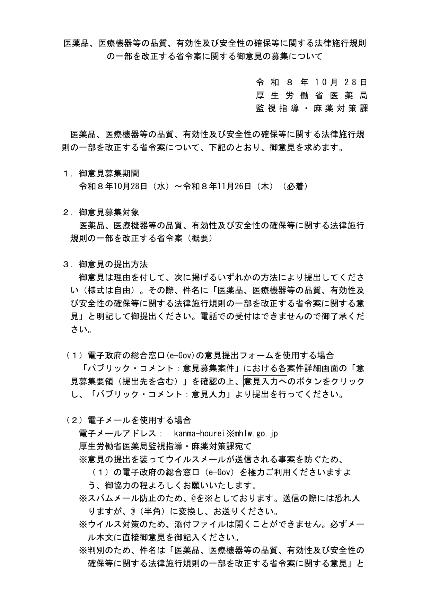
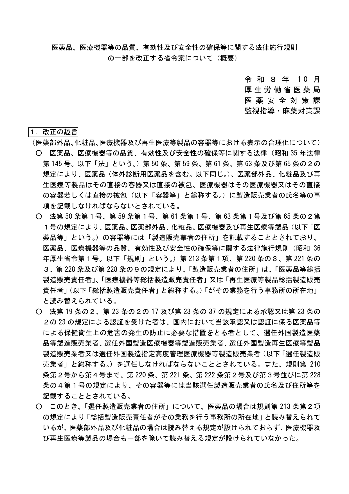
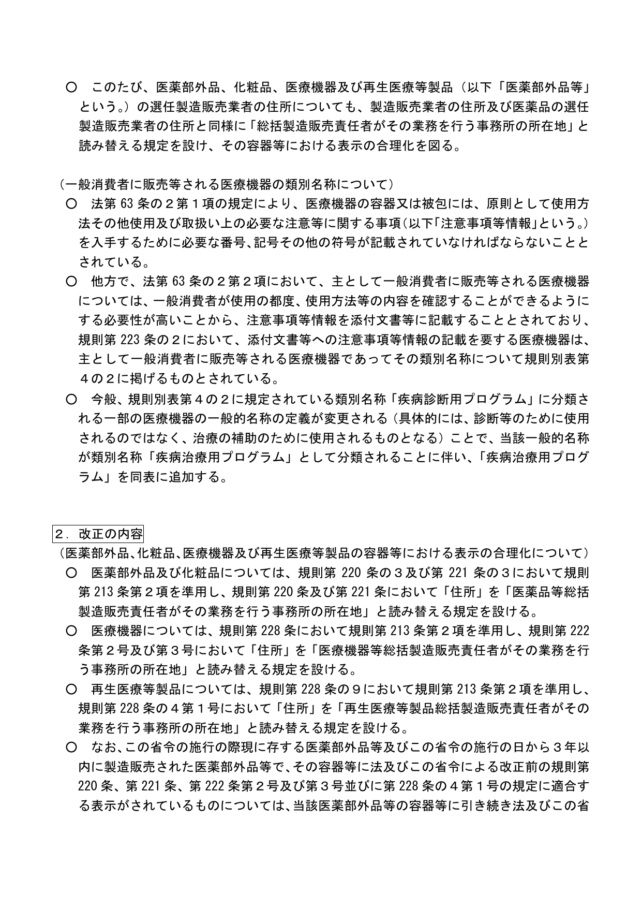
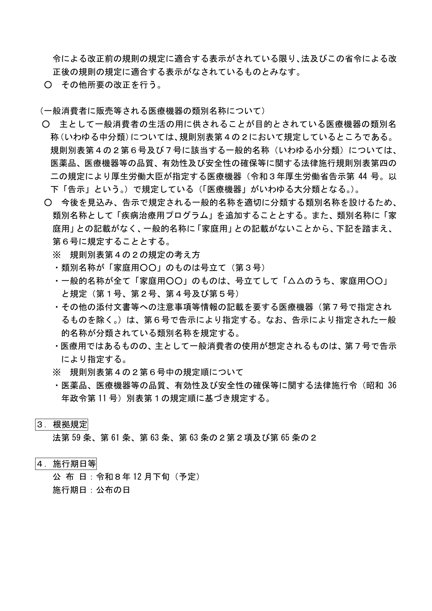

通过 **选任制造销售业者**（外国审批或认证后，在日本指定的本地责任商）往日本卖 **化妆品、医薬部外品** 的品牌注意：厚生労働省在 **2026年10月28日** 把 [药机法施行规则一部改正省令案](https://public-comment.e-gov.go.jp/servlet/Public?CLASSNAME=PCMMSTDETAIL&Mode=0&id=495260234) 挂到了 e-Gov 征求意见。我们于 **2026年11月13日** 下载并核对了同页两份官方 PDF（意见募集要领、改正案概要）。

**先说清楚：这还是征求意见，不是已经改完的规则。** 现在在售货不必立刻改包装。意见收到 **2026年11月26日（周四）必着**。

站内相关：[外原規2021 又一轮改正案（意见到 11-28）](/news/2026-11-04-japan-jsqi-2021-amendment-public-comment/)、[日本合规](/compliance/jp/)。这两条不是同一件事，不要混。

## 改了什么（草案口径）

按药机法，化妆品、医薬部外品容器上要写制造销售业者的姓名和 **住所**。普通制造销售业者的「住所」，规则里已经可以改写成 **总括制造销售责任人办理业务的事务所所在地**。

缺口在 **选任制造销售业者** 这一头：概要写明，**药品** 的选任商住所已经可以这样改写，但 **医薬部外品和化妆品没有相应读替规定**，医疗器械和再生医疗等产品也只覆盖了一部分。草案打算把化妆品、医薬部外品（以及医疗器械、再生医疗等产品）的选任商住所，也改成和药品一样，容器上可印责任人办公地，把标签写法对齐、少绕一层登记住所。

过渡安排（草案）：这部省令施行时已经在库的货，以及 **施行日起 3 年内** 制造销售、且容器仍符合改正前规则的，只要旧标还按旧规则正确标注，就 **视为符合** 改正后的规定。

施行节点（草案、予定）：

- **公布日**：令和 8 年 12 月下旬（约 **2026 年 12 月下旬**，予定）
- **施行日**：公布当日

同案后半还有医疗器械类別名称「疾病治疗用程序」的调整，跟化妆品标签不是一件事，本条不展开。

## 影响谁

- **走选任制造销售业者路径**、把化妆品或医薬部外品卖进日本的品牌、工厂和日方责任商：以后容器地址有可能改印责任人办公地，不用再和药品两套写法
- 负责改包装、印日文地址的合规和设计同事：要等定稿后再决定是否改版；草案已给了 3 年过渡，不必抢着重印
- **自己就是制造销售业者、只做普通化粧品製造販売届的卖家**：制造销售业者住所本来就可以读替为责任人办公地。本条主要补的是「选任商」这一头，不要理解成所有日本标签都要重做

## 意味着什么、现在注意什么

1. **这是简化，不是加严。** 没有新的禁限用成分，也没有要求提前换标。
2. **还没定稿。** 公布日只是予定 12 月下旬，最终条文、过渡和施行日以厚劳省后续公布为准。
3. 想提意见：按要领走 e-Gov 表单、邮件或邮寄，**11月26日必着**；邮件件名须写明案件名称，附件不会被打开（详见要领 PDF）。
4. 不要和外原規 2021 改正案混在一起：那条管的是医薬部外品原料规格，意见收到 11-28；本条管的是容器上怎么写选任商地址。

本站已标 **needs_review**，等定稿或公布后再更新合规页。

## 证据（核对日期 2026-11-13）

意见募集要领首页：厚劳省医薬局监视指导・麻药对策课 **令和 8 年 10 月 28 日** 发布，意见募集期间为 **10 月 28 日（水）至 11 月 26 日（木）（必着）**：

<small>来源：e-Gov 案件 495260234 附件「意见公募要领」官方 PDF 第1页，核对日期 2026-11-13。</small>

改正案概要第1页写明主题是医薬部外品、化妆品等容器表示合理化，并指出化妆品、医薬部外品的选任制造销售业者住所目前没有「改写成责任人办公地」的读替规定：

<small>来源：同页附件「命令などの案／パブコメ概要」官方 PDF 第1页，核对日期 2026-11-13。</small>

概要第2页：拟为化妆品、医薬部外品等选任商住所增设读替规定；施行时已在库及施行日起 3 年内制造销售、且符合改正前标注的，过渡期内可视作符合新规（条文跨至第3页）：

<small>来源：同上官方 PDF 第2页，核对日期 2026-11-13。</small>

概要第3页写明公布日 **令和 8 年 12 月下旬（予定）**，施行日为 **公布当日**：

<small>来源：同上官方 PDF 第3页「施行期日等」，核对日期 2026-11-13。</small>

## 来源

- e-Gov · [医薬品、医療機器等の品質、有効性及び安全性の確保等に関する法律施行規則の一部を改正する省令案に関する御意見の募集（案件番号 495260234）](https://public-comment.e-gov.go.jp/servlet/Public?CLASSNAME=PCMMSTDETAIL&Mode=0&id=495260234)
- 厚劳省医薬局 · 意见募集要领 PDF、改正案概要 PDF（同页附件；本站已存证据目录）
- 站内对照：[外原規2021 改正案征求意见](/news/2026-11-04-japan-jsqi-2021-amendment-public-comment/)、[日本合规](/compliance/jp/)
