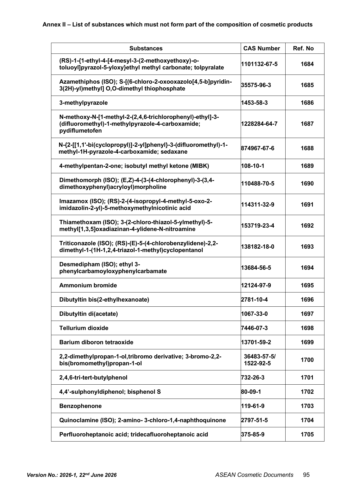
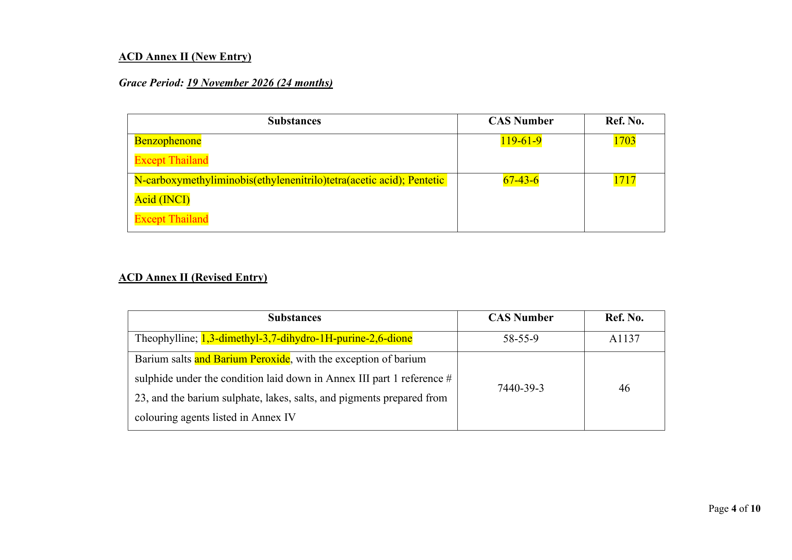

做 **东南亚美妆** 的注意：再过两周还有一条硬禁用，很多人会跟 [二苯酮-3（BP3）11-15 限量](/news/2026-11-01-asean-benzophenone-3-limit-nov-15/) 搞混。

这次禁的是 **二苯甲酮**（INCI/英文 **Benzophenone**，CAS **119-61-9**），东盟化妆品指令（ACD）**附录 II（禁用物质表）Ref. No. 1703**，分类标注 **Carc. 1B**。菲律宾 FDA **Circular No.2026-0001** 的附件 A 写明过渡期 **24 个月，至 2026年11月19日**：起只能卖合规产品，不合规须撤出市场。同日还有 [BHT 限量](/news/2026-11-03-ph-fda-bht-limit-nov-19/) 到期，配方表建议一起扫。

## 改了什么

| 项目 | 内容 |
| --- | --- |
| 物质 | **Benzophenone（二苯甲酮）**，CAS 119-61-9 |
| 规则 | 列入 ACD **附录 II**（不得作为化妆品成分） |
| 编号 | Ref. **1703** |
| 节点 | **2026-11-19** 起不合规不得上架、须撤市（菲 FDA 2026-0001 Annex A） |

**不要跟这两条搞混：**

1. **二苯酮-3 / Benzophenone-3 / Oxybenzone**（CAS 131-57-7）——附录 VII **限量 + 标签**，节点是 **11-15**，见站内 BP3 稿。  
2. **二苯甲酮 / Benzophenone**（CAS 119-61-9）——附录 II **整条禁用**，节点是 **11-19**，就是本条。

名字都带 benzophenone，CAS 和附件完全不同。配方表、ERP、质检单请按 **CAS** 筛，别只搜英文半截词。

泰国起初曾标注例外，菲通告正文记载泰国后续同意按东盟同一过渡期（**2026-11-19**）执行；东盟秘书处 **2026-06-22** 版附录 II 条目 1703 **未再写 Except Thailand**。泰国店铺仍建议再对一下泰国 FDA 最新通报页。

## 影响谁

- 在新加坡、马来西亚、泰国、印尼、菲律宾、越南等东盟市场卖护肤、防晒、彩妆、香氛的品牌与跨境店（Shopee / Lazada / TikTok Shop）
- OEM/配方商：二苯甲酮常出现在香精、溶剂、光稳定相关原料里，不一定写在「防晒剂」栏
- 采购与质检：要按 CAS 119-61-9 查原料 COA / SDS，不能只看商品中文名

## 意味着什么、现在注意什么

1. **11-19 前**：含 Benzophenone（119-61-9）的在售 SKU 完成换料或撤架；库存按国家撤市要求消化，别赌平台不抽检。  
2. 和 **11-15 的 BP3 限量**、**11-19 的 BHT 限量** 分开建清单，三张表别并成一张「benzophenone 相关」糊过去。  
3. 改配方后按各国规则更新通报（CPN / notification）与 PIF。  
4. 欧线：欧盟对 Benzophenone 亦有 CMR/禁用路径，东盟这条是东南亚落地节点，欧线另按欧盟法规核。

## 证据（核对日期 2026-11-03）

东盟秘书处官网附录 II 第 95 页可见 **Benzophenone / 119-61-9 / 1703**：

菲律宾 FDA Circular 2026-0001 附件 A 第 4 页写明该条 **Grace Period: 19 November 2026**：

## 来源

- 东盟秘书处 · [ACD Annex II（Version 2026-1, 22 June 2026）](https://asean.org/wp-content/uploads/2026/07/Annex-II-Release_22nd-June-2026-clean.pdf)
- Philippines FDA · [FDA Circular No.2026-0001](https://www.fda.gov.ph/fda-circular-no-2026-0001-consolidated-amendments-to-the-asean-cosmetic-directive-acd-as-adopted-during-the-40th-to-42nd-asean-cosmetic-committee-acc-meeting-and-their-related-meetings/)（附件 A PDF：[Consolidated ACD Amendments](https://www.fda.gov.ph/wp-content/uploads/2026/05/Annex-A-Consolidated-ACD-Amendments-40th-42nd.pdf)）
- 站内对照：[二苯酮-3 限量 11-15](/news/2026-11-01-asean-benzophenone-3-limit-nov-15/)、[菲律宾 BHT 限量 11-19](/news/2026-11-03-ph-fda-bht-limit-nov-19/)、[菲 FDA 2026-0001 概述](/news/2026-02-15-ph-fda-circular-2026-0001-acd/)
