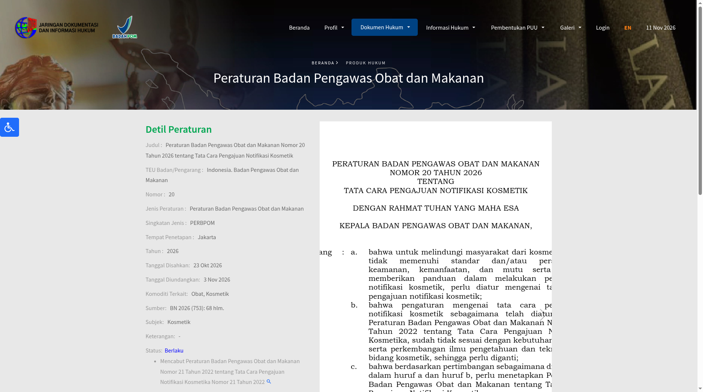
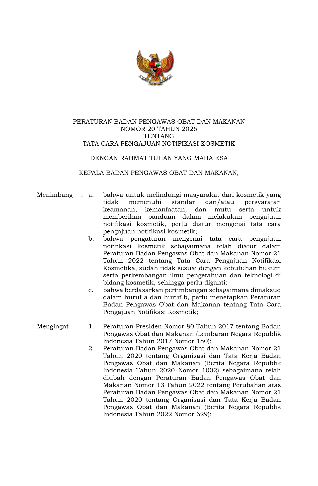
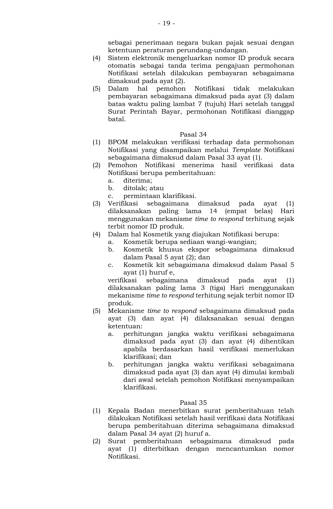
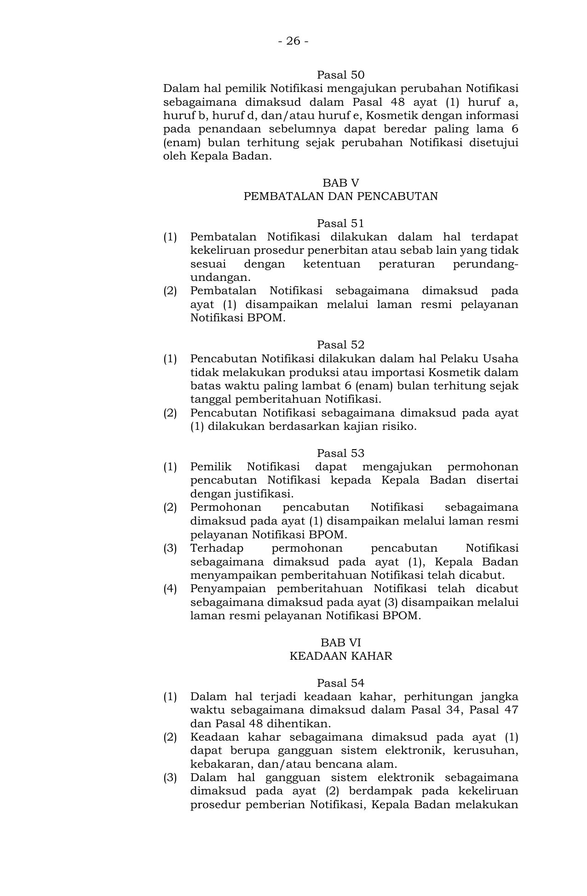
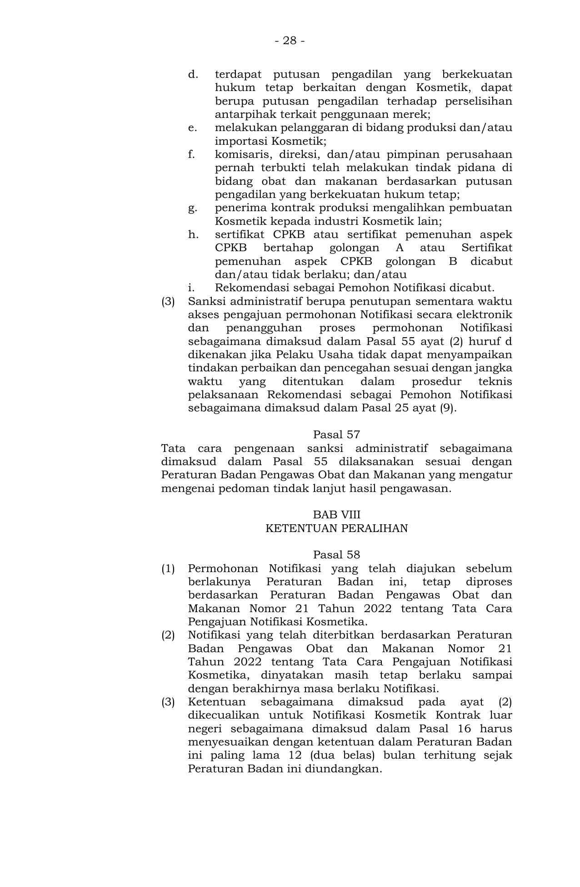
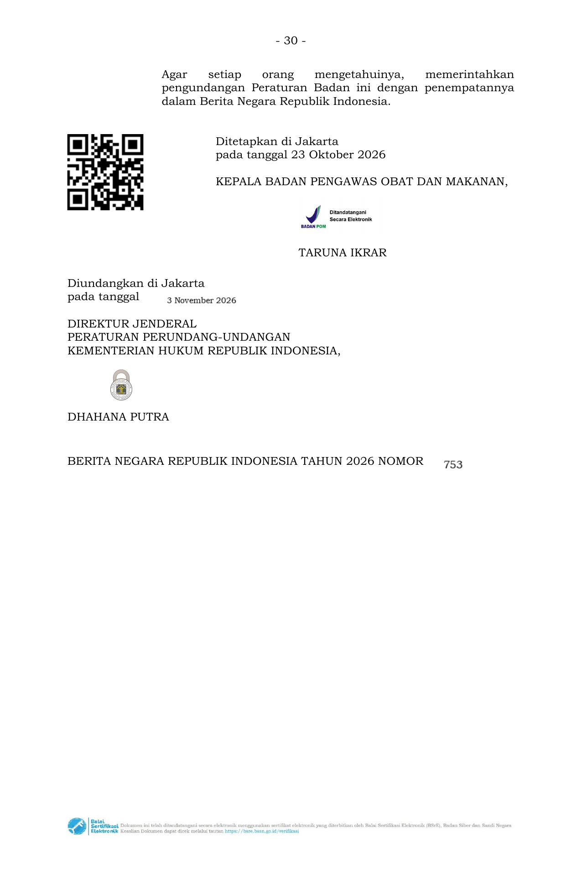

在印尼卖化妆品、或把成品交给当地进口商做 BPOM 通报的品牌注意：印尼食品药品管理局（BPOM）已颁布 [《化妆品通报申请程序条例》（2026年第20号）](https://jdih.pom.go.id/view/slide/1796/20/2026/c92a10324374fac681719d63979d00fe)。条例于 **2026年10月23日** 在雅加达签署，**11月3日** 刊入《印度尼西亚国家公报》2026年第753号并自当日生效，同时废止原来的 **2022年第21号**。我们于 **2026年11月11日** 在 BPOM 官方法规库 JDIH 核到详情页和 68 页正文。

**先说清楚：这不是征求意见稿，是已经生效的正式条例。** 11月3日前已经交上去、还在审的申请，仍按旧的第21/2022号处理；已经拿到的通报号，一般可以用到原来的有效期结束。但有一个硬例外：走「境外合同生产（Kosmetik Kontrak luar negeri）」路径的通报，必须自公布之日起 12 个月内改到新规要求，也就是最迟到 **2027年11月3日**。

## 改了什么

新申请从 11 月 3 日起按第 20 号办理，通过 BPOM 官方通报系统电子提交。正文里对卖家、品牌和供应链最要紧的几条是：

1. **审评时限按工作日算（Hari 在条例里定义为工作日）**  
   一般最长 **14 个工作日**，从缴完费、系统发出产品 ID 号起算，按「收到才计时」（time to respond）机制走。香水、专供出口产品、化妆品套装（kit）最长 **3 个工作日**。一旦要求补正，计时暂停，补正交上去后重新从头算。补正最多 3 次，须在接到补正通知后 **14 个工作日** 内提交，否则视为拒绝。缴款单开出后 **7 个工作日** 不缴费，申请作废。

2. **通报有效期最长 3 年，到期要办展期**  
   还要继续卖，必须在到期前申请展期。如果有效期在展期审批过程中过了，只要生产许可（CPKB 或分阶段/B 类许可）仍有效，还可以继续生产，但必须等新的通报下来才能在印尼流通。到期后才去申请展期的，要按新申请重新走。过期未展期还在市场上卖，会被当成无通报产品。

3. **拿证后 6 个月不生产或不进口，可能被撤号**  
   自通报通知之日起 **6 个月内** 没有生产或进口，BPOM 可以按风险评估撤销通报。不是写了就自动一律撤销，但不要只挂着号不进货。

4. **境外合同生产收紧了申请人资格**  
   这条只能由 **印尼境内化妆品工厂或关联公司** 申请，不能随便找一家进口商顶上。还要说明为什么这款产品不能在印尼生产，并逐步把产品开发、生产工艺或质量监督方面的技术转到印尼。关联关系须用经过公证或登记的声明来证明。境外代工厂要有仍有效的 GMP 证书；BPOM 有疑问时，可以到产地现场查。

5. **进口成品只能由化妆品进口商申请，且按成品申报**  
   进口商一般要先向当地 BPOM 技术执行单位申请设施检查，取得「通报申请人推荐函」（已有化妆品工业许可的除外）：新申请自现场检查之日起最长 **12 个工作日** 出结果，变更自缴费起最长 **5 个工作日**。材料还包括：仍有效的代理指定书（须写明有权做通报、进口和经销成品等要素）、东盟以外来源的自由销售证明（CFS，境外合同生产除外）、GMP 证明（东盟可用实施声明；没有主管机关证书时，可用与东盟等效的 GMP 证明），以及懂产品信息档案（DIP）的技术负责人。DIP 须在申请通报前就备好。

6. **一个产品名称原则上只能由一个申请人通报**  
   关联公司可以例外，但要按条例提供经公证或登记的声明。印尼境内同一配方、同一包装设计放在多家厂或委托国内代工，可以申请共用一个通报号，国内代工接收方最多 **3 家**，且不能再转包。

## 影响谁

- 把成品卖进印尼、找当地进口商做 BPOM 通报的美妆日化品牌和跨境卖家
- 已经或准备走「境外合同生产」路径的品牌，以及在印尼的关联公司
- 印尼本地化妆品工厂、承接国内合同生产的代工厂
- 在印尼电商平台上架、需要填写通报号的店铺

## 意味着什么、现在注意什么

1. **新货从 11 月 3 日起按第 20 号准备材料**，不要再拿着第 21/2022 号的老清单硬套；申请前把 DIP 备齐。
2. **先对一下手里的号是「进口成品」还是「境外合同生产」。** 后者要在 **2027年11月3日** 前改到位，包括申请人资格、不能在印尼生产的说明，以及技术转让安排。
3. **已经拿到号的，别只挂号不进货、不生产。** 6 个月内没有实际生产或进口，存在被撤号的风险。
4. **核对进口商侧资格：** 有没有有效的「通报申请人推荐函」和符合卫生、仓储要求的设施，代理授权书有没有写全通报、进口和经销权。
5. **盯住 3 年有效期，提前办展期。** 过期未展期的货不能再在印尼流通。
6. 本条管的是通报程序，不替代印尼语标签、清真认证等其他要求。补充装、Class B 工厂范围等仍是此前已挂网的征求意见稿，不能和本条混成已经生效。

## 证据（核对日期 2026-11-11）

BPOM 官方法规库 JDIH 详情页：文号第 20/2026 号，2026年10月23日签署、11月3日公布，状态为生效（Berlaku），废止第 21/2022 号，来源为国家公报 2026 年第 753 号、共 68 页。

<small>来源：印尼 BPOM JDIH 详情页，核对日期 2026-11-11。</small>

官方 PDF 第 1 页（国徽正文封面，说明第 21/2022 号已不适应、予以替换）：

<small>来源：JDIH 官方 PDF 第1页，核对日期 2026-11-11。</small>

第 19 页 Pasal 34：一般最长 14 个工作日，香水、专供出口和套装最长 3 个工作日；补正后时限重新起算。同页还有缴款单 7 个工作日不缴即作废。

<small>来源：JDIH 官方 PDF 第19页，核对日期 2026-11-11。</small>

第 26 页 Pasal 52：自通报通知之日起 6 个月内不生产或不进口，可按风险评估撤销通报。

<small>来源：JDIH 官方 PDF 第26页，核对日期 2026-11-11。</small>

第 28 页 Pasal 58：已受理申请仍按第 21/2022 号处理，已发通报一般用到原有效期结束；境外合同生产须在公布之日起 12 个月内改到新规。

<small>来源：JDIH 官方 PDF 第28页，核对日期 2026-11-11。</small>

第 30 页签署与公布页：2026年10月23日由 BPOM 主席 Taruna Ikrar 签署，11月3日公布，国家公报 2026 年第 753 号。第 29 页 Pasal 59–60 写明废止第 21/2022 号、自公布之日起施行。

<small>来源：JDIH 官方 PDF 第30页，核对日期 2026-11-11。官方 PDF 另见同目录 [peraturan-bpom-20-2026.pdf](/media/evidence/2026-11-03-bpom-cosmetic-notification-regulation-20-2026/peraturan-bpom-20-2026.pdf)。</small>
