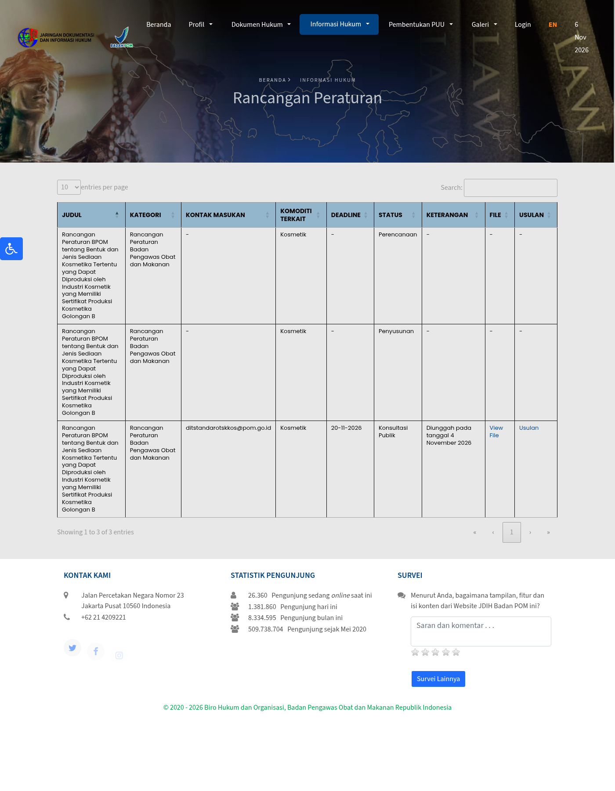
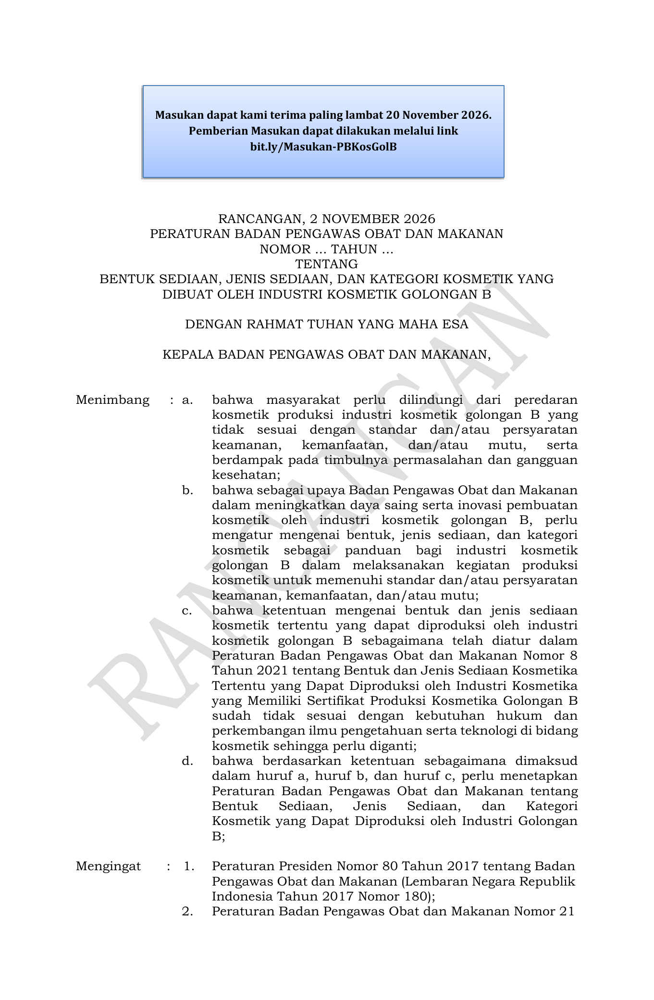
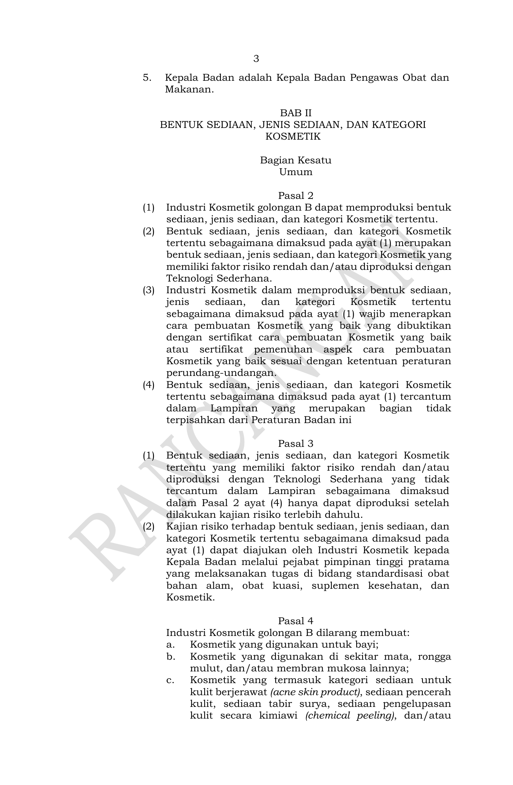
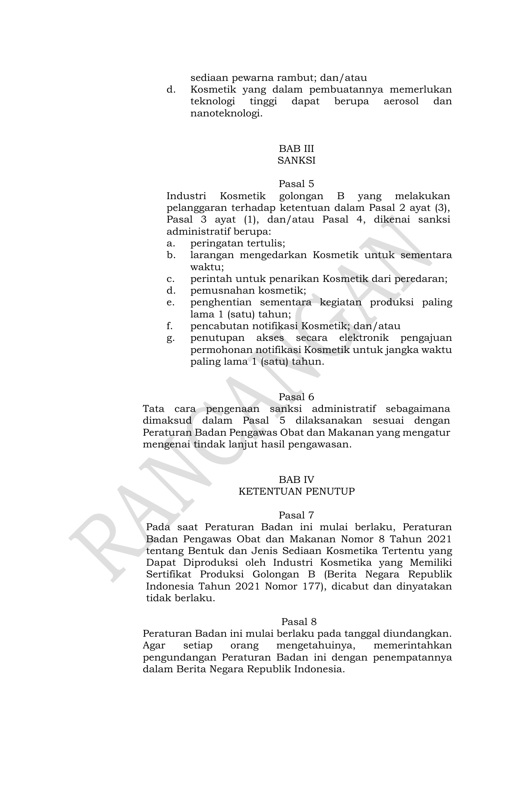

在印尼持有或打算用 **Class B（Golongan B）化妆品生产证** 的工厂、以及把货交给 Class B OEM 的品牌注意：BPOM 在 JDIH 挂出《Class B 化妆品工厂可生产的剂型、制剂类型与品类》草案，**2026年11月4日**上传征求意见，反馈截止 **2026年11月20日**（联系 ditstandaratskkos@pom.go.id；草案页另附 bit.ly/Masukan-PBKosGolB）。正式颁布后将替换现行 **2021年第8号**，自颁布日起生效。

**先说清楚：还是征求意见稿。** Class A 工厂本来就能做全剂型；本条主要动的是 **Class B（低风险/简单工艺）** 的边界。

## 改了什么

据官方草案 PDF（封面标注 RANCANGAN, 2 NOVEMBER 2026）：

1. **监管维度扩成三轴**  
   Class B 只能做「低风险和/或简单工艺」产品，附件按 **剂型 → 制剂类型 → 产品品类** 列清单（液体/半固体/粉体/固体四大类，含香水、洁面、日霜晚霜、面膜粉、块皂等大量日常品类）。

2. **新定义**  
   - **简单工艺**：机械结构与操作不复杂，可手操或用基础机器，易清洁防交叉污染。  
   - **化学剥脱（chemical peeling）**：含化学物质、用于去除面部/颈部死皮的化妆品。

3. **附件没列到的品类**  
   即便自认低风险/简单工艺，**也要先向 BPOM 做风险评估申请**，通过后才能生产——不是「附件没有就自己猜能做」。

4. **仍禁止 Class B 生产**（Pasal 4）  
   - 婴儿用化妆品  
   - 眼周、口腔及其他黏膜用化妆品  
   - **祛痘、美白/亮肤、防晒、化学剥脱、染发** 等品类  
   - 需要高技术的形态：**气雾剂、纳米技术产品**  
   相对现行规则：禁令表述从「含某功效成分」更多改成「按产品品类」；**压粉/粉饼（serbuk kompak）拟从「高技术禁止」挪进允许清单**，纳米产品则明确进禁止项。

5. **违规后果**  
   书面警告、暂禁流通、召回销毁、最长停产 1 年、撤销通报、最长 1 年关闭电子通报通道等。

## 影响谁

- 印尼 **Class B 持证工厂** 及技术负责人（TTP）  
- 把护肤/彩妆/洗护交给 **Class B OEM** 的品牌、跨境卖家本地化生产线  
- 想在 Class B 线开 **粉饼/压粉** 新品类的工厂（草案方向是放开，但仍要等定稿）  
- **只进口密封成品、不在印尼建厂/代工的卖家**：本条不改你的通报上架路径，但选代工厂时要核对对方证书范围

## 意味着什么、现在注意什么

1. **别提前按草案投产**：11-20 前可提意见；现行仍按 2021 年第 8 号。  
2. Class B 工厂：把在产/计划产品按「剂型+制剂+品类」对照附件；美白、防晒、祛痘、染发、眼部、婴儿等仍不要往 Class B 塞。  
3. 品牌选 OEM：合同里写清对方是 A 还是 B、覆盖哪些品类；附件外新品要留风险评估时间。  
4. 粉饼方向值得关注，但定稿前别当已合法。  
5. 提意见截止 **2026年11月20日**。

## 证据（核对日期 2026-11-06）

JDIH 草案详情页（公开征求意见、截止 20-11-2026、11-04 上传）：

草案 PDF 第1页：征求意见截止 2026-11-20，拟替代 2021 年第 8 号：

第3–4页 Pasal 4：Class B 禁止品类（婴儿、黏膜、美白防晒等、气雾/纳米）：

## 来源

- 印尼 BPOM · JDIH · [Rancangan Peraturan BPOM tentang Bentuk dan Jenis Sediaan… Golongan B](https://jdih.pom.go.id/draft/detail/1792/Rancangan%20Peraturan%20BPOM%20tentang%20Bentuk%20dan%20Jenis%20Sediaan%20Kosmetika%20Tertentu%20yang%20Dapat%20Diproduksi%20oleh%20Industri%20Kosmetik%20yang%20Memiliki%20Sertifikat%20Produksi%20Kosmetika%20Golongan%20B)（公开征求意见，截止 2026-11-20；2026-11-04 上传）
- 同页官方草案 PDF（本站已存证据目录）
- 站内对照：[印尼合规](/compliance/id/)
