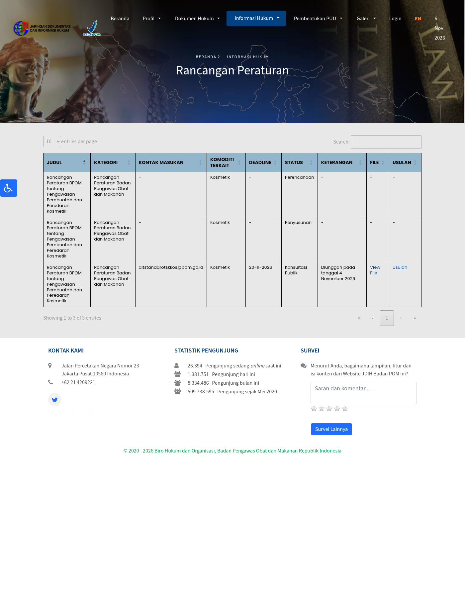
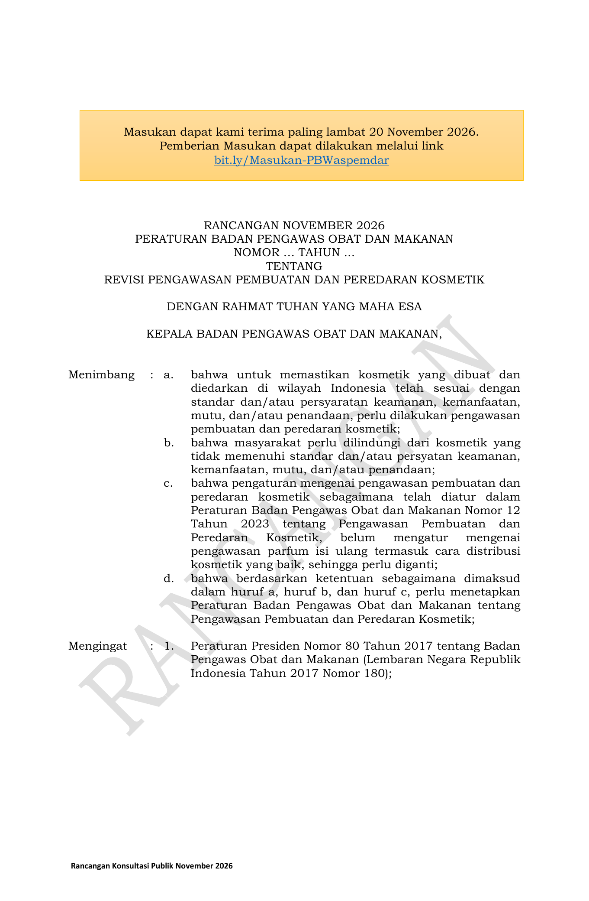
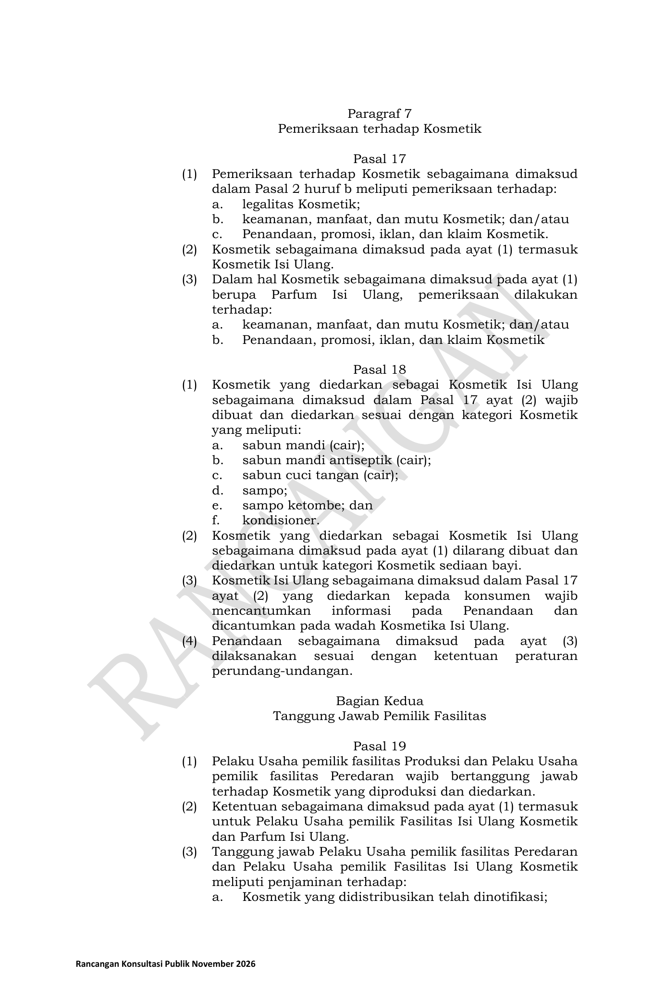
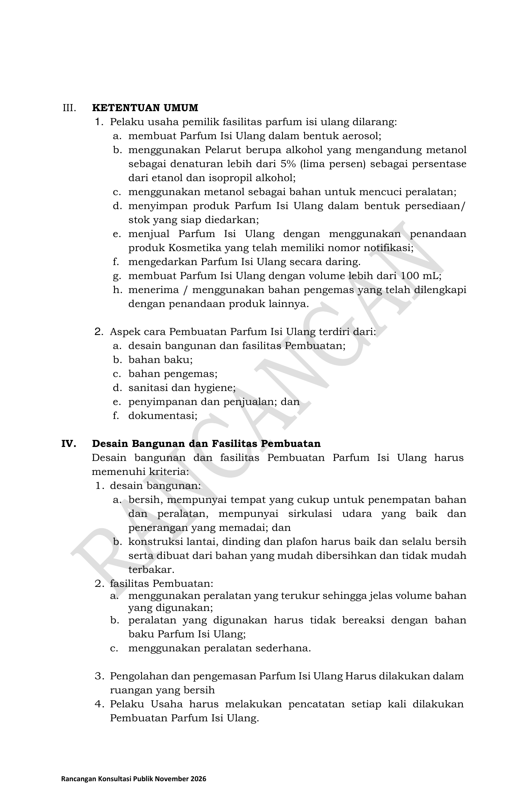

在印尼做 **补充装（isi ulang）洗护、门店调香/分装香水**，或给本地门店供货的品牌注意：印尼食品药品监督管理局（BPOM）在 JDIH 挂出《化妆品生产与流通监管》修订草案，**2026年11月4日**上传、状态为公开征求意见，反馈截止 **2026年11月20日**（联系 ditstandarotskkos@pom.go.id；草案页另附 bit.ly/Masukan-PBWaspemdar）。定稿后将替换现行 **2023年第12号**。

**先说清楚：现在还是征求意见稿，没正式颁布，今天的现货不因此直接下架。** 但印尼补充装零售、门店调香增长很快，定稿后会动到门店审批、可售品类和线上卖法。

## 改了什么

据官方草案 PDF（封面标注 RANCANGAN NOVEMBER 2026）：

1. **首次定义并监管两类补充业务**  
   - **Kosmetik Isi Ulang（补充装化妆品）**：在补充装设施里按消费者要求重新灌装。  
   - **Parfum Isi Ulang（补充香水）**：消费者到店，现场用香精浓缩物（可含/不含溶剂）按比例调配，供个人使用。

2. **补充装化妆品：先批、限品类**  
   - 通报号持有人或补充装设施经营者，要先向 BPOM 标准化相关司局申请批准，交提案（附件 I）；产品须已有通报号；若非通报持有人自营，还要交合作协议。  
   - **允许补充的只有 6 类**：液体沐浴露、抗菌液体沐浴露、液体洗手液、洗发水、去屑洗发水、护发素。  
   - **婴儿用化妆品禁止**做补充装流通。  
   - 灌装容器要按规定贴标，原包装保存等细则见草案。

3. **补充香水：禁线上、限量、禁气雾等**（附件 II）  
   经营者不得：做气雾剂形态；用甲醇作清洗剂；变性酒精中甲醇超乙醇+异丙醇总量的 5%；囤「做好就能直接卖」的库存；套用其他已通报产品的标签卖；**线上流通**；**单次灌装超过 100 mL**；用已印其他产品标签的包材。  
   另写明：对每位消费者销售 **最多 3 件**；标签须含产品名（含「parfum」与变体代码）、生产日期、净含量、生产设施名称与城市等。

4. **过渡期**  
   现有补充香水设施：法规颁布起 **最长 12 个月**内改到符合新规；草案对补充装化妆品设施未另写过渡期（定稿以官方为准）。

## 影响谁

- 印尼本地 **补充装洗护门店、药妆店分装柜台、商场调香亭**  
- 想推「到店补灌」的 **品牌、通报持有人、代运营**  
- 给上述门店供 **大包装原液/香精浓缩物** 的工厂与进口商  
- **只卖密封成品、不做门店分装的跨境店**：本条不改你的上架/通报义务，但别把「补充装」业务模式照搬线上

## 意味着什么、现在注意什么

1. **别当成已经生效**：11-20 前可提意见；现行仍按 2023 年第 12 号。  
2. 在做或计划做补充装：对照 6 类清单——面霜、精华、彩妆等不在名单里，草案下不能当补充装卖。  
3. 补充香水：电商/社群团购分装这条路草案直接禁；单次 ≤100 mL、每客 ≤3 件要写进 SOP。  
4. 想提意见：走 JDIH 草案页或 bit.ly/Masukan-PBWaspemdar，截止 **11月20日**。

## 证据（核对日期 2026-11-06）

JDIH 草案详情页（公开征求意见、截止 20-11-2026、11-04 上传）：

草案 PDF 第1页：征求意见截止 2026-11-20，修订理由含补充香水监管空白：

第11页 Pasal 18：补充装仅限6类洗护、禁婴儿装：

附件 II 第18页：补充香水禁止事项（含禁线上、单次≤100mL）：

## 来源

- 印尼 BPOM · JDIH · [Rancangan Peraturan BPOM tentang Pengawasan Pembuatan dan Peredaran Kosmetik](https://jdih.pom.go.id/draft/detail/1791/Rancangan%20Peraturan%20BPOM%20tentang%20Pengawasan%20Pembuatan%20dan%20Peredaran%20Kosmetik)（公开征求意见，截止 2026-11-20；2026-11-04 上传）
- 同页官方草案 PDF（本站已存证据目录）
- 站内对照：[印尼合规](/compliance/id/)、[BPJPH 376 销售服务 SJPH](/news/2026-10-29-bpjph-376-cosmetics-sales-services-sjph/)
