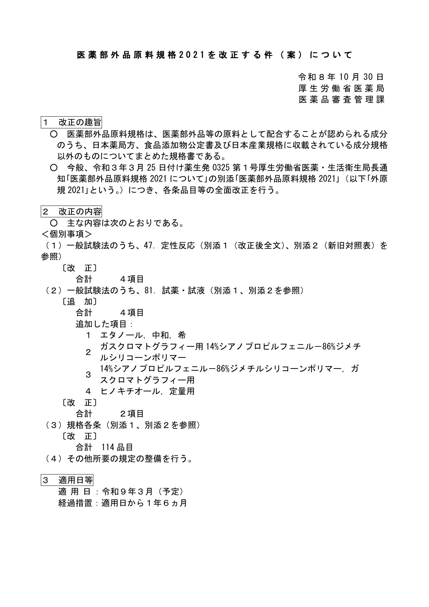
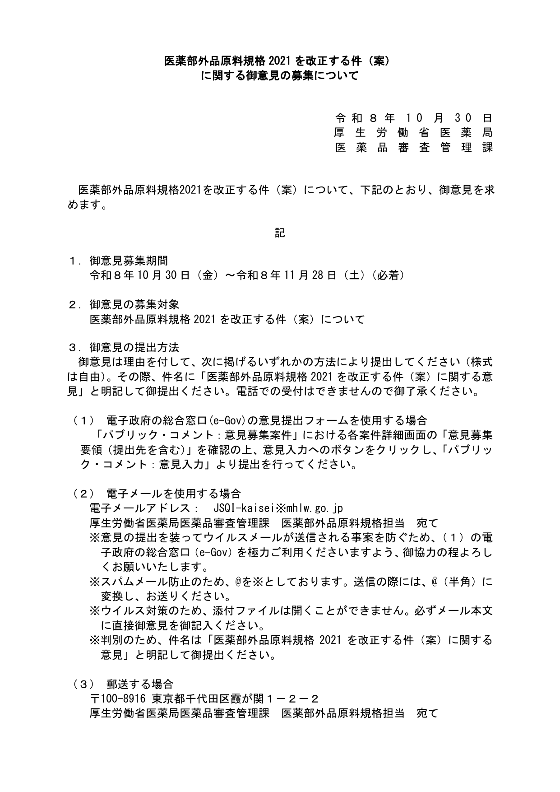

做 **日本医薬部外品**（美白、药妆洗护、防痘/生发等走批准路径的产品）的品牌和制造销售业者注意：厚生労働省 **2026年10月30日** 在 [e-Gov](https://public-comment.e-gov.go.jp/servlet/Public?CLASSNAME=PCMMSTDETAIL&Mode=0&id=495260219) 挂出 **「医薬部外品原料規格2021を改正する件（案）」** 公众意见募集。这是 **新一轮改正草案**，不是站内已写过的 [外原規2021 改正自 2026-10-01 全面适用](/news/2026-10-01-japan-yakugenki-2021-full-application/) 那条落地提醒。

**先说清楚：现在还在征求意见，规则没定稿，今天在售货不受这条新草案直接约束。** 但适用日草案写的是 **令和9年3月（2027年3月，予定）**，后面还有 **1年6个月** 经过措置——医薬部外品链条长，适合提前对照各条。

## 改了什么（草案口径）

据厚劳省医薬局医薬品审查管理课 **改正案概要 PDF**（令和8年10月30日）：

| 块 | 草案内容 |
| --- | --- |
| 定性反应（一般试验法 47） | **改正 4 项** |
| 试药・试液（一般试验法 81） | **追加 4 项**、**改正 2 项**（含中和稀乙醇、GC 用 14% 氰丙基苯基-86% 二甲基硅氧烷聚合物、定量用扁柏酚等） |
| **规格各条** | **改正合计 114 品目** |
| 其他 | 所要规定整備 |

- **意见募集**：2026-10-30 起，**2026-11-28（土）必着**（e-Gov 案件页显示受付至 11-29 0:00）
- **适用日（予定）**：令和 **9** 年 **3** 月（约 **2027-03**）
- **经过措置**：自适用日起 **1 年 6 个月**

具体哪 114 个各条怎么改，要以别添１（改正后全文）与别添２（新旧对照）为准；概要页只给了数量与试验法举例。

## 影响谁

- 在日本以 **医薬部外品** 路径拿批准的品牌、制造销售业者、OEM：原料规格写外原規各条或引用一般试验法的，要跟草案对一遍
- 把「药妆 / 美白 / 防痘」当卖点、准备或已经切到医薬部外品批准的跨境团队
- **只做普通化粧品製造販売届、不碰医薬部外品批准的卖家**：本条不直接改你的届出义务；别把未批准功效说成医薬部外品

## 意味着什么、现在注意什么

1. **别跟 10-01 全面适用那条混**：10-01 管的是 **上一轮** 外原規改正后的落地；本条是 **又一轮** 草案，节点在 **2027 年 3 月（予定）**。
2. 有日方制造销售业者的：把别添２里与自家配方相关的各条抽出来，评估检验方法与规格值是否要改原料 COA / 放行标准。
3. 想提意见：按募集要领走 e-Gov 表单、邮件或邮寄，**11-28 必着**；邮件件名须写明案件名称（详见要领 PDF）。
4. 定稿前以 e-Gov / 厚劳省后续通知为准；本站标了 **needs_review**，定稿或适用日官宣后再改合规页。

## 证据（核对日期 2026-11-04）

改正案概要首页写明规格各条改正 **114 品目**、适用日 **令和9年3月（予定）**、经过措置 **1年6个月**：

意见募集要领首页写明募集期间至 **2026-11-28（土）必着**：

## 来源

- e-Gov · [医薬部外品原料規格2021を改正する件（案）に関する御意見の募集（案件番号 495260219）](https://public-comment.e-gov.go.jp/servlet/Public?CLASSNAME=PCMMSTDETAIL&Mode=0&id=495260219)
- 厚劳省医薬局 · 改正案概要 PDF、意见募集要领 PDF（同页附件；本站已存证据目录）
- 站内对照：[外原規2021 改正 2026-10-01 全面适用](/news/2026-10-01-japan-yakugenki-2021-full-application/)、[日本合规](/compliance/jp/)
