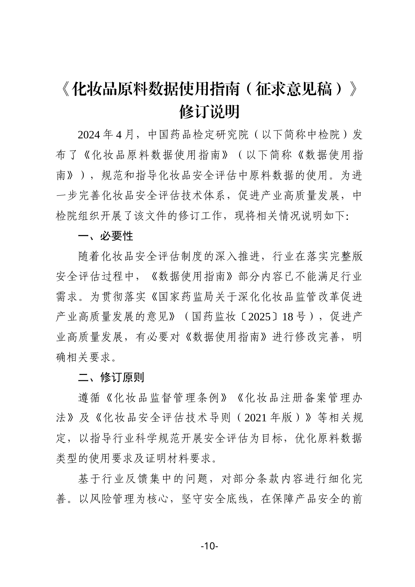
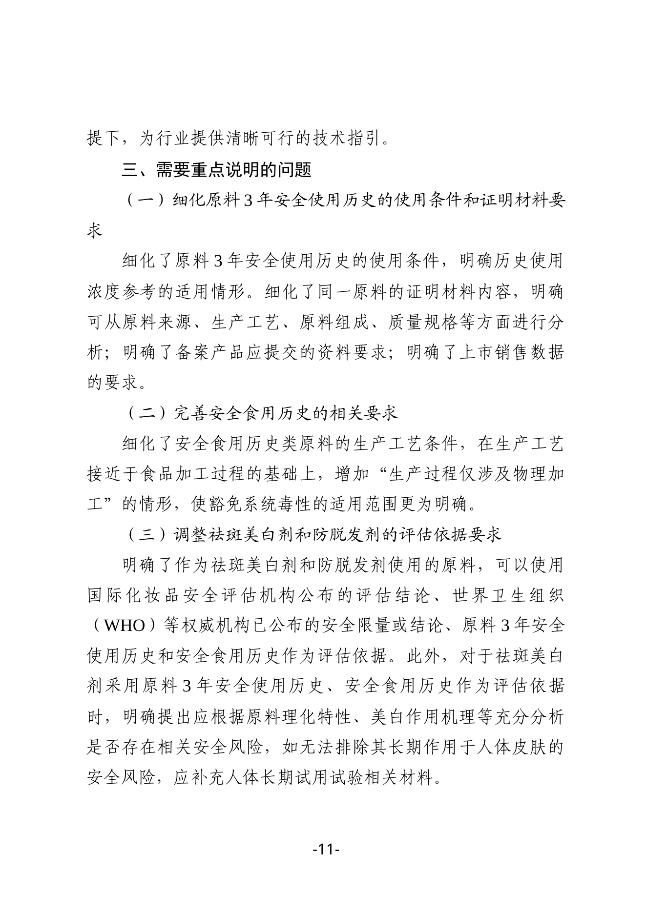

在中国做 **完整版安全评估、注册/备案** 的品牌、原料商和代工厂注意：中国药品检定研究院（中检院）**2026年11月4日** 挂出 [《化妆品原料数据使用指南（征求意见稿）》](https://www.nidc.org.cn/bshff/hzhpbzh/hzhpbzhtzgg/202611041321372272012.html)，是对 **2024年4月30日** 版《化妆品原料数据使用指南》的修订。意见反馈截止 **2026年11月30日**，邮箱 hzpbwh@nidc.org.cn。

**先说清楚：现在还是征求意见稿，现行指南未改，今天交的安评资料仍按现行规则。** 但完整版安评材料清单会跟着这条走，美白/防脱相关配方适合提前对照。

## 改了什么（修订说明口径）

据附件《修订说明》重点三条：

1. **细化原料「3年安全使用历史」**  
   明确历史使用浓度什么时候能参考；同一原料证明材料可从 **来源、生产工艺、组成、质量规格** 等分析；写清备案产品要交什么；补上 **上市销售数据** 要求。

2. **完善「安全食用历史」**  
   生产工艺接近食品加工之外，增加 **「生产过程仅涉及物理加工」** 的情形，系统毒性豁免范围写得更清楚——植物粉、简单物理提取类原料可能更容易对上这条，但仍要证明材料够格。

3. **调整祛斑美白剂、防脱发剂的评估依据**  
   这两类功效原料，草案写明可以用：国际化妆品安全评估机构结论、WHO 等权威机构安全限量/结论、原料 3 年安全使用历史、安全食用历史。  
   **但**：祛斑美白若只靠「3年使用历史 / 安全食用历史」，还要根据理化特性、美白作用机理充分分析长期皮肤风险；**排不掉风险的，要补人体长期试用试验材料**——不是放宽到随便用历史数据交差。

修订动机写明：完整版安评推进后，旧指南部分内容跟不上行业需求，落实国药监妆〔2025〕18号促高质量发展意见。

## 影响谁

- 在中国做 **普通/特殊化妆品注册备案、完整版安评** 的品牌、备案人、安评机构  
- **祛斑美白、防脱发** 特殊化妆品，以及相关新原料/功效原料供应商  
- 想用「食用历史 / 3年使用历史」少做系统毒性的原料商、工厂  
- **只做跨境零售、不在国内注册备案的卖家**：本条不改你的平台上架义务

## 意味着什么、现在注意什么

1. **别当成已经生效**：11-30 前可提意见；定稿前以现行 2024-04 指南为准。  
2. 安评和配方团队：把在用的「3年历史」「食用历史」证据包对照草案过一遍，缺销售数据、工艺说明的现在补，比定稿后返工便宜。  
3. 美白/防脱：就算草案放行国际机构结论和历史数据，长期试用那条可能卡住「只想用历史数据、不想做人试」的路径——预算和排期要留余量。  
4. 想提意见：下官网附件反馈表，**11月30日前**发到 hzpbwh@nidc.org.cn。

## 证据（核对日期 2026-11-06）

修订说明第10页：修订必要性与原则（对2024年4月版指南修订）：

修订说明第11页：3年安全使用历史、安全食用历史（含仅物理加工）、祛斑美白/防脱发评估依据与人体长期试用：

## 来源

- 中检院 · [关于公开征求《化妆品原料数据使用指南（征求意见稿）》意见的通知](https://www.nidc.org.cn/bshff/hzhpbzh/hzhpbzhtzgg/202611041321372272012.html)（2026-11-04）
- 同页附件1：《化妆品原料数据使用指南（征求意见稿）》及修订说明（本站已存证据目录）
- 站内对照：[中国合规](/compliance/cn/)、[中检院新原料创新指导](/news/2026-10-23-nidc-new-ingredient-innovation-guidance/)
