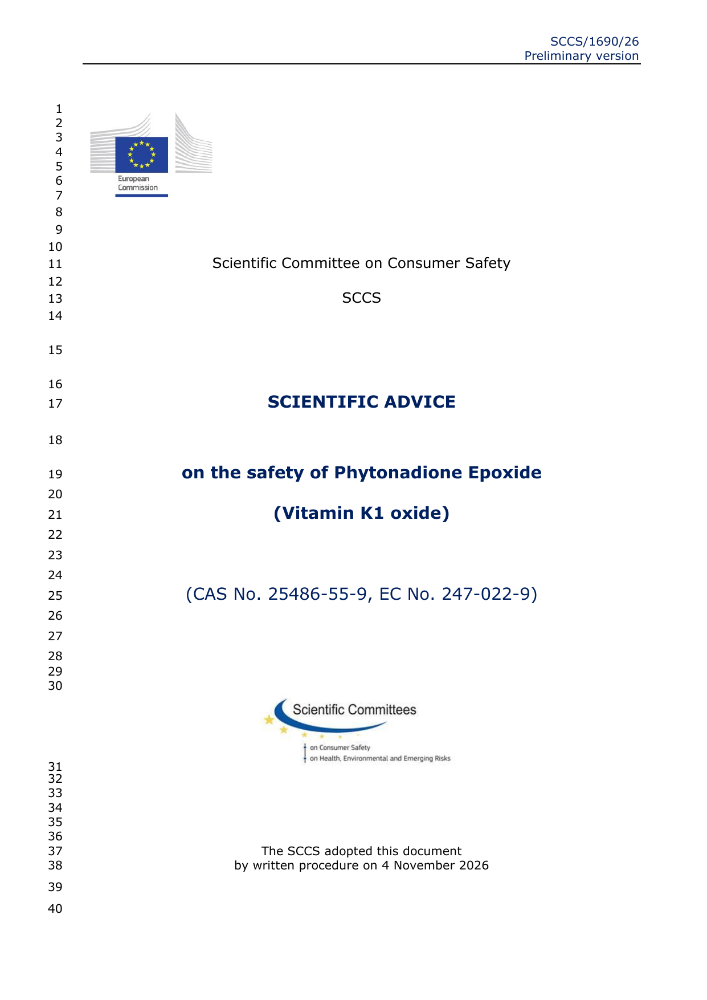
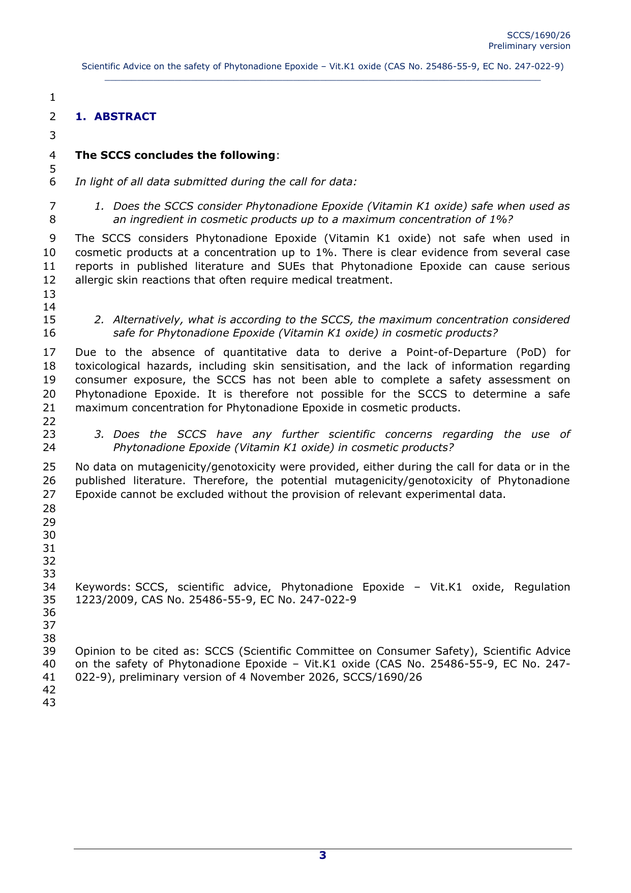

出口 **欧盟**、配方里有 **维生素K1氧化物（Phytonadione Epoxide / Vitamin K1 oxide，CAS 25486-55-9）** 的品牌和工厂注意：欧盟消费者安全科学委员会（SCCS）**2026年11月4日** 书面通过初步科学建议，欧盟健康总司 **11月5日** 挂网公开征求意见，文件编号 **SCCS/1690/26**，意见截止 **2027年1月11日**。

**先说清楚：这是初步科学建议，还不是化妆品法规附件禁限用的正式修订。** 今天在售合规货不受本条直接下架；但结论已经很硬，后续委员会极可能跟进限用或禁用。

## 结论写了什么

据官方 PDF 摘要（Abstract）：

1. **≤1% 是否安全？** — **不安全。** 文献病例与严重不良事件（SUE）显示，该成分可引起常需就医的严重过敏性皮肤反应。  
2. **安全上限是多少？** — **给不出来。** 缺乏定量毒理学起点（含皮肤致敏）和消费者暴露数据，无法完成安全评估。  
3. **还有没有别的担心？** — **致突变/遗传毒性不能排除**：征集与公开文献都没提供相关实验数据。

成分定位：INCI / 常用名 **Phytonadione Epoxide（Vitamin K1 oxide）**，CAS **25486-55-9**，EC **247-022-9**，常出现在宣称淡化黑眼圈、改善青紫的眼霜/精华类配方里（并非所有「维生素K」都是这一氧化物形态——配方单要按 INCI/CAS 对）。

## 影响谁

- 向欧盟投放、配方含 **Phytonadione Epoxide** 的护肤/眼部护理品牌、RP、代工厂  
- 原料商：向欧供应该原料或含该原料的混合物  
- **不含该 CAS、只做国内或其他市场**：本条不直接改你的义务；但若宣传「欧标同款」且配方有该成分，要评估后续附件修订风险

## 意味着什么、现在注意什么

1. **盘点配方**：按 CAS/INCI 筛欧盟在售与在研 SKU，别只搜「维生素K」。  
2. **新品避开**：2027 年前后准备进欧盟的眼霜/修护类，研发阶段就换掉该氧化物；SCCS 连安全上限都给不出，留给正式限用的空间很小。  
3. **跟征求意见**：对结论有数据要补的，按欧盟健康总司页面说明在 **2027-01-11** 前反馈；最终意见与委员会立法动作以官网为准。  
4. 本站标了 **needs_review**，附件 II/III 正式修订后再改合规页禁限用条目。

## 证据（核对日期 2026-11-06）

SCCS/1690/26 封面：2026-11-04 书面通过初步版：

摘要页：≤1% 不安全、无法给出安全上限、遗传毒性数据缺失：

## 来源

- 欧盟健康与食品安全总司 · [SCCS Scientific Advice open for comments on Phytonadione Epoxide (Vitamin K1 oxide)](https://health.ec.europa.eu/latest-updates/sccs-scientific-advice-open-comments-safety-phytonadione-epoxide-vitamin-k1-oxide-deadline-11-2026-11-05_en)（2026-11-05）
- 同页 PDF：SCCS/1690/26 preliminary version of 4 November 2026（本站已存证据目录）
- 站内对照：[欧盟合规](/compliance/eu/)、[ECHA 奥克立林限制意见](/news/2026-11-01-echa-octocrylene-cosmetics-restriction-opinion/)
