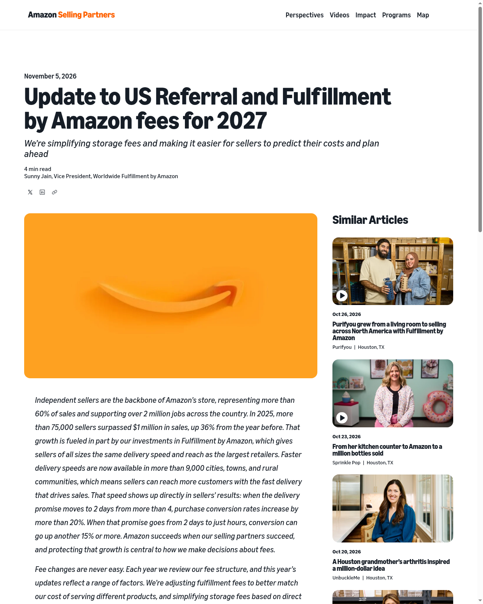
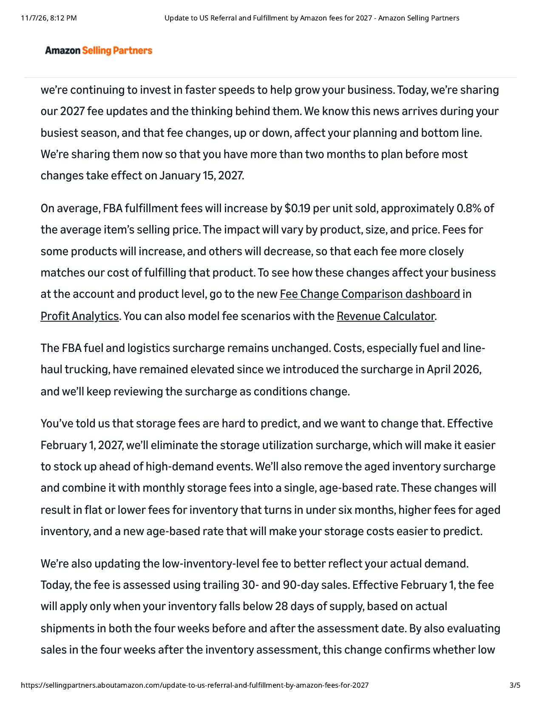
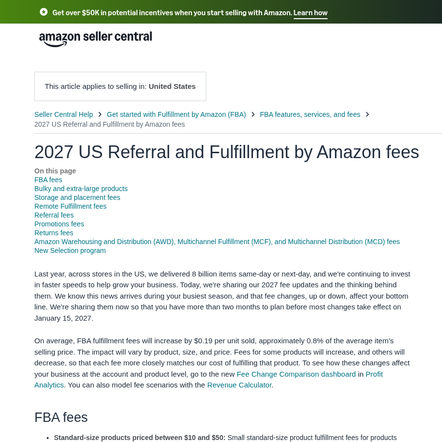
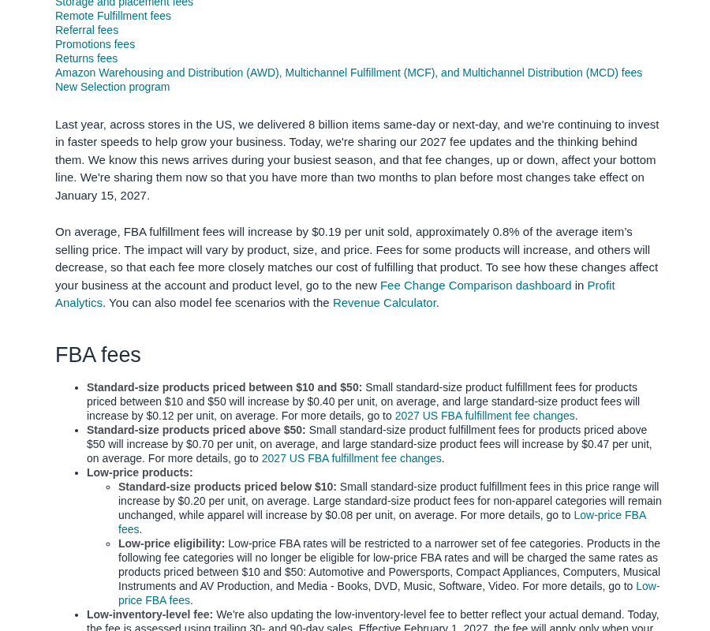
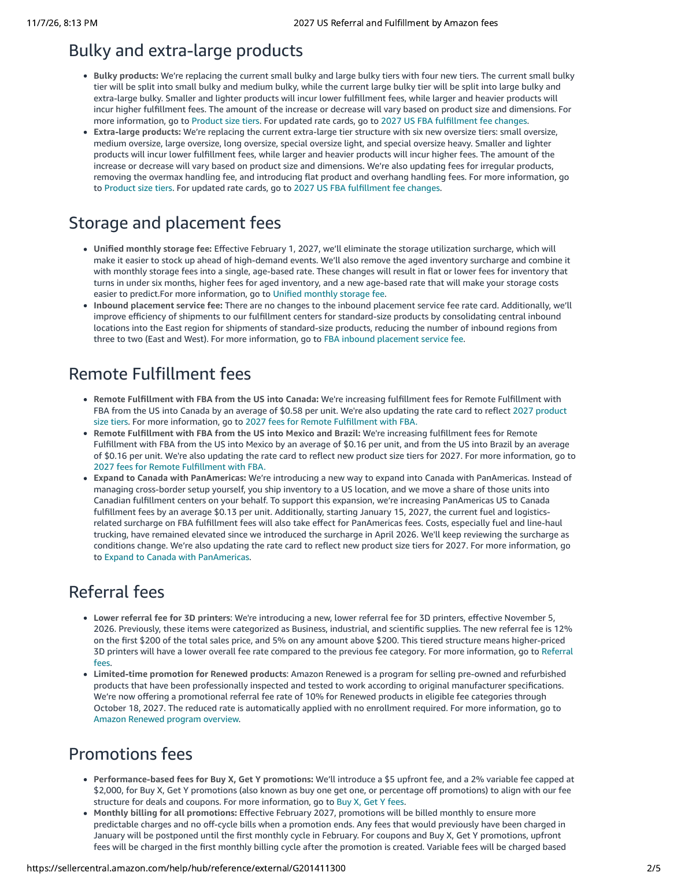

亚马逊在 **Amazon Selling Partners** 发的《[Update to US Referral and Fulfillment by Amazon fees for 2027](https://sellingpartners.aboutamazon.com/update-to-us-referral-and-fulfillment-by-amazon-fees-for-2027)》（**2026-11-05**）说清楚了：美国站 **2027** 年销售佣金与 FBA 费用要动。细则写在 Seller Central 帮助页《[2027 US Referral and Fulfillment by Amazon fees](https://sellercentral.amazon.com/gp/help/external/G201411300)》。美妆面霜、精华、彩妆这种 **小件多 SKU**，别只看「平均涨 $0.19」——按尺寸和售价档，有的会涨得更狠。

## 改了什么

### 1. FBA 配送费（多数 **2027-01-15** 起）

- 官方口径：平均每件多 **$0.19**，大约等于均价商品售价的 **0.8%**
- 有的 SKU 涨、有的降，按尺寸/售价更贴近履约成本
- Seller Central 写明按价格档大致影响（官方平均值，不是你自己的 ASIN）：
  - **$10–$50 小号标准件**：平均约 **+$0.40**/件
  - **$10–$50 大号标准件**：平均约 **+$0.12**/件
  - **>$50 小号标准件**：平均约 **+$0.70**/件
  - **<$10 低价档**：平均约 **+$0.20**/件；且低价 FBA 资格品类会收窄（汽车、家电、电脑等一批类目不再吃低价档，改走标准费率）
- 后台已有 **Fee Change Comparison**（Profit Analytics）和 **Revenue Calculator** 可按账号/商品建模

### 2. 燃油与物流附加费：先不动

- 美国站 FBA **燃油与物流附加费比例维持不变**（官方写明自 2026-04 引入后本轮不调）
- 和欧洲站 11-02 起 1.5%→2% 不是一回事，别混

### 3. 仓储费重构（**2027-02-01** 起）

- **取消**仓储利用率附加费（storage utilization surcharge）
- **取消**库龄附加费，并与月度仓储费 **合并成单一按库龄费率**
- 官方预期：周转 **6 个月以内** 的库存持平或更低；**老库存**更贵、更好预估
- 低库存费：改为库存低于 **28 天供给** 才收，按评估日前后各四周实际发货量看，减少「突然爆单/清季」误伤

### 4. 其他顺带动的（美妆相关度因店而异）

- 远程履约（美→加/墨/巴等）、超大件分级、Buy X Get Y 促销费（$5 固定 + 2% 可变、封顶 $2000）、AWD/MCF 等——帮助页有专节；不是每家美妆店都踩到

## 影响谁

- **亚马逊美国站走 FBA 的美妆、个护、香水卖家**（含跨境）：面霜/精华多落在 **$10–$50** 标准件，官方平均涨幅往往 **高于**「全站平均 $0.19」
- **SKU 多、季节货多、库龄容易拖过半年的店**：2 月起仓储规则更吃「转得慢」的货
- **靠低价引流小样/旅行装（<$10）的店**：低价档也涨，且资格品类可能收窄——要核对自家类目还在不在低价 FBA 名单里

## 意味着什么、现在注意什么

1. **别等 1 月再算**：现在到生效还有两个多月，用 Fee Change Comparison 把在售 ASIN 拉一遍，尤其是 **$10–$50** 美妆主销。  
2. **黑五备货别只看峰值配送费**：旺季附加费之外，还要叠 2027 年新配送费与 2 月新仓储口径。  
3. **清老库存**：库龄附加费并入月度费率后，转不动的货会更贵——临期、滞销色号趁 Q4 清。  
4. **低价小样单独核**：确认是否仍享受低价 FBA；不行就按标准档重算毛利。  
5. **燃油附加费美站本轮不动**，别拿欧洲站涨价新闻套到美店。

## 证据（核对日期 2026-11-07）

Amazon Selling Partners 公告页标题与日期 **November 5, 2026**：

公告正文：多数变更 **2027-01-15**；FBA 配送均涨 **$0.19**；燃油附加费不动；**2027-02-01** 起仓储利用率/库龄附加费并入按库龄月度费、低库存费改 28 天供给：

Seller Central 帮助页标题、适用范围 United States，以及均涨 $0.19 / 约 0.8% 售价：

按售价/尺寸档的官方平均影响（含 $10–$50、$50+、低价档）：

仓储与入库布局、远程履约等专节（2-01 起统一按库龄仓储费等）：

## 来源

- Amazon Selling Partners · [Update to US Referral and Fulfillment by Amazon fees for 2027](https://sellingpartners.aboutamazon.com/update-to-us-referral-and-fulfillment-by-amazon-fees-for-2027)（2026-11-05）
- Amazon Seller Central Help · [2027 US Referral and Fulfillment by Amazon fees](https://sellercentral.amazon.com/gp/help/external/G201411300)
- 站内相关：[美国站旺季配送费](/news/2026-10-15-amazon-us-holiday-peak-fees/)、[美国合规](/compliance/us/)
