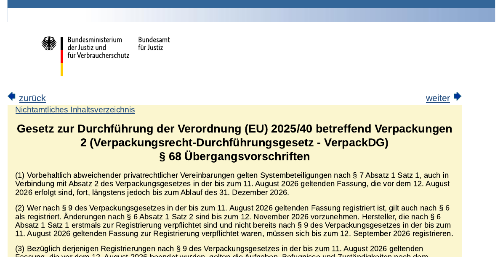
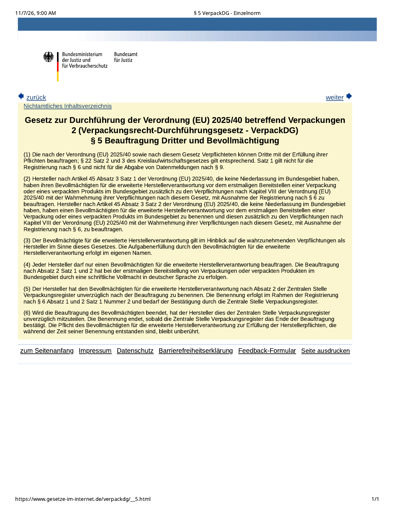
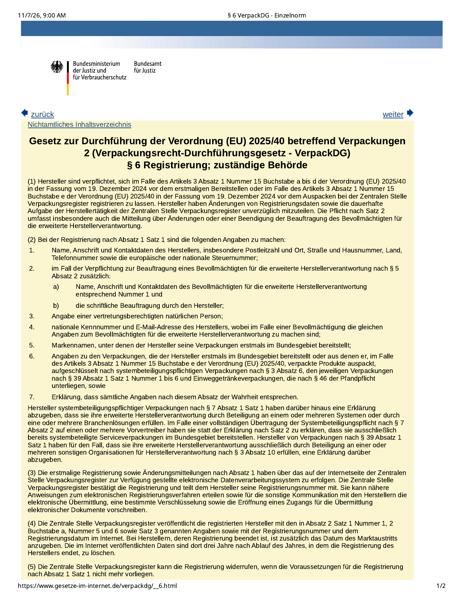
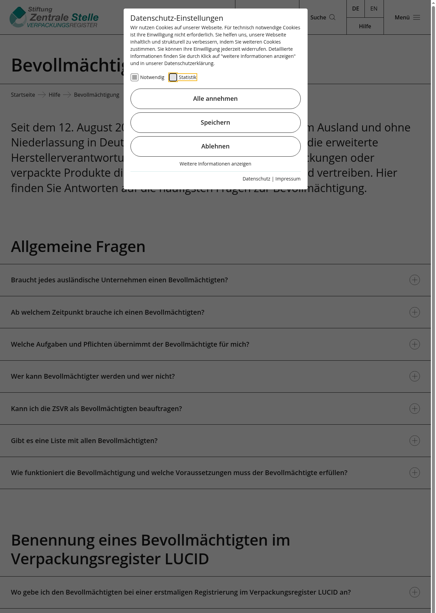

在 **Temu 德站、亚马逊欧洲站、独立站直邮** 往德国卖 **有包装的化妆品、个护** 的跨境卖家注意：德国联邦法律文本里写死了一个近在眼前的日子——**2026年11月12日**。

依据联邦司法部在 [gesetze-im-internet.de](https://www.gesetze-im-internet.de/verpackdg/__68.html) 公布的 **《包装法实施法》（Verpackungsrecht-Durchführungsgesetz，VerpackDG）§ 68 第 2 款**：以前按旧《包装法》§ 9 已经在中央包装登记处（LUCID）注册过的厂家，视为已按新法 § 6 注册；但 **§ 6 第 1 款第 2 句规定的注册数据变更，必须在 2026年11月12日之前办完**。同条第 1 款第 3 句写明：这类变更 **尤其包括** 延伸生产者责任 **授权代表（Bevollmächtigter）的委托变更或终止**——也就是说，该挂代表的，要在这个日子前把代表写进 LUCID。

## 改了什么

三块条文连在一起看：

1. **谁必须请德国授权代表（§ 5）**  
   在联邦境内 **没有住所/营业场所**、却直接向德国最终用户提供包装或包装产品的境外厂家，须在 **首次投放前** 委托一名德国延伸生产者责任授权代表（书面德文委托；每人只能委托一名；登记本身仍由厂家自己做，代表不替代注册）。

2. **LUCID 注册要写什么（§ 6）**  
   有义务委托代表时，注册须同时填代表的名称、地址、联系方式，并提交书面委托；之后代表变更或结束也要立刻报登记处。

3. **已注册老户的死线（§ 68 第 2 款）**  
   旧法时期已经注册的 → **2026-11-12 前** 补齐 § 6 第 1 款第 2 句要求的变更（含授权代表信息）。  
   新法下首次才有义务注册、且旧法下本不必注册的 → 过渡条款写的是 **2026-09-12 前** 完成注册（该日已过，仍未注册的按现行义务尽快补）。

中央包装登记处（ZSVR）[Bevollmächtigung 帮助页](https://www.verpackungsregister.org/hilfe/bevollmaechtigung) 用白话复述了同一套规则：境外、无德国机构、直接卖给德国最终用户 → 要有代表；LUCID 仪表盘有「Beauftragter Bevollmächtigter」入口可补登。

**说明：** 条文写的是「须完成变更」，**没有**在公开法条里写「11-12 当天自动删号」。不办可能面临监管与平台侧下架/罚款风险；Temu 等平台后台已单独催德站卖家在 11-12 前完成 AR/LUCID 绑定，以卖家中心通知为准。

## 影响谁

- **没有德国公司/分支、却用包裹直邮德国消费者** 的美妆、个护、香水品牌与工厂（纸盒、瓶罐、外箱都算包装产品）
- **Temu 德站、亚马逊欧洲站 FBM/直邮、独立站小包** 里主体仍是境外公司的卖家
- 已有 LUCID 号、但 **还没在登记里挂上德国授权代表** 的老户——正是 § 68 第 2 款盯的那批
- **已在德国有住所、或只卖给德国企业不面向最终用户** 的路径：义务范围不同，以 § 5 / ZSVR 说明为准，勿机械套用

## 意味着什么、现在注意什么

1. **这周内登录 LUCID**：看仪表盘是否提示要补「Bevollmächtigter」；没有代表 ID 的，先签德文书面委托，再在登记里提交并由代表确认。  
2. **别把「化妆品责任人（RP）」和「包装授权代表」混为一谈**：欧盟化妆品责任人管配方与安全；VerpackDG 授权代表管德国包装延伸责任（系统参与、数量申报等）。两边都可能要，但不是同一个合同。  
3. **平台催办不等于法律全文**：Temu 等写「逾期 LUCID 可能失效」是运营侧表述；法律文本确认的硬节点是 **11-12 前完成注册变更**。以 [§ 68](https://www.gesetze-im-internet.de/verpackdg/__68.html)、[§ 5](https://www.gesetze-im-internet.de/verpackdg/__5.html)、[§ 6](https://www.gesetze-im-internet.de/verpackdg/__6.html) 与 ZSVR 后台为准。  
4. 本站德国合规页「包装登记与授权代表」条目已按本轮核对刷新。

## 证据（核对日期 2026-11-07）

§ 68 第 2 款原文写明：旧法已注册者视为按 § 6 注册，**Änderungen nach § 6 Absatz 1 Satz 2 sind bis zum 12. November 2026 vorzunehmen**：

§ 5：无德国住所的境外厂家须在首次投放前委托延伸生产者责任授权代表：

§ 6：变更义务涵盖授权代表委托变更/终止；有义务时注册须填代表信息：

ZSVR 帮助页复述境外直邮须指定授权代表，并说明如何在 LUCID 补登：

## 来源

- [VerpackDG § 68 Übergangsvorschriften](https://www.gesetze-im-internet.de/verpackdg/__68.html)（联邦司法部 / gesetze-im-internet.de）
- [VerpackDG § 5 Beauftragung Dritter und Bevollmächtigung](https://www.gesetze-im-internet.de/verpackdg/__5.html)
- [VerpackDG § 6 Registrierung](https://www.gesetze-im-internet.de/verpackdg/__6.html)
- ZSVR · [Bevollmächtigung 帮助页](https://www.verpackungsregister.org/hilfe/bevollmaechtigung)
- 站内：[德国合规](/compliance/de/)
