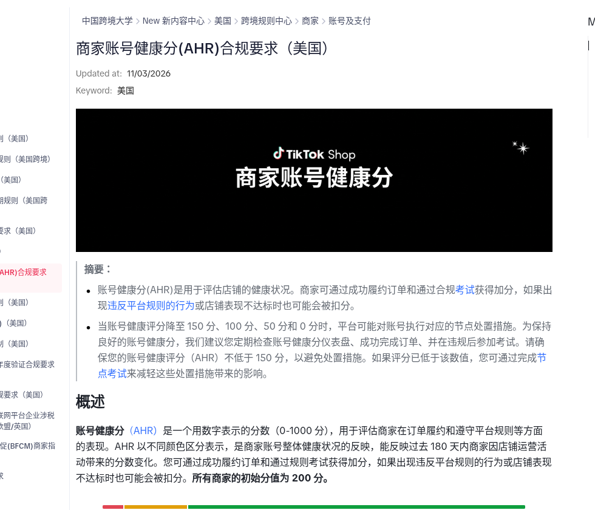
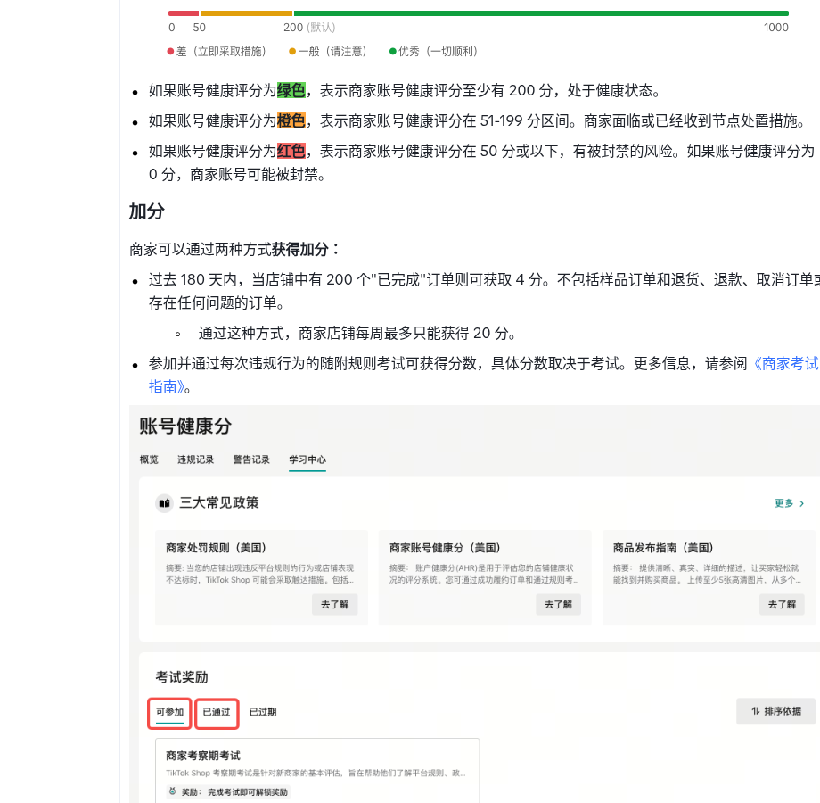
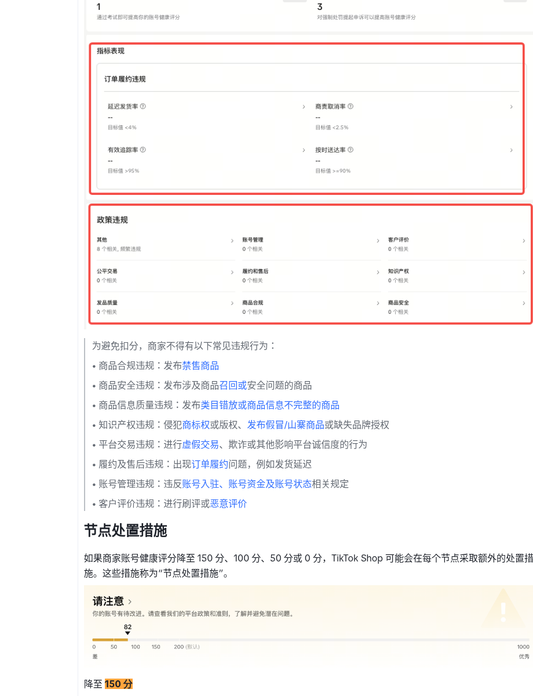
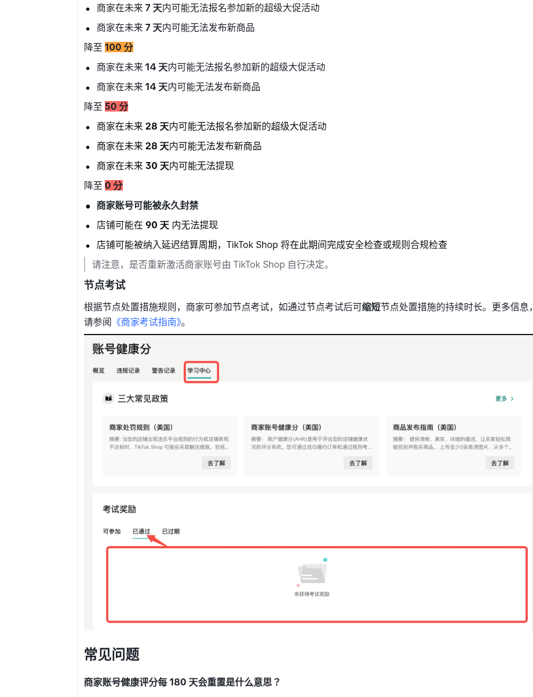

TikTok Shop **美国站**跨境卖家大学公开页《[商家账号健康分(AHR)合规要求（美国）](https://seller.tiktokshopglobalselling.com/university/essay?knowledge_id=4526040723982097)》标注 **Updated at: 11/03/2026**。站内此前 [黑五 BFCM 门槛稿](/news/2026-10-19-tiktok-shop-us-bfcm-campaign/) 只写了「AHR 宜高于 150」；本页把 **整条节点梯子**（150 / 100 / 50 / 0）和美妆卖家最容易踩的 **扣分大类** 写全了——黑五临近，分掉了不只报不上活动，还可能 **发不了新品、提不了现**。

## 改了什么

### 1. AHR 怎么算（白话）

- 分数区间 **0–1000**；新店初始 **200**
- 看过去 **180 天** 的履约与守规；加分、扣分都会在约 180 天后滚掉（申诉成功返还的分除外）
- **绿色**：至少 200，健康
- **橙色**：约 51–199，已面临或已收到节点处置
- **红色**：≤50，有封禁风险；到 **0** 可能永久封号

加分两条主路：

1. 过去 180 天里，每 **200** 笔「已完成」订单加 **4** 分（样品、退货退款、取消、有问题订单不算）；靠订单每周最多加 **20** 分  
2. 违规后参加并通过规则考试，按考试给分

### 2. 四个节点处置（官方写的「可能」）

| 分数掉到 | 可能发生的事 |
| --- | --- |
| **150** | 未来 **7 天** 可能无法报名新的超级大促 |
| **100** | 未来 **14 天** 可能无法报超级大促；**14 天** 可能无法发布新商品 |
| **50** | 未来 **28 天** 可能无法报超级大促、无法发新品；未来 **30 天** 可能无法提现 |
| **0** | 账号可能被 **永久封禁**；店铺可能 **90 天** 无法提现，并可能进入延迟结算（平台做安全/合规检查）。是否重开由平台自行决定 |

官方建议：**把 AHR 维持在不低于 150**，避免节点处置；已经低于这条线的，可通过 **节点考试** 缩短处置时长（详见卖家大学《商家考试指南》）。

### 3. 美妆店最容易被扣的几类

官方列举的常见违规里，美妆跨境尤其要盯：

- **商品合规**：禁售品上架  
- **商品安全**：召回或安全问题商品  
- **商品信息质量**：类目错放、信息不完整  
- **知识产权**：商标/版权、假冒山寨、缺品牌授权  
- **履约及售后**：延迟发货等  
- 另有平台交易（刷单欺诈）、账号管理、客户评价（刷评）等

和站内已有的 [禁恶心护肤特写](/news/2026-10-26-tiktok-shop-us-graphic-skincare-closeups/)、[BFCM 门槛](/news/2026-10-19-tiktok-shop-us-bfcm-campaign/) 是同一套账号健康体系：**内容/合规违规会打到 AHR，AHR 再反过来卡活动和发品**。

## 影响谁

- **TikTok Shop 美国站美妆、个护、香水卖家**（含跨境）：分掉了先伤大促与上新，再伤提现  
- **靠达人带货的品牌**：达人夸大功效、侵权素材，最终可能记到店铺违规，拖垮 AHR  
- **备战 11-11—11-30 黑五 BFCM 的店**：BFCM 指南已要求 AHR 宜 >150；本页确认 ≤150 就会触发「卡超级大促」节点

## 意味着什么、现在注意什么

1. **这周打开 Seller Center「账号健康分」仪表盘**：看现在分在绿/橙/红哪段，有没有未处理违规。  
2. **别只为了报黑五临时刷分**：订单加分有每周上限；更稳的是清掉合规/IP/履约问题，再参加节点考试缩短处置。  
3. **上新与提现是硬杠杆**：掉到 100 可能发不出新品；掉到 50 可能冻提现——旺季现金流比「少报一场活动」更疼。  
4. **AHR ≠ 店铺体验分**：官方 FAQ 写明体验分偏奖励、低也不直接处置；AHR 偏合规，低了会节点处置。别混着看。

## 证据（核对日期 2026-11-07）

卖家大学页标题与更新日期 **11/03/2026**，摘要写明降至 150/100/50/0 触发节点处置、建议不低于 150：

分数色条（绿≥200 / 橙51–199 / 红≤50）与加分规则（每200完成单+4、每周上限20）：

政策违规大类（含商品合规、商品安全、知识产权、履约）与节点处置章节抬头：

150/100/50/0 节点措施、节点考试与学习中心入口：

## 来源

- TikTok Shop 跨境卖家大学 · [商家账号健康分(AHR)合规要求（美国）](https://seller.tiktokshopglobalselling.com/university/essay?knowledge_id=4526040723982097)（Updated 2026-11-03）
- 站内相关：[美国站黑五 BFCM 门槛](/news/2026-10-19-tiktok-shop-us-bfcm-campaign/)、[禁恶心护肤特写](/news/2026-10-26-tiktok-shop-us-graphic-skincare-closeups/)、[美国合规](/compliance/us/)
