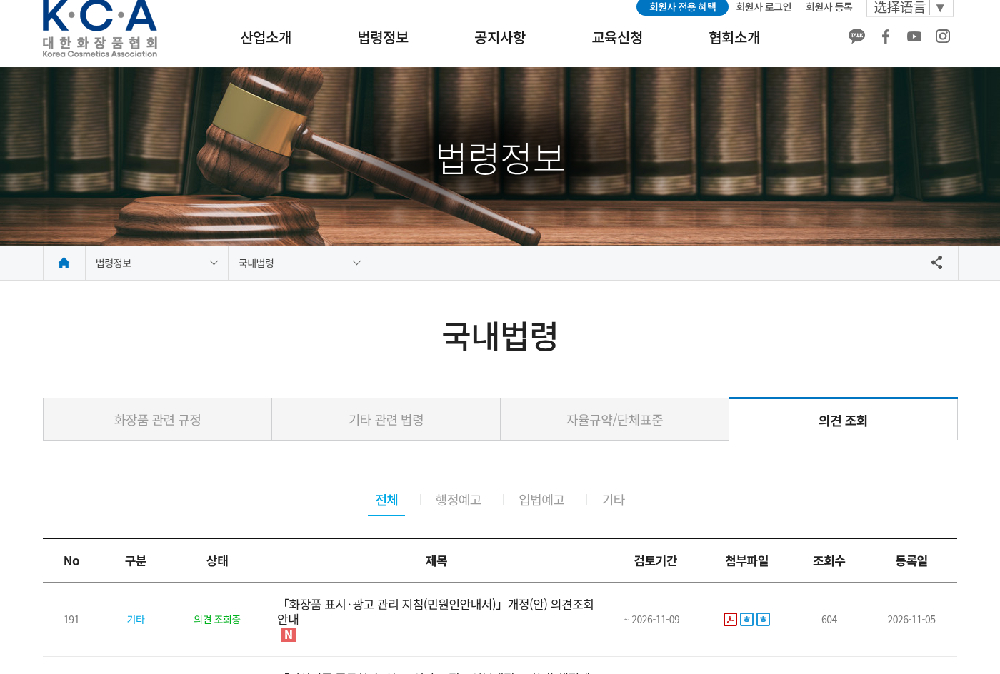
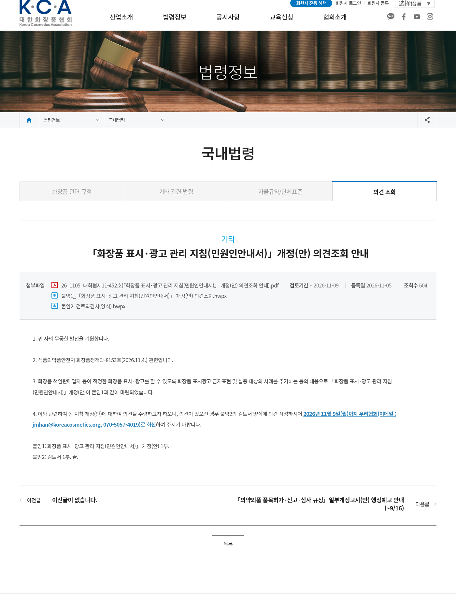
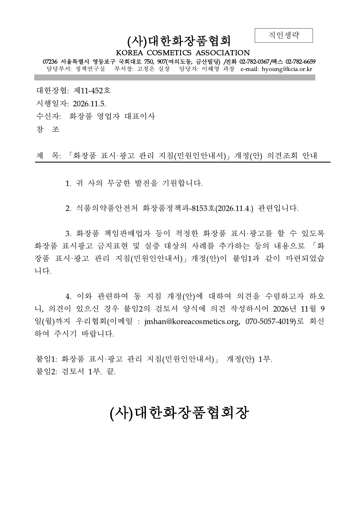
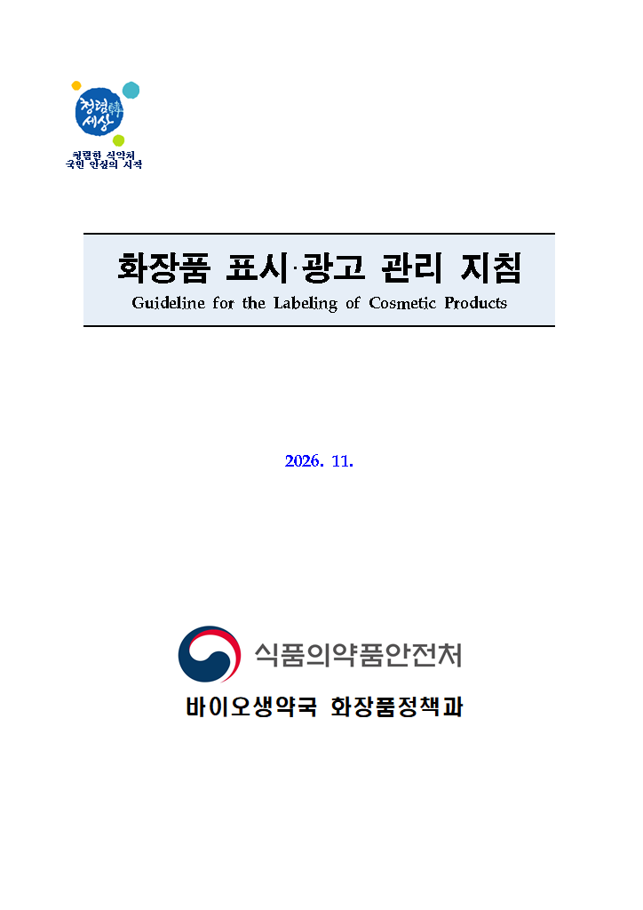
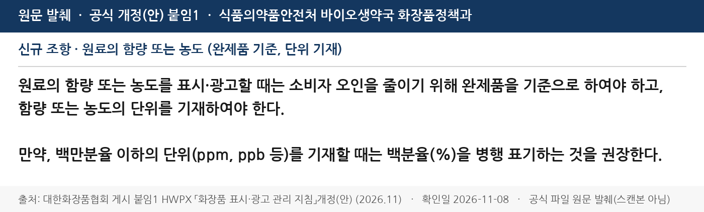
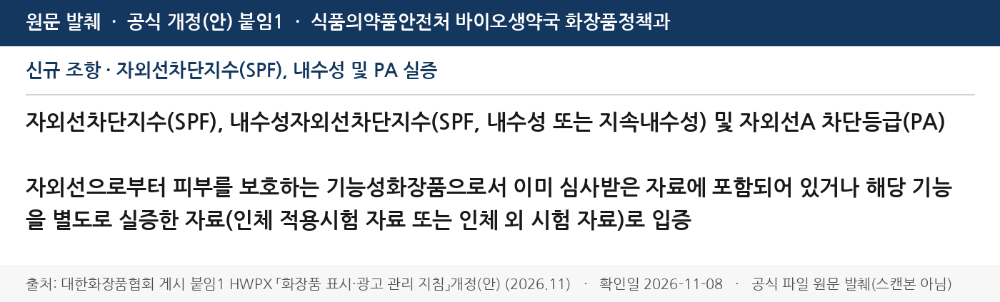

在韩国卖化妆品、或者往韩国投放广告的品牌注意：韩国化妆品协会（KCIA）**2026年11月5日**在[意见查询栏](https://kcia.or.kr/home/law/law_04.php?type=view&no=17968)挂出《化妆品表示·广告管理指针（民愿人指南）》修订（案）意见征集通知（대화협제 **11-452** 号）。公文写明依据食品医药品安全处化妆品政策课-**8153** 号（**2026.11.4.**），把修订案公开征求意见，**2026年11月9日（周一）**前把意见回给协会。

**先说清楚：现在还是草案，规则没定稿，今天在售货不会因为这条修订案立刻违规。** 但它是食药处对「哪些话不能说、哪些功效必须拿出试验数据」的适用口径更新，韩国详情页、直播话术、内容素材最好对照着先查一遍。这跟站内已写过的[11月27日起禁止 AI 假专家带货](/news/2026-11-01-korea-ai-fake-expert-cosmetic-ads-ban/)不是同一件事——那条是《化妆品法》已通过的禁令，这条是广告指针的修订草案。

协会公文把修订重点概括成一句话：为了让责任销售业者把表示、广告做对，**追加禁止表述和需要实证的广告情形**。修订案全文在附件「붙임1」HWPX，封面署名为食药处生物生药局化妆品政策课，日期 **2026. 11.**

## 改了什么（草案口径）

我们下载了协会挂出的修订案，并对照食药处官网现行《化妆品表示·广告管理指针（民愿人指南）》**안내서-0086-07**（**2025年8月14日**版）原文核对。下面这几条是现行版里没有、修订案新写入的：

### 1. 说成分含量、浓度：必须按成品算，还要写出单位

修订案写：宣传原料的含量或浓度时，为减少消费者误解，**必须以成品（완제품）为基准**，并且**必须写明含量或浓度的单位**。如果用到百万分率以下的单位（**ppm、ppb** 等），建议同时标出百分率（**%**）。

跨境卖家常见的「含 10000 ppm 烟酰胺」「精华里加了 5% 某某提取物」，以后不能只写原料桶里的浓度，得换算成瓶子里实际有多少，并把单位写清楚。提取物含量本来就要扣掉提取溶剂、稀释溶剂再按成品计——这一条现行版里已有，本轮是在此之上把「一般原料的含量/浓度」也收紧了。

### 2. 防晒 SPF、耐水性、PA：要有审查资料或另行试验

修订案把下列主张列入主要实证对象：

- 紫外线阻断指数（**SPF**）
- 耐水性紫外线阻断指数（**SPF**，耐水性或持续耐水性）
- 紫外线 A 阻断等级（**PA**）

要求：作为保护皮肤免受紫外线的功能性化妆品，须用**已经通过审查（申报）的资料**，或对该功能**另行实证的资料**（人体适用试验或体外试验）来证明。

只在详情页写「SPF50+ / PA++++ / 防水」但拿不出功能性化妆品审查资料或对应试验报告的，会更难过关。

### 3. 禁止表述也补了例子

协会公文说本轮会追加禁止表述的事例。对照现行 2025-08 版，修订案里新出现的例子包括：即使只是天然存在的极微量，也不得标出被《麻药类管理法》列为麻药类、化妆品不得配合的成分名称或含量，例如四氢大麻酚（**THC**）、大麻二酚（**CBD**）；面部轮廓相关表述补了双下巴、中面部缩小等说法；医疗级/医美操作相关表述补了 Juvelook（쥬베룩）、Medical Device 等。干细胞、外泌体、微针（MTS）等说法现行版已经限制，不是本轮才有。

指针本身是「民愿人指南」，草案也写明**对外不具独立法律强制力**，供理解《化妆品法》禁止广告条款时参考。但食药处查违规广告时，就是按这类口径来看整体印象的。

## 影响谁

- **在 Coupang、韩国独立站、TikTok / Instagram / YouTube 投韩国广告的美妆卖家**，尤其爱在详情页和短视频里报成分浓度、防晒指数的团队
- **责任销售业者和代运营**：韩国站文案、包装贴纸、直播话术都要按成品浓度和实证资料重新过一遍
- **做防晒、强调高含量活性物、或打 CBD/汉麻概念的跨境品牌**：这几类话术被点名的风险最高
- 只在中国站卖、完全不面对韩国消费者的店：本条不直接管你

## 意味着什么、现在注意什么

1. **想提意见只剩 11 月 9 日**：按协会要求，用附件「붙임2」意见书格式写好，在 **2026年11月9日（周一）** 前发到 `jmhan@koreacosmetics.org`（电话 070-5057-4019）。过了就赶不上这轮。
2. **别把草案当成已经生效**：定稿前以食药处后续正式发布的指针为准；本站标了 **needs_review**，正式文本出来后再改合规页。
3. **先自查三件事**：成分含量是不是按成品算、单位写了没有；防晒 SPF / 防水 / PA 有没有审查或试验资料；有没有 CBD/THC 名称、医美操作或「削脸/去双下巴」这类容易被看成医疗功效的说法。
4. **进口货的外文包装**：现行指针已允许用修改、删除、覆盖贴标（over-labelling）让外文表示符合要求，并提醒贴纸不能在流通中掉落——修订案保留了这一条。
5. 不要和 [AI 假专家广告禁令（11月27日施行）](/news/2026-11-01-korea-ai-fake-expert-cosmetic-ads-ban/) 混在一起：那条已经立法，这条还在征求意见。

## 证据（核对日期 2026-11-08）

韩国化妆品协会「意见查询」列表第 191 条：标题为指针修订（案）意见征集通知，状态「意见查询中」，征求意见截至 **2026-11-09**，注册日 **2026-11-05**：

详情页写明依据食药处化妆品政策课-**8153** 号（**2026.11.4.**），修订内容是追加禁止表述和实证对象事例，意见须在 **2026年11月9日（周一）** 前回协会；附件包括公函 PDF、修订案 HWPX 和意见书格式：

协会公函（대화협제 11-452 号，施行日 **2026.11.5.**）原文同样写明截止日和修订目的：

修订案（붙임1）封面：食药处生物生药局化妆品政策课，《化妆品表示·广告管理指针》，**2026. 11.**：

修订案正文新增「原料含量或浓度须按成品计算并记载单位；ppm/ppb 建议同时标出 %」（摘自协会发布的官方 HWPX 原文，非扫描件）：

修订案正文新增防晒 **SPF**、耐水性 **SPF** 及 **PA** 须以审查资料或另行人体/体外试验资料实证（摘自同一官方 HWPX）：

## 来源

- 韩国化妆品协会 · [「化妆品表示·广告管理指针（民愿人指南）」修订（案）意见征集通知](https://kcia.or.kr/home/law/law_04.php?type=view&no=17968)（등록일 2026-11-05，征求意见截至 2026-11-09）
- 同上页附件：대화협제11-452号公函 PDF、붙임1 修订案 HWPX、붙임2 意见书格式
- 对照用现行指针：食药处法令信息「化妆品表示·广告管理指针」안내서-0086-07（告示日 20250814）
- 站内对照：[韩国 11 月 27 日起禁止 AI 假专家给化妆品带货](/news/2026-11-01-korea-ai-fake-expert-cosmetic-ads-ban/)、[韩国合规](/compliance/kr/)
