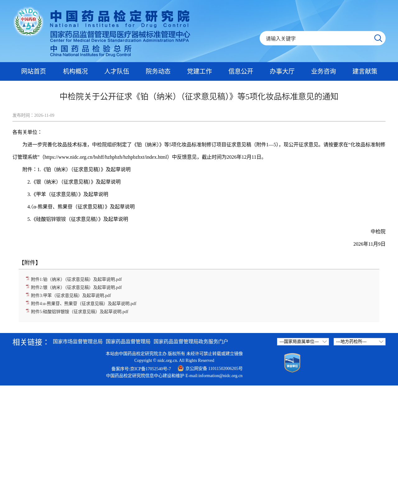
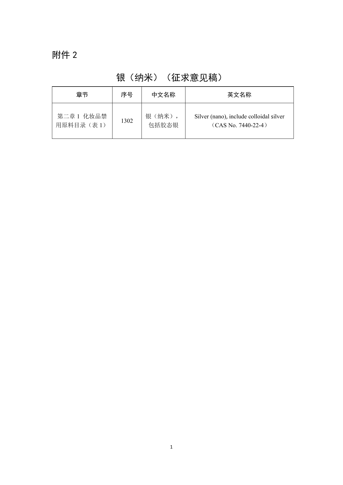
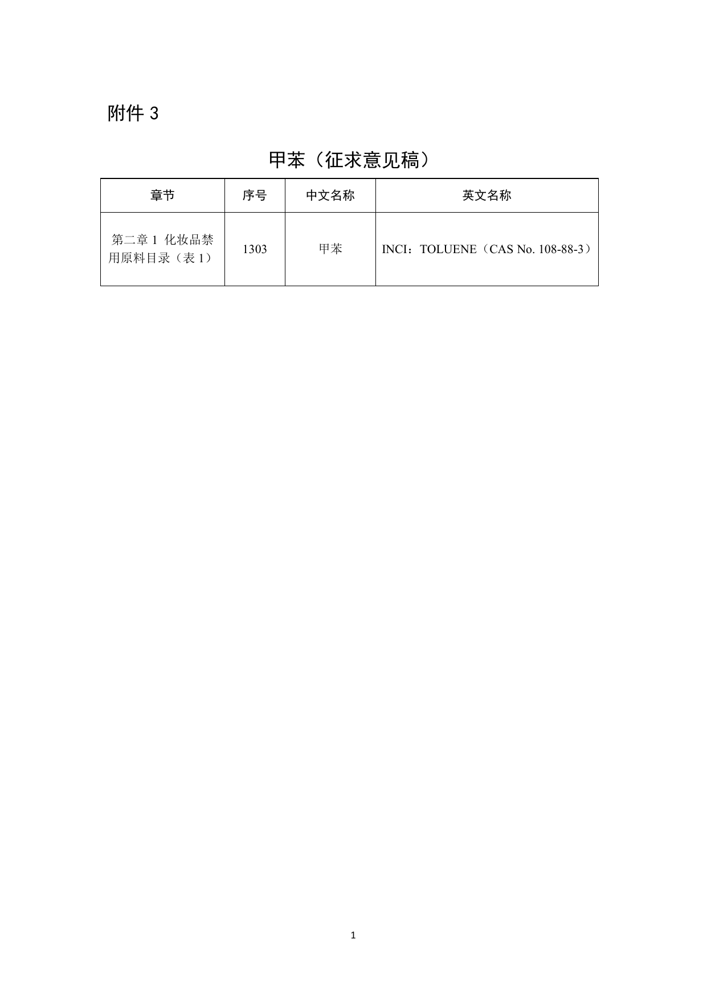
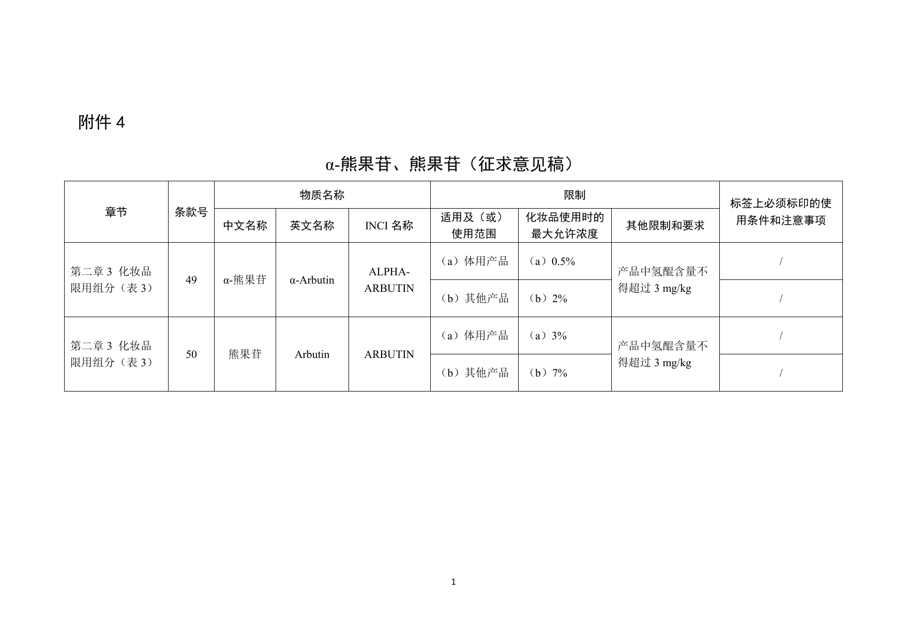
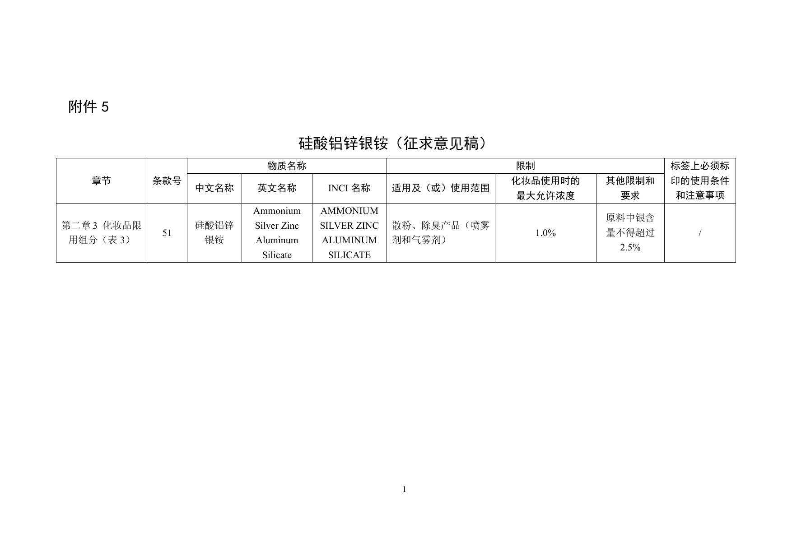

在中国做化妆品注册备案、配方和原料的品牌注意：中国药品检定研究院（中检院）**2026年11月9日**发布 [关于公开征求《铂（纳米）（征求意见稿）》等5项化妆品标准意见的通知](https://www.nidc.org.cn/bshff/hzhpbzh/hzhpbzhtzgg/202611090851362278252.html)，把5份征求意见稿挂到「化妆品标准制修订管理系统」征集意见，**截止 2026年12月11日**。

**先说清楚：现在还是征求意见稿，《化妆品安全技术规范》还没改，今天在售配方不会因为这条立刻违规。** 但禁用/限用一旦定稿，美白、抗菌概念原料和指甲油等溶剂相关配方会直接受影响，适合现在对表。

## 改了什么（草案口径）

我们核对了官网通知正文和附件1—5 PDF。对照现行《已使用化妆品原料目录》，这5项都还在「已使用」里；草案要把它们写进《化妆品安全技术规范》的禁限表：

### 1. 拟禁用：铂（纳米）、银（纳米）、甲苯

| 原料 | 草案去向 | 草案要点 |
| --- | --- | --- |
| 铂（纳米），包括胶态铂 | 禁用原料目录（表1）序号1301 | 胶态铂现属已使用原料；草案以安全信息不足为由拟禁，对齐欧盟附录Ⅱ |
| 银（纳米），包括胶态银 | 禁用原料目录（表1）序号1302 | 胶态银现属已使用原料；草案提到可能的生殖毒性风险，对齐欧盟附录Ⅱ |
| 甲苯 TOLUENE | 禁用原料目录（表1）序号1303 | 现属已使用原料；草案拟全面禁用 |

做「胶态铂 / 胶态银」概念护肤、或指甲油等仍用甲苯的配方，定稿后就不能再按旧目录继续用。

### 2. 拟限用：α-熊果苷、熊果苷

写入限用组分（表3），并卡死氢醌残留：

- **α-熊果苷**：体用产品最高 **0.5%**，其他产品 **2%**；产品中氢醌 ≤ **3 mg/kg**
- **熊果苷**：体用产品最高 **3%**，其他产品 **7%**；产品中氢醌 ≤ **3 mg/kg**

美白精华、身体乳如果把α-熊果苷加得很猛，或氢醌残留没控住，以后会卡注册/备案和抽检。

### 3. 拟限用：硅酸铝锌银铵

写入限用组分（表3）条款51：仅允许用于 **散粉、除臭产品（喷雾剂和气雾剂）**，最高 **1.0%**，且原料中银含量不得超过 **2.5%**。其他剂型按草案不能再当「随便加」的防腐/抗菌原料。

## 影响谁

- 在中国做 **普通/特殊化妆品注册备案** 的品牌、备案人、工厂、安评机构  
- 用 **胶态铂、胶态银、甲苯、α-熊果苷、熊果苷、硅酸铝锌银铵** 的原料商和代工厂  
- 美白、抗菌概念、指甲油/溶剂相关品类的供应链  
- **只做跨境零售、不在国内注册备案的卖家**：本条不改你的平台上架义务，但国内货源若含上述原料，定稿后供货会变

## 意味着什么、现在注意什么

1. **别当成已经生效**：12-11 前可在[化妆品标准制修订管理系统](https://www.nidc.org.cn/bshff/hzhpbzh/hzhpbzhxt/index.html)提意见；定稿并实施前，仍以现行规范为准。  
2. 配方/原料团队：把在产、在备配方按上表扫一遍；美白线重点看α-熊果苷浓度和氢醌残留方法。  
3. 胶态铂/胶态银概念产品：哪怕现在目录里能用，也要准备替代方案，别压太多库存到定稿窗口。  
4. 甲苯：溶剂和香精载体里有没有残留/故意添加，要跟原料商书面确认。

## 证据（核对日期 2026-11-09）

中检院官网通知页（2026-11-09，意见截止12-11，附件1—5）：

附件1：铂（纳米）拟列入禁用原料目录表1：

附件2：银（纳米）拟列入禁用原料目录表1：

附件3：甲苯拟列入禁用原料目录表1：

附件4：α-熊果苷、熊果苷拟限用浓度与氢醌≤3 mg/kg：

附件5：硅酸铝锌银铵拟限散粉/除臭且≤1.0%：

起草说明页（禁限理由与欧盟对齐口径）亦已存证据目录。

## 来源

- 中检院 · [关于公开征求《铂（纳米）（征求意见稿）》等5项化妆品标准意见的通知](https://www.nidc.org.cn/bshff/hzhpbzh/hzhpbzhtzgg/202611090851362278252.html)（2026-11-09）
- 同页附件1—5 PDF（本站已存证据目录）
- 站内对照：[中国合规](/compliance/cn/)、[中检院原料数据使用指南征求意见](/news/2026-11-04-nidc-ingredient-data-guide-public-comment/)
