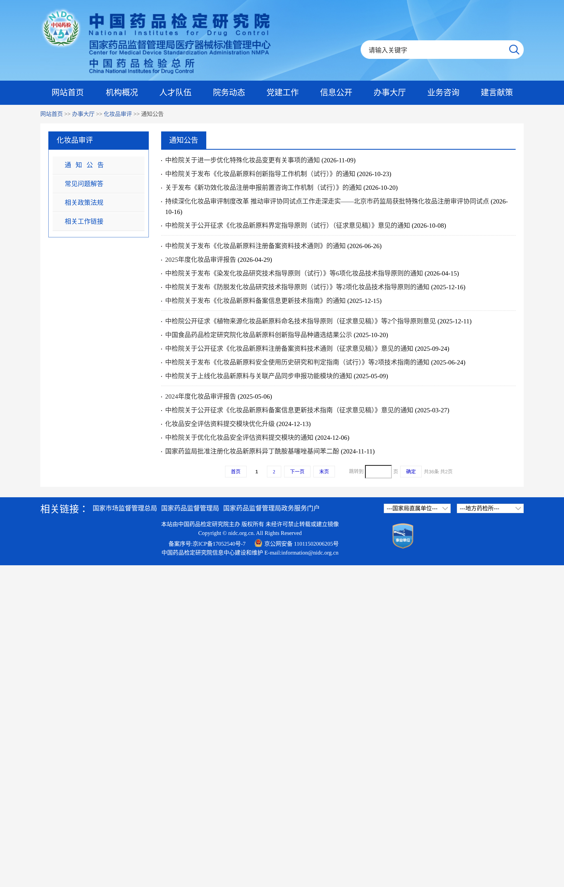
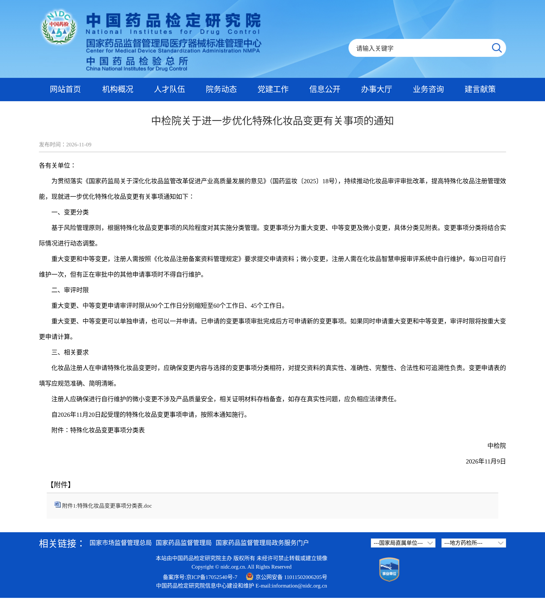
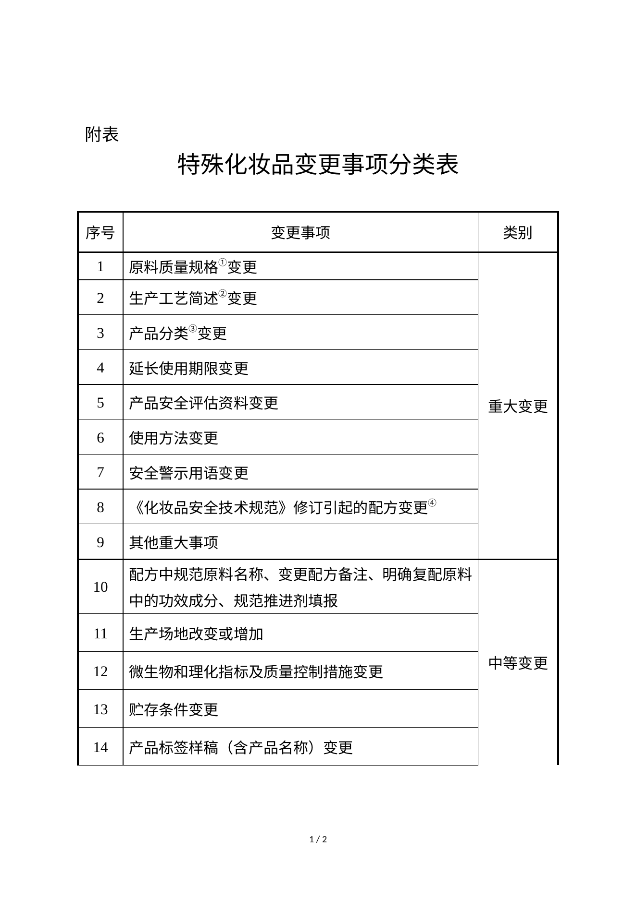
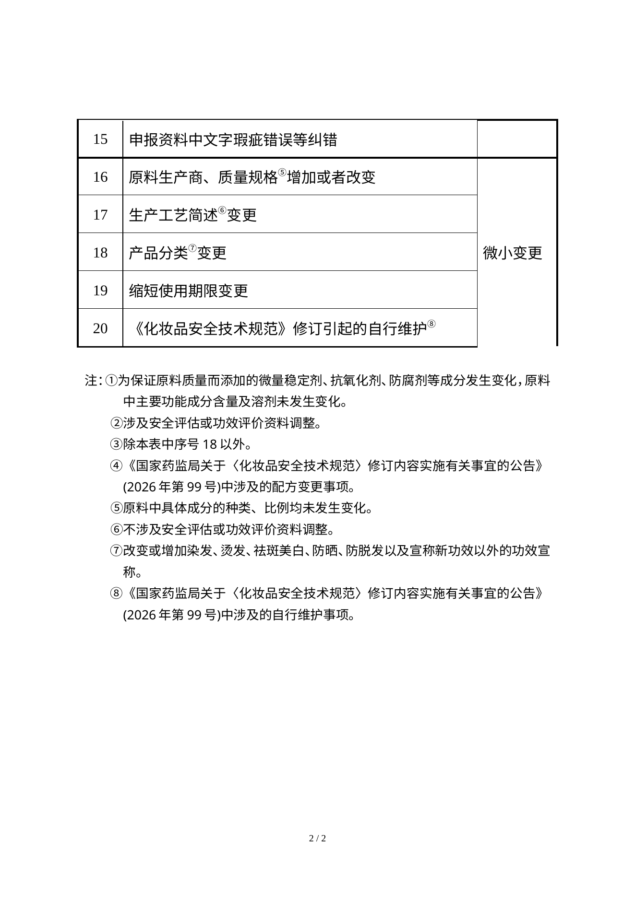
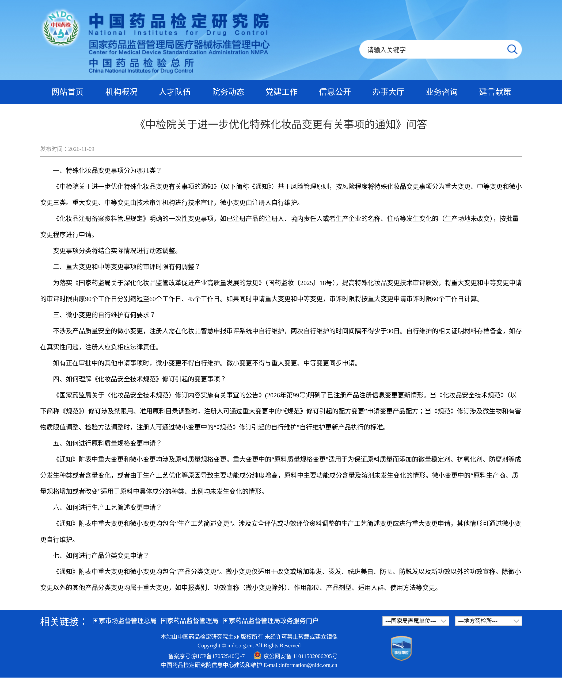

在中国做防晒、染发、烫发、祛斑美白、防脱发或新功效这些**特殊化妆品注册**的品牌注意：中国药品检定研究院（中检院）**2026年11月9日**发布 [关于进一步优化特殊化妆品变更有关事项的通知](https://www.nidc.org.cn/bshff/hzhpjssp/hzpsptzgg/202611091043412278418.html)，并挂了附件《特殊化妆品变更事项分类表》和配套 [问答](https://www.nidc.org.cn/bshff/hzhpjssp/hzhpspcjwtjd/hzhpwtjdjssp/202611091043412278419.html)。**自 2026年11月20日起受理的**特殊化妆品变更申请，按这份通知执行。

**先说清楚：这不是再征求意见，是已经落地的办事规则；管的是已经拿到特殊化妆品注册证之后怎么改信息，不是普通化妆品备案。** 11月20日前已经受理的申请，通知没有写要回溯。

## 改了什么

为落实国家药监局《关于深化化妆品监管改革促进产业高质量发展的意见》（国药监妆〔2025〕18号），中检院按风险把变更分成三类，分类以后还会结合实际情况动态调整。

### 1. 重大变更：审评从 90 个工作日压到 60 个工作日

分类表序号 1–9，主要包括：

- 原料质量规格变更：为保证原料质量而添加的微量稳定剂、抗氧化剂、防腐剂等成分变化，且主要功能成分含量和溶剂没变；问答还写明，工艺优化导致主要功能成分纯度增高、含量和溶剂未变的，也走这一条
- 生产工艺简述变更（涉及安全评估或功效评价资料调整）
- 产品分类变更（除下面说的微小情形以外：申报类别、特殊功效宣称、作用部位、剂型、适用人群、使用方法等）
- 延长使用期限
- 产品安全评估资料变更
- 使用方法变更
- 安全警示用语变更
- 《化妆品安全技术规范》修订引起的配方变更（规范调整禁限用、准用原料目录时）
- 其他重大事项

### 2. 中等变更：审评从 90 个工作日压到 45 个工作日

分类表序号 10–15：

- 规范原料名称、改配方备注、明确复配原料中的功效成分、规范推进剂填报
- **生产场地改变或增加**
- 微生物和理化指标及质量控制措施变更
- 贮存条件变更
- **产品标签样稿（含产品名称）变更**
- 申报资料文字瑕疵纠错

### 3. 微小变更：注册人自行维护，不用再走审评

分类表序号 16–20：

- 原料生产商、质量规格增加或改变（原料里具体成分的种类、比例都没变）
- 生产工艺简述变更（不涉及安评或功效评价资料调整）
- 产品分类变更（只改或增加染发、烫发、祛斑美白、防晒、防脱发以及新功效**以外**的功效宣称）
- 缩短使用期限
- 《化妆品安全技术规范》修订引起的自行维护（规范调整微生物/有害物质限值或检验方法时，自行维护产品执行的标准）

自行维护的规矩（通知 + 问答）：

- 在化妆品智慧申报审评系统里自己改
- 两次自行维护的间隔不得少于 30 日（通知写的是每 30 日可自行维护一次）
- 有正在审批中的其他申请时，不能自行维护
- 微小变更不得与重大、中等变更同步申请
- 必须不涉及产品质量安全，证明材料存档备查；真实性出问题要担责

## 申请时还要注意

1. 重大和中等可以单独申请，也可以一并申请；如果同时申请，审评时限按重大变更的 **60 个工作日**算。
2. 已经申请的变更审批完成之后，才能再申请新的变更。
3. 选错分类由注册人负责：必须保证变更内容和所选分类相符，并对资料真实性、准确性、完整性、合法性和可追溯性负责。
4. 注册人、境内责任人或生产企业只是改名称、住所，生产场地没变的，仍按《化妆品注册备案资料管理规定》里的批量变更程序走，不按这张三类表。

## 影响谁

- 在中国持有特殊化妆品注册证的注册人（防晒、染发、烫发、祛斑美白、防脱发、新功效）
- 境外品牌的境内责任人
- 帮注册人改配方、换场地、改标签、做安评的工厂、实验室和咨询机构

只做普通化妆品备案，或只做跨境电商零售、不在国内拿特殊化妆品注册证的卖家：这条不改你的平台上架义务。

## 意味着什么、现在注意什么

1. **11月20日起再递变更，先对分类表。** 换生产场地、改标签或产品名称，都是中等变更，要审评，不是自己在系统里改一下就完事。
2. 同一事项可能因情形不同走不同通道：改工艺、改产品分类、改原料质量规格，都可能是重大或微小，对不上就容易被卡住。
3. 以后《化妆品安全技术规范》改禁限用目录，配方要走重大变更；只是限值或检验方法调整，可以自行维护执行标准。
4. 有在审事项时，别急着自行维护微小变更；也别同时塞一个微小变更和一个重大/中等变更。
5. 审评变快了，但“一次只能排一队”：上一件批完才能递下一件。既换场地又改配方的，要排期。

## 证据（核对日期 2026-11-09）

中检院化妆品审评通知公告列表置顶（2026-11-09）：

中检院官网通知页（2026-11-09，自 11月20 日起受理的申请按本通知施行）：

附件《特殊化妆品变更事项分类表》第 1 页（重大变更 1–9、中等变更 10–14）：

附件分类表第 2 页（中等变更 15、微小变更 16–20 及注释①–⑧）：

中检院官网配套问答页（2026-11-09，七问：分类、时限、自行维护、规范修订、原料规格、工艺简述、产品分类）：

## 来源

- 中检院 · [关于进一步优化特殊化妆品变更有关事项的通知](https://www.nidc.org.cn/bshff/hzhpjssp/hzpsptzgg/202611091043412278418.html)（2026-11-09）
- 同页附件：[特殊化妆品变更事项分类表.doc](https://www.nidc.org.cn/directory/web/nifdc/infoAttach/092652e7-2139-47a6-89dc-da6226016a8b.doc)
- 中检院 · [《中检院关于进一步优化特殊化妆品变更有关事项的通知》问答](https://www.nidc.org.cn/bshff/hzhpjssp/hzhpspcjwtjd/hzhpwtjdjssp/202611091043412278419.html)（2026-11-09）
- 站内对照：[中国合规](/compliance/cn/)、[中检院征求纳米铂/银与甲苯禁用及熊果苷限用](/news/2026-11-09-nidc-nano-pt-ag-toluene-arbutin-draft/)
