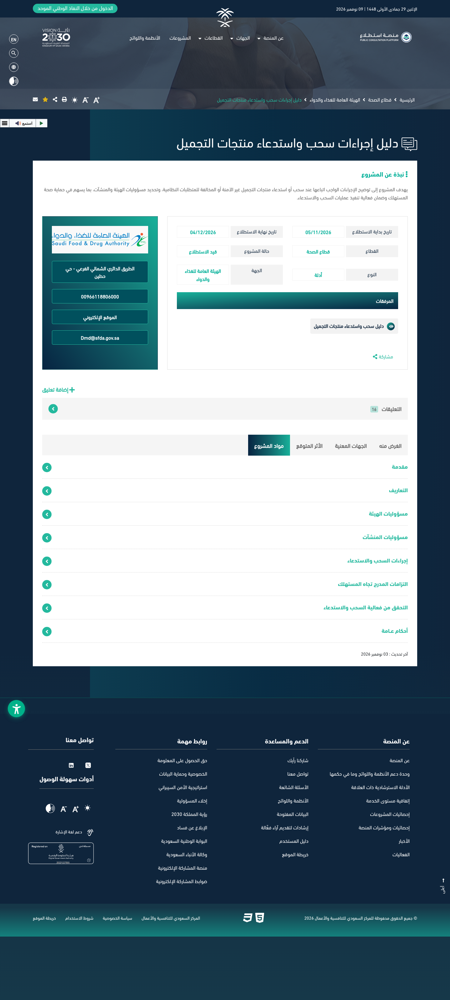
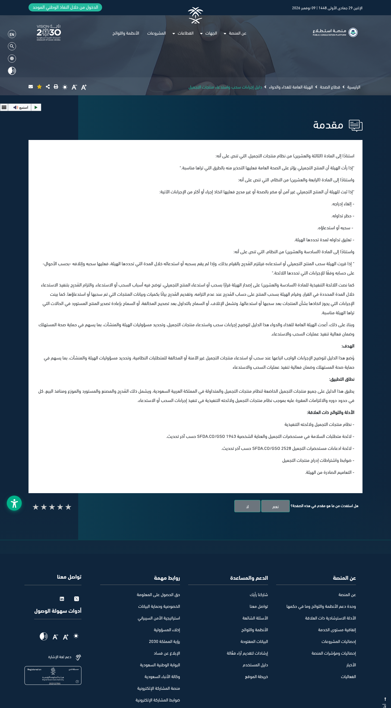
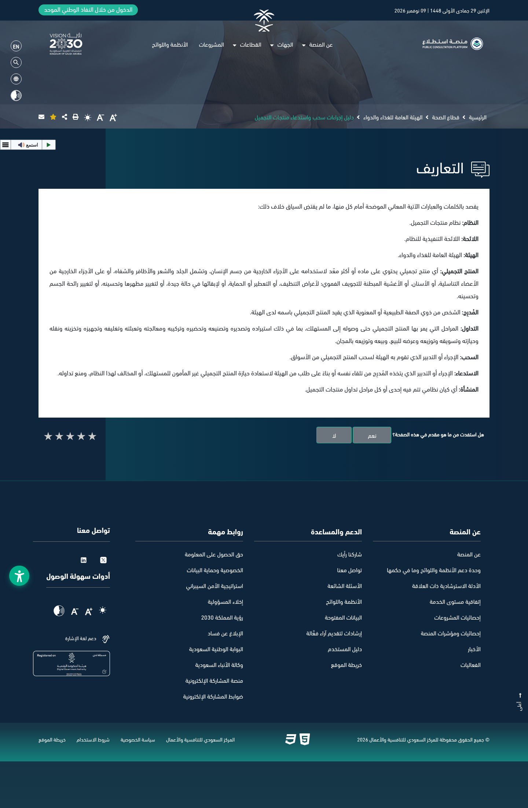
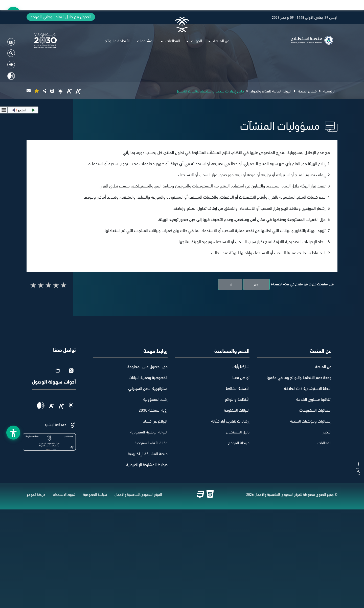
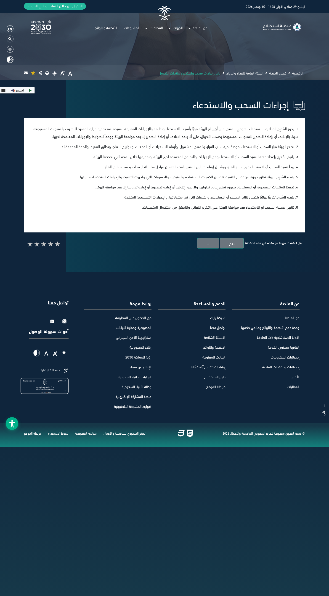
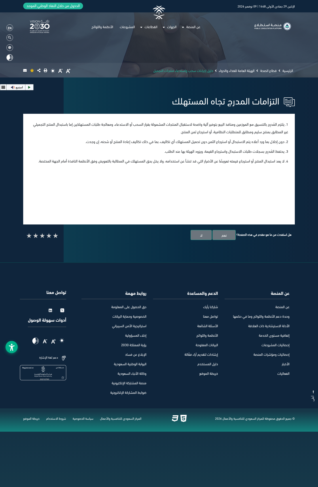
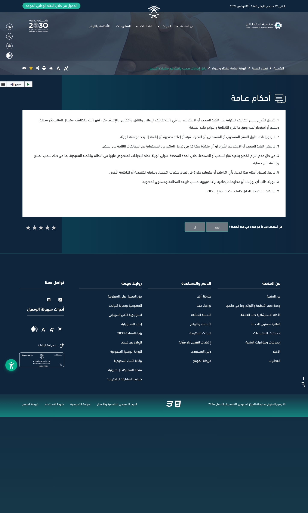

在沙特卖化妆品、或者把货交给当地公司做 SFDA 列名的品牌注意：沙特国家竞争力中心「意见征询」平台（Istitlaa）挂出了食品药品总局（SFDA）起草的 [《化妆品撤回与召回程序指南》](https://istitlaa.ncc.gov.sa/ar/health/sfda/CPWRPG)。官网项目卡写明：**征求意见从 2026年11月5日到 12月4日**，页脚最后更新是 **2026年11月3日**。

**先说清楚：现在还是征求意见稿，不是已经生效的正式指南。** 它是把《化妆品法》第 23、24、26 条和执行条例里已有的「下架、召回、销毁」权限，写成一套可操作的流程。定稿前，今天在售货不会因为这份草案本身立刻多出新罚则；但列名人（المُدرِج，即以自己名义在 SFDA 列名的人）如果真遇到召回，后面多半就按这个口径走。

## 改了什么（草案口径）

指南把两件事分开了：

- **撤回（السحب）**：由 SFDA 自己把产品从市场上拿下来
- **召回（الاستدعاء）**：由列名人主动发起，或应 SFDA 要求，把不安全或违规产品从消费者手里收回，并停止流通

适用范围写得很宽：所有受《化妆品法》约束、在沙特流通的化妆品，**列名人、制造商、进口商、经销商和销售网点**都按各自角色承担责任。

### 1. 境外一召回，也要立刻报 SFDA

草案要求流通链条上的企业，一旦知道下面任一情况，**立即通知 SFDA**：

- 产品造成了伤害
- 出现生产错误
- **该产品在任何国家被召回**
- 出现其他可能需要撤回或召回的信息

决定一经下达，要马上停止制造、进口、经销、陈列和销售；还要按批次/生产日期清点数量、通知下游、把收回来的货单独隔离存放，在 SFDA 发话之前不得自行处理。

对中国工厂和品牌来说：如果同一配方在中国、欧盟或美国先召回，沙特这边的列名人和进口商按草案也不能假装不知道，要同步报过去。

### 2. 消费者：换合格货，或退全款，运费不能让买家出

列名人要和经销商、网点一起，给消费者一个明确的回收入口，并处理两类请求：

- 换成符合法规的合格产品，或
- 退回货款

草案写明：**换货或退款不得让消费者承担任何费用，包括退货和运输费用**。换货或退款也不等于人身损害赔偿，消费者仍可按其他法律另行索赔。相关申请记录要留档，SFDA 随时可能要。

### 3. 钱谁出：广告、运输、仓储、销毁、换货退款都由列名人承担

一般条款写：列名人承担执行撤回/召回的**全部费用**，包括公告、运输、仓储、（如果决定销毁的）销毁，以及按规定换货或退款的费用。如果列名人没有在决定规定的期限内执行，SFDA 可以按法律和执行条例自己去撤回并销毁，**费用记在列名人头上**。

另外几条也很硬：

- 收回来的货，未经 SFDA 同意，不得再上市、不得自行销毁、不得再出口
- 列名人可以主动发起自愿召回，但必须立刻向 SFDA 说明原因、范围、拟采取的措施，以及打算销毁还是把进口货再出口；**销毁或再出口必须先得到 SFDA 批准**
- 要按官方程序和表格提交执行计划，并定期报告进度；SFDA 批准最终报告后，这次撤回/召回才算结束
- 执行了撤回/召回，并不免除列名人或链条上其他企业对违规行为的责任

法律依据在引言里写得很明白：产品影响公共健康时，SFDA 应公开警示（第 23 条）；产品不安全、有害健康或未列名时，可以取消列名、禁止流通、撤回或召回、或暂停流通（第 24 条）；列名人不按期执行的，由 SFDA 代为撤回并销毁、费用由其承担（第 26 条）。

## 影响谁

- 在沙特做 **SFDA 化妆品列名** 的本地公司（列名人）及其授权的中国品牌、工厂
- 往沙特出口化妆品的进口商、经销商和销售网点
- 同一款货同时在其他国家上市的品牌：境外召回会触发向 SFDA 申报
- 只通过跨境小包散卖、并未在沙特列名的卖家：本草案直接点名的是受《化妆品法》约束并在沙特流通的产品；未列名本身按第 24 条也可能被撤回或禁止流通，不能当成「没列名就没事」

## 意味着什么、现在注意什么

1. **别把草案当成已经生效**：12月4日前可在[意见征询页面](https://istitlaa.ncc.gov.sa/ar/health/sfda/CPWRPG)提交意见；定稿公布前，仍以现行《化妆品法》和执行条例为准。本站标了 needs_review，正式文本出来后再改合规页。
2. 已经在沙特列名的品牌：现在就可以把「境外召回 → 通知沙特列名人 → 报 SFDA」写进召回 SOP，并核对该不该留得下批次、销量和库存台账。
3. 合同里最好提前写清：一旦召回，公告、物流、仓储、销毁、对消费者换货退款这些费用怎么在品牌和列名人之间分摊。草案把法定义务放在列名人身上，商业上最后多半会转给品牌。
4. 不要自行把问题货销毁或运回国内：草案要求先得到 SFDA 批准。
5. 这和站内已写过的 [针管/安瓿包装限制](/news/2026-08-04-sfda-syringe-ampoule-packaging/) 不是同一件事——那条管包装形态，这条管出事后怎么下架和召回。

## 证据（核对日期 2026-11-09）

沙特国家竞争力中心「意见征询」平台项目页（标题为《化妆品撤回与召回程序指南》，征求意见 2026-11-05 至 2026-12-04，最后更新 2026-11-03）：

引言：依据《化妆品法》第23、24、26条，说明指南目的和适用范围（列名人、制造商、进口商、经销商、销售网点）：

定义：撤回由 SFDA 实施，召回由列名人主动或应 SFDA 要求实施：

企业责任：须立即申报伤害、生产错误或在任何国家发生的召回，并停止产销、清点隔离：

撤回与召回程序：自愿召回须先报备，销毁或再出口须经 SFDA 批准：

对消费者义务：换合格产品或退款，不得让消费者承担退货或运输费用：

一般条款：全部费用由列名人承担；逾期不执行的，SFDA 可代为撤回并销毁、费用由其承担：

## 来源

- 沙特国家竞争力中心「意见征询」平台（Istitlaa）· 食品药品总局 SFDA · [دليل إجراءات سحب واستدعاء منتجات التجميل](https://istitlaa.ncc.gov.sa/ar/health/sfda/CPWRPG)（征求意见 05/11/2026–04/12/2026，最后更新 03 نوفمبر 2026）
- 站内对照：[沙特合规](/compliance/sa/)
