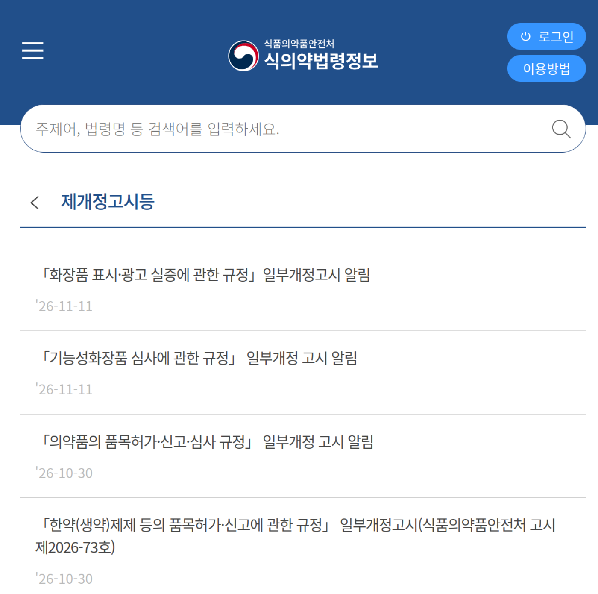
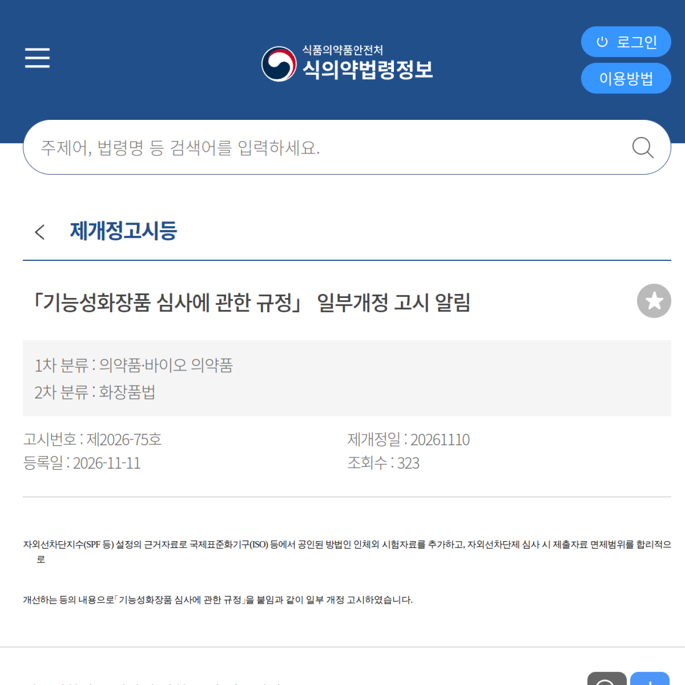
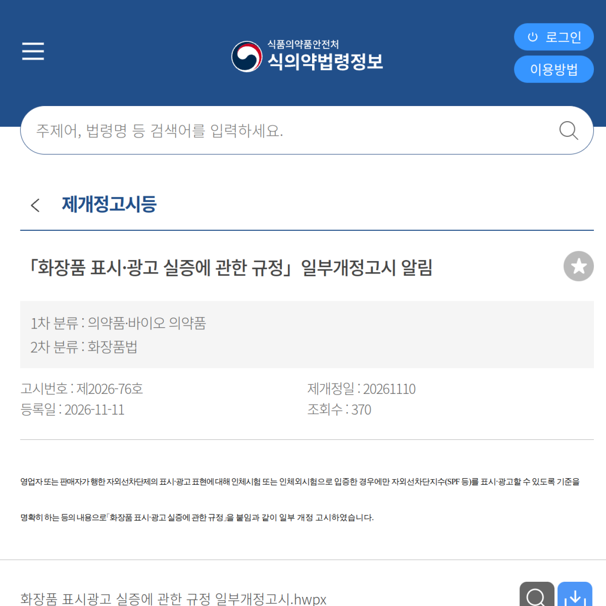
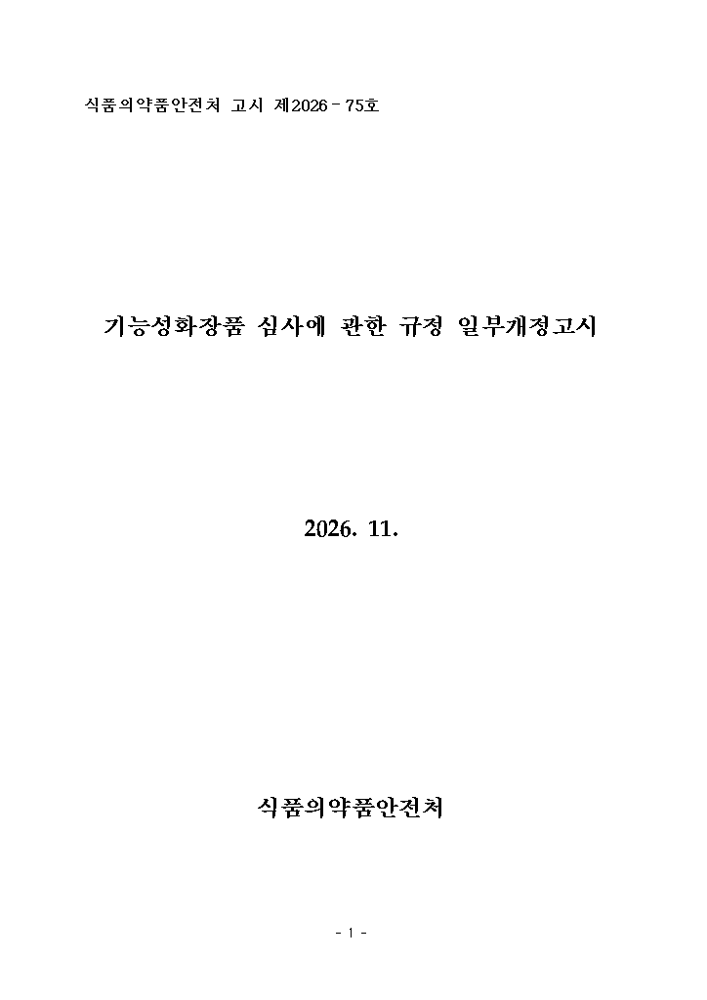
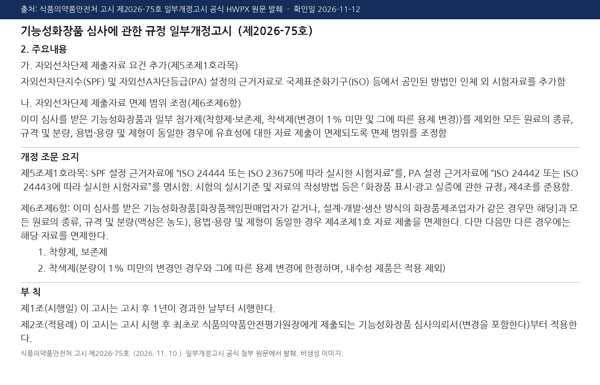
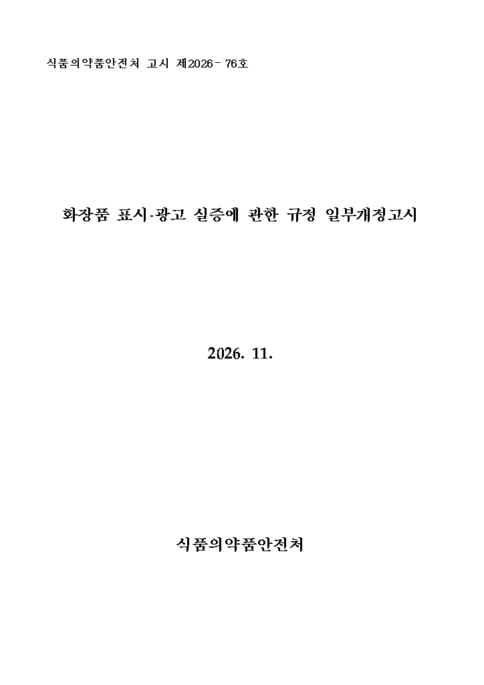
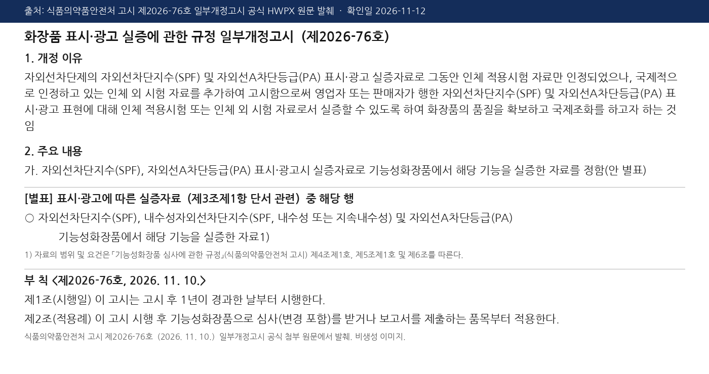

在韩国卖防晒、或者要在详情页和广告里写 SPF、PA 的品牌注意：韩国食品医药品安全处（食药处）**2026年11月10日**公布了两份已经定稿的高示，**11月11日**挂到官网「제개정고시등」栏目：

- [제2026-75호《功能性化妆品审查规定》一部改正](https://www.mfds.go.kr/law/board/boardDetail.do?brdId=data0008&menuKey=28&seq=15204)
- [제2026-76호《化妆品表示·广告实证规定》一部改正](https://www.mfds.go.kr/law/board/boardDetail.do?brdId=data0008&menuKey=28&seq=15205)

我们于 **2026年11月12日** 打开了食药处官网详情页，并下载核对了官方附件 HWPX 里的修订理由、条文和부칙。

**先说清楚：这两份不是征求意见稿，已经正式公布；但也不是今天就生效。** 부칙都写着「고시 후 1년이 경과한 날부터 시행」——고시日是 2026年11月10日，也就是 **2027年11月10日** 起施行。不要和站内已写过的[《化妆品表示·广告管理指针》修订草案](/news/2026-11-08-korea-cosmetic-labeling-ad-guideline-draft-nov9/)混在一起：那份指针征求意见已在 11月9日截止，目前仍未见定稿。

## 改了什么

### 1. 防晒 SPF、PA 的审查资料：可以交 ISO 等人体外试验

第2026-75号把防晒指数（**SPF**）和紫外线 A 阻断等级（**PA**）的设定依据，**增加了国际标准化组织（ISO）等公认方法的人体外试验资料**。附件对照表写得很具体：SPF 可按 **ISO 24444**，也可以按 **ISO 23675**；PA 可按 **ISO 24442**，也可以按 **ISO 24443**。试验怎么做、报告怎么写，还要参照《化妆品表示·广告实证规定》第4条。

### 2. “换个香精就能沿用旧审查资料”的口子收窄了

同一份高示调整了防晒产品提交有效性资料的免除范围。新条文的原则是：已经通过审查的功能性化妆品，必须是**同一责任销售业者，或同一家按设计-开发-生产方式制造的工厂**，而且**全部原料的种类、规格和分量（液剂看浓度）、用法用量和剂型都相同**，才能免交这部分资料。

只有这些改动还可以免：

- 香精、防腐剂
- 着色剂及其对应溶剂：分量变动要**不到 1%**；**耐水产品不适用**这条着色剂例外

以前非耐水产品往往只需「起功效的那些原料」相同就能免，现在是整瓶配方都要对齐，只留下香精、防腐剂和很小的着色剂空间。只改个味道、加一点色素还可能走免除；配方动得多，就要重新交有效性资料。可以写成「适量」的原料范围，也随免除范围一并写清楚了。

### 3. 广告里写 SPF、PA：要用功能性化妆品的相应实证资料

第2026-76号的修订理由写明：以前防晒 SPF、PA 的表示·广告实证，**只认人体适用试验资料**；这次把国际上已经承认的人体外试验资料也加进去，好跟国际做法对齐。改正后的附件把 SPF、耐水性 SPF 和 PA 的实证资料，定为「在功能性化妆品中就该功能做过实证的资料」，并且要符合《功能性化妆品审查规定》第4、5、6条的范围和要件——也就是上面那套、已经包含人体外 ISO 路径的规则。

不是随便拿一份体外测试报告，就能在详情页上写 SPF50+。

## 影响谁

- 在 Coupang、韩国独立站、TikTok / Instagram / YouTube 面向韩国消费者卖防晒，或要宣传 SPF/PA 的美妆品牌和责任销售业者
- 要向韩国食品医药品安全评价院提交功能性化妆品审查（含变更）的工厂、进口商
- 做 SPF、PA 检测的实验室：人体外 ISO 方法进入正式认可范围
- 只在中国或其他市场卖、完全不进入韩国审查和韩国广告的店：本条不直接管你

## 意味着什么、现在注意什么

1. **还有大约一年准备期，不是明天就违规。** 两份高示都是 **2027年11月10日** 起施行。第2026-75号부칙还写：施行后**首次**向食品医药品安全评价院长提交的功能性化妆品审查申请书（含变更）才适用。第2026-76号부칙写：施行后作为功能性化妆品接受审查（含变更）或提交报告的品目才适用。已经在售、又不走新审查或报告的，不要理解成公布当天所有广告立刻作废；但 2027 年要送审、变更或交报告的防晒，现在就该按新口径准备。
2. **可以开始评估人体外 ISO 路径。** 如果人体试验周期长、成本高，先问实验室能否按 ISO 23675（SPF）、ISO 24443（PA）出具符合食药处要求的资料，把时间和预算算清楚。
3. **别再想当然地「只改香精就沿用旧批件」。** 先对照新的免除范围，看责任销售业者或工厂是不是同一家，整瓶配方是不是只动了香精、防腐剂或不到 1% 的着色剂；耐水产品更要小心。
4. **详情页和广告上的 SPF、PA，要和审查资料对得上。** 数字、耐水性、PA 等级，都要有功能性化妆品相应功能的实证资料，不要只写宣称。
5. **不要和广告指针修订草案混为一谈。** 指针修订案仍未见定稿；这次落地的是审查规定和广告实证规定两份高示。[AI 假专家带货禁令](/news/2026-11-01-korea-ai-fake-expert-cosmetic-ads-ban/)仍按 11月27日施行那条执行，和本条不是一件事。

## 证据（核对日期 2026-11-12）

食药处官网法令信息「제개정고시등」列表将两份高示均登记在 **2026-11-11**：

<small>来源：韩国食药处法令信息「제개정고시등」列表页，核对日期 2026-11-12。</small>

제2026-75호详情页：고시번호第2026-75号，제개정일 2026-11-10，등록일 2026-11-11；摘要写明将 ISO 等公认方法的人体外试验资料增列为 SPF 等设定依据，并调整防晒审查资料免除范围：

<small>来源：韩国食药处法令信息详情页 seq=15204，核对日期 2026-11-12。</small>

제2026-76호详情页：고시번호第2026-76号，제개정일 2026-11-10，등록일 2026-11-11；摘要写明防晒表示·广告须以人体试验或人体外试验证实后，才可标示、广告 SPF 等：

<small>来源：韩国食药处法令信息详情页 seq=15205，核对日期 2026-11-12。</small>

第2026-75号官方一部改正고시封面（고시日 2026. 11.）：

<small>来源：食药处官网官方附件「기능성화장품 심사에 관한 규정 일부개정고시.hwpx」首页，核对日期 2026-11-12。</small>

第2026-75号官方附件摘录：修订要点、第5条 ISO 试验方法、第6条免除范围，以及부칙「고시 후 1년이 경과한 날부터 시행」（摘自官方 HWPX 原文，非扫描件）：

<small>来源：同上官方 HWPX 修订理由、对照条文与부칙，核对日期 2026-11-12。</small>

第2026-76号官方一部改正고시封面：

<small>来源：食药处官网官方附件「화장품 표시광고 실증에 관한 규정 일부개정고시.hwpx」首页，核对日期 2026-11-12。</small>

第2026-76号官方附件摘录：修订理由写明以往只认人体试验、本次增加人体外试验；별표将 SPF/PA 实证资料定为功能性化妆品相应功能实证资料；부칙同样自고시满一年后施行（摘自官方 HWPX 原文，非扫描件）：

<small>来源：同上官方 HWPX 修订理由、별표与부칙，核对日期 2026-11-12。</small>

## 来源

- 韩国食药处法令信息 · [「제개정고시등」列表](https://www.mfds.go.kr/law/board/list.do?brdId=data0008&menuKey=28)（两份高示登记日 2026-11-11）
- 韩国食药处 · [제2026-75호「功能性化妆品审查规定」一部改正](https://www.mfds.go.kr/law/board/boardDetail.do?brdId=data0008&menuKey=28&seq=15204)（제개정일 2026-11-10）及官方附件 HWPX（一部改正고시、전문）
- 韩国食药处 · [제2026-76호「化妆品表示·广告实证规定」一部改正](https://www.mfds.go.kr/law/board/boardDetail.do?brdId=data0008&menuKey=28&seq=15205)（제개정일 2026-11-10）及官方附件 HWPX（一部改正고시、전문）
- 站内对照：[韩国化妆品标示广告指针修订案征求意见至11月9日](/news/2026-11-08-korea-cosmetic-labeling-ad-guideline-draft-nov9/)、[韩国 11 月 27 日起禁止 AI 假专家给化妆品带货](/news/2026-11-01-korea-ai-fake-expert-cosmetic-ads-ban/)、[韩国合规](/compliance/kr/)
