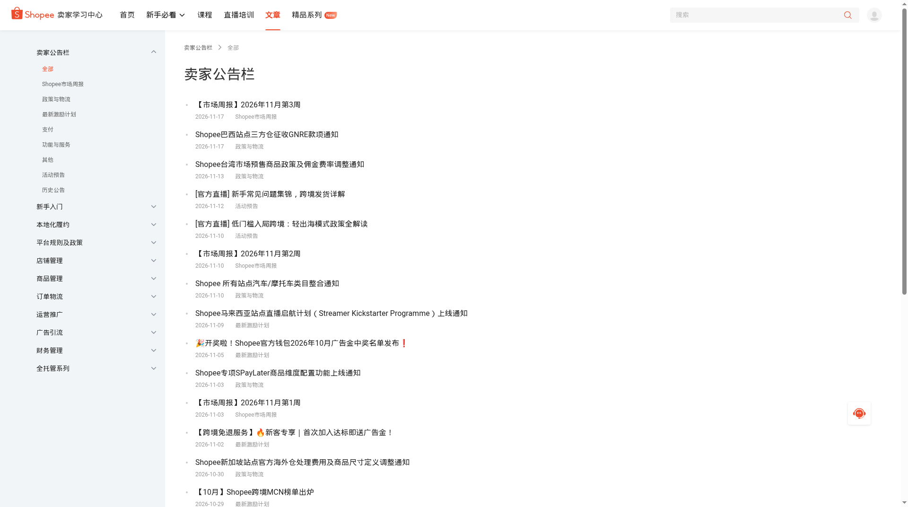
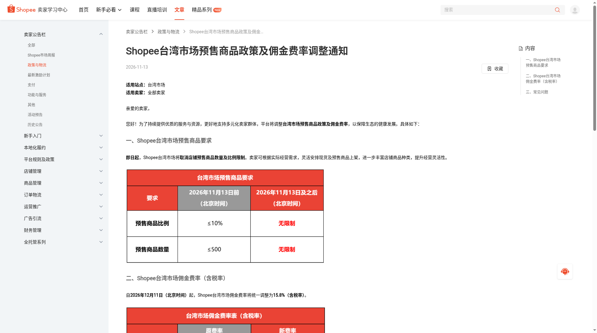
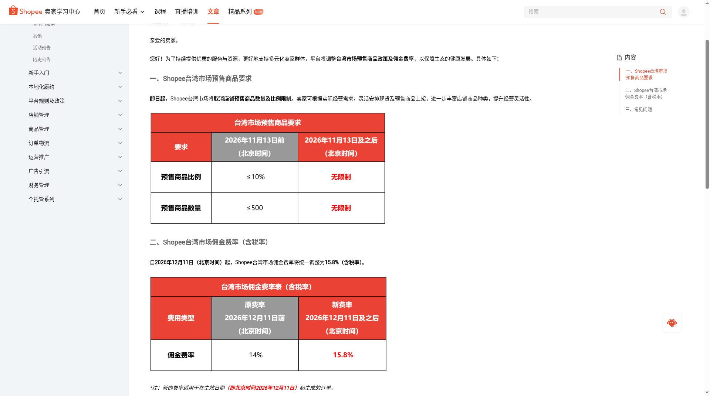
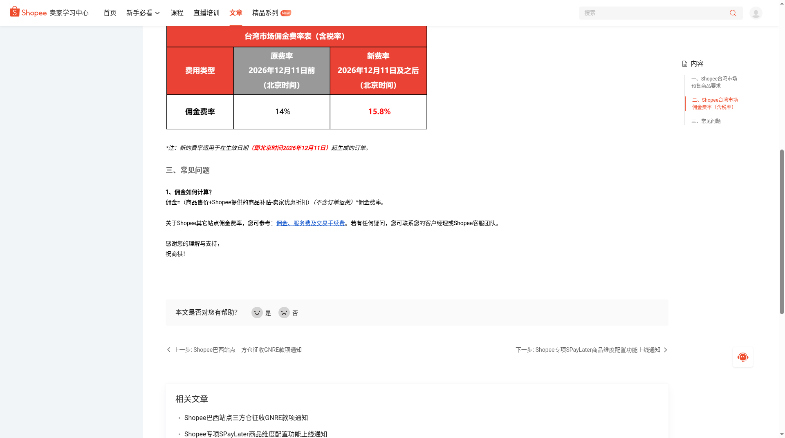

Shopee 卖家学习中心 2026年11月13日发布《[Shopee台湾市场预售商品政策及佣金费率调整通知](https://shopee.cn/edu/article/28807)》，适用站点是**台湾市场**，适用卖家写的是**全部卖家**。两件事一起改：预售门槛已经放开，佣金要等到 12 月才涨。

## 改了什么

**预售（已生效）：** 北京时间 **2026年11月13日**起，取消店铺预售商品的数量和比例限制。此前是预售占比 **≤10%**、预售件数 **≤500**；现在这两项都是「无限制」。卖家可以按自己的备货节奏搭配现货和预售，不再被这条线卡住。

**佣金（还未切）：** 北京时间 **2026年12月11日**起，台湾市场佣金费率（含税率）由 **14%** 统一调整为 **15.8%**。官方脚注写得很清楚：新费率只适用于**生效当天及之后生成的订单**，不按发货日切。12月10日及之前已经生成的单，不会因为后来才发出去就改按 15.8% 重算。

佣金怎么算，公告也给了公式：

> 佣金 =（商品售价 + Shopee 提供的商品补贴 − 卖家优惠折扣）（不含订单运费）× 佣金费率

也就是说：平台给的商品补贴要进基数，卖家自己让的价可以从基数里扣掉，订单运费不参与抽佣。这次公告只动了佣金这一档，没有改交易手续费。学习中心费用总表（2026-09-22 更新）里，台湾市场跨境直邮的交易手续费仍是 **2.5%**、预售商品服务费仍是 **3%**，与「12-11 前佣金仍是 14%」的口径一致；12-11 之后请再对一次卖家中心费用页和实际账单。

## 影响谁

- **做台湾市场的美妆、个护、香水卖家**（含中国跨境直邮店）：每单佣金多 **1.8 个百分点**。客单价越低、原本毛利越薄，越要提前重算。
- **以前被预售占比或 500 件上限卡住的店**：11-13 起可以按需加预售款，补货周期长的色号、季节款不必再先堆一批发货库存。但这不是免费午餐——公告没说取消预售订单服务费。
- **12-11 前已经下出去、还没发货的单**：仍按 14% 计佣金，不用赶着提前发货来「躲涨价」。

## 意味着什么、现在该做什么

1. **先按 15.8% 倒推 12 月的保本价。** 售价 1,000 元新台币、没有卖家折扣也没有平台商品补贴的单，佣金从 140 元变成 158 元，多交 18 元；若平台还补了 100 元商品补贴，基数是 1,100 元，12-11 起佣金约 174 元。低价面膜、唇釉这类薄利款，可能要微调售价或先拿掉不划算的活动。
2. **预售放开不等于成本下降。** 可以多挂预售，但要把履约天数和现有预售服务费一起算进去，别为了冲 SKU 把发货拖垮、取消单和差评涨上去。
3. **11-13 到 12-10 是窗口期：** 预售限制已经取消，佣金却还是 14%。想测长尾款、预售款，趁这段用旧费率看账单，12-11 后再决定哪些留下。
4. **这次改的是平台费用，不改化妆品本身的合规要求**（成分、标签、通报等仍按原规则），见 [台湾合规](/compliance/tw/)。

## 证据（核对日期 2026-11-22）

Shopee 卖家学习中心「卖家公告栏」列出该通知，日期 **2026-11-13**，分类为政策与物流：

通知正文抬头：适用站点为台湾市场、适用卖家为全部卖家；即日起取消预售商品数量及比例限制（此前占比 ≤10%、数量 ≤500）：

佣金费率表写明：北京时间 2026年12月11日前为 14%，12月11日及之后为 15.8%（含税率）；脚注说明新费率适用于生效日起生成的订单：

文末常见问题给出佣金计算公式（售价加平台商品补贴、减去卖家折扣，不含订单运费）：

## 来源

- Shopee 卖家学习中心 · [Shopee台湾市场预售商品政策及佣金费率调整通知](https://shopee.cn/edu/article/28807)（页面显示发布于 2026-11-13；2026-11-22 打开核对）
- 现行费用说明（12-11 前仍列佣金 14%）见同中心 [佣金、服务费及交易手续费](https://shopee.cn/edu/article/25770)
