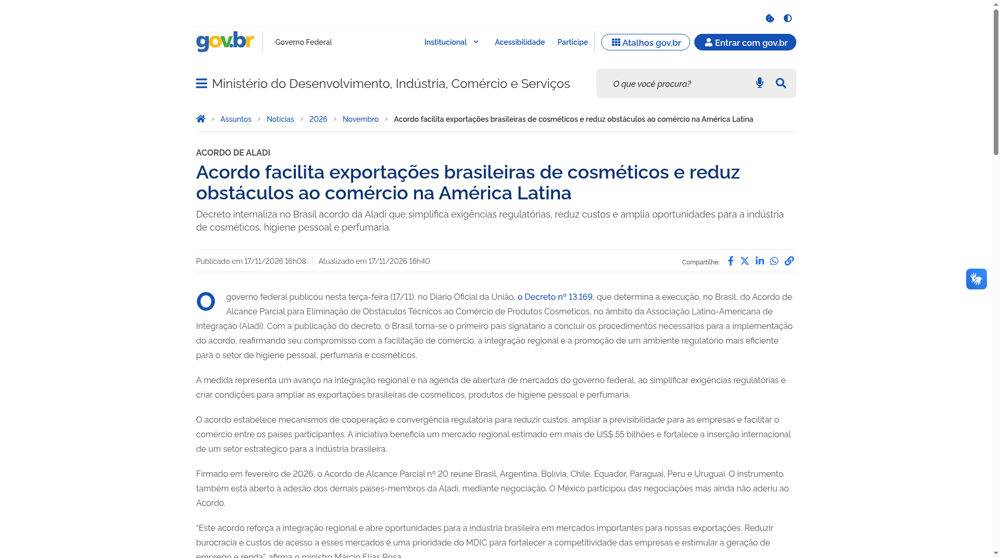
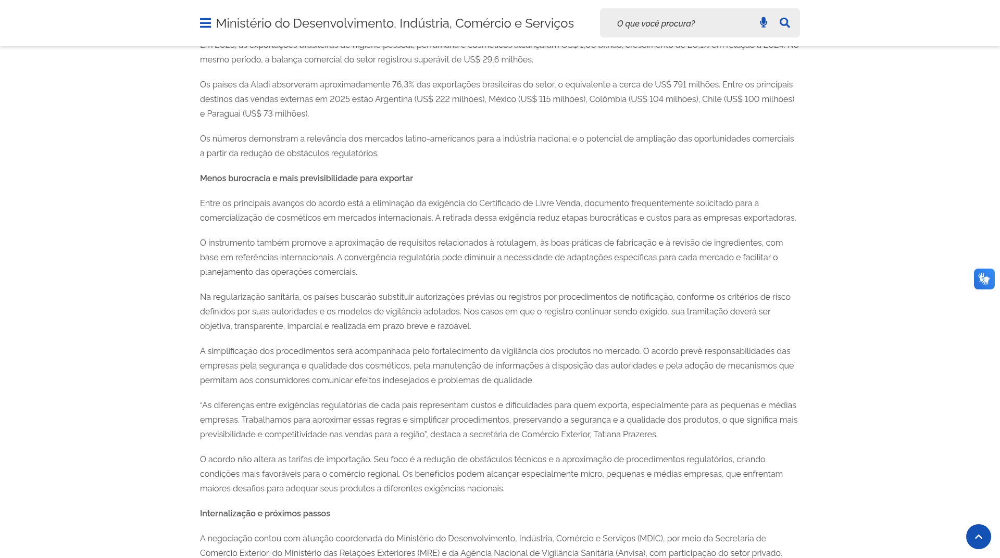
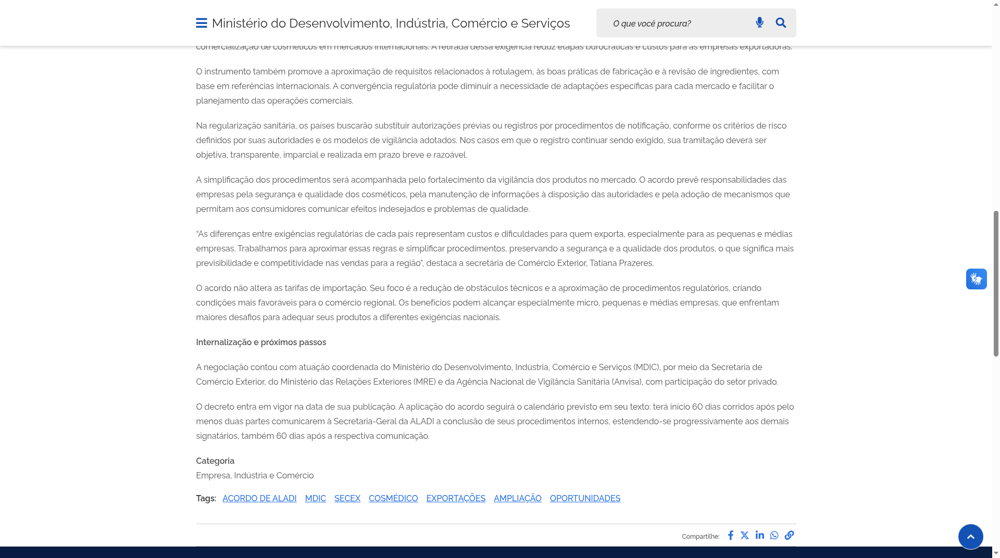

在巴西卖化妆品、或者想把巴西当作拉美中转枢纽的品牌注意：巴西发展、工业、贸易和服务业部（MDIC）在 [11月17日的官方新闻](https://www.gov.br/mdic/pt-br/assuntos/noticias/2026/novembro/acordo-facilita-exportacoes-brasileiras-de-cosmeticos-e-reduz-obstaculos-ao-comercio-na-america-latina) 里写明，当天《联邦公报》（Diário Oficial da União）公布了 **第13.169号法令**，在巴西执行拉美一体化协会（ALADI）《消除化妆品技术性贸易壁垒部分范围协定》（第20号协定）。

**先说清楚：这不是今天起就可以跳过巴西现行 ANVISA 程序。** 法令把这份协定纳入了国内法，巴西也成了第一个走完国内程序的签署国；但协定要真正用起来，还得再有一个签署国向 ALADI 总秘书处完成通知，满 60 个自然日之后，才在已经完成程序的国家之间适用。

## 改了什么

根据 MDIC 官方新闻（发布于 2026年11月17日 16:08，更新于 16:40）：

- 第13.169号法令于 **11月17日** 在《联邦公报》公布，在巴西执行上述第20号协定。MDIC 写明：**法令自公布之日起生效**。
- 巴西是第一个完成实施该协定所需国内程序的签署国。
- 协定于 **2026年2月** 签署（官方新闻只写到月份，没有写到具体哪一天），签署方是巴西、阿根廷、玻利维亚、智利、厄瓜多尔、巴拉圭、秘鲁和乌拉圭。其他 ALADI 成员国经谈判可以加入。墨西哥参加了谈判，但还没有加入。
- 协定本身的适用时间表是：至少两个缔约方把国内程序完成情况通知 ALADI 总秘书处后，再过 **60 个自然日** 才开始适用；之后每多一个签署国完成通知，也是满 60 日再对该国适用。
- 按 MDIC 的说明，协定落地后的主要安排包括：
  - **取消自由销售证明**（Certificado de Livre Venda，常称 CFS）这一常见跨境文件要求；
  - 标签、良好生产规范（GMP）和成分审查向国际参考靠拢；
  - 在卫生注册上，各国将按本国当局划定的风险，寻求用**通报**替代部分事前许可或注册；如果仍要注册，办理应当客观、透明、公正，并在合理短的期限内完成；
  - **不改变进口关税**，重点是减少技术性壁垒、让规则更接近。

MDIC 新闻把法令链到了《联邦公报》上的 [第13.169号法令（2026年11月16日）](https://www.in.gov.br/web/dou/-/decreto-n-13.169-de-16-de-novembro-de-2026-744722285) 页面。本轮核验时该公报页无法打开，文中条款以我们已经打开并截图的 MDIC 官方新闻为准。

## 影响谁

- 已经在巴西做、或准备进入巴西的化妆品品牌、代工厂、进口商，以及持有 ANVISA 经营许可、负责产品通报或注册的本地公司
- 打算把巴西当作拉美区域枢纽、再分到其他签署国的企业
- 只在其他市场销售、不进入巴西和这些签署国的卖家：这条不改你现在的上架义务

## 意味着什么 / 现在注意什么

- **今天该办的手续一件都不能少。** 本地公司仍要持有 ANVISA 经营许可（AFE）和地方卫生许可，产品仍要按 1/2 级做通报或注册，标签仍要葡萄牙语。详情见站内 [巴西合规](/compliance/br/)。
- 真正的价值在后面：如果协定按 MDIC 所说的时间表适用，拉美签署国之间有望少交一份 CFS，标签、生产和成分规则也可能更接近，想把巴西当区域枢纽的品牌，要盯的是**第二个签署国有没有向 ALADI 秘书处完成通知**。通知后再数 60 天。
- 「将寻求以通报替代部分注册」不等于巴西已经改掉现行分级通报/注册。在 ANVISA 正式改规则之前，仍按现在的办法办。
- 这不是关税优惠，不能按降税来算成本。
- 本站已在巴西合规页补了一句跟踪事项，并标了 needs_review；等协定实际适用或 ANVISA 另发执行细则时再改义务表。

## 证据（核对日期 2026-11-19）

MDIC 官方新闻页：标题、发布与更新日期（2026年11月17日 16:08 / 16:40），以及第13.169号法令在《联邦公报》公布、巴西率先完成国内程序、协定于2026年2月签署并列出签署国：

<small>来源：巴西发展、工业、贸易和服务业部（MDIC）官方新闻，核对日期 2026-11-19。</small>

同一篇新闻写明：取消自由销售证明，标签、良好生产规范和成分审查趋同，卫生注册将按风险寻求以通报替代部分事前许可或注册，且协定不改变进口关税：

<small>来源：巴西 MDIC 官方新闻「Menos burocracia e mais previsibilidade para exportar」一节，核对日期 2026-11-19。</small>

「Internalização e próximos passos」一节写明：法令自公布之日起生效；协定适用须至少两个缔约方通知 ALADI 总秘书处后满 60 个自然日：

<small>来源：巴西 MDIC 官方新闻「Internalização e próximos passos」一节，核对日期 2026-11-19。</small>

## 来源

- 巴西发展、工业、贸易和服务业部（MDIC）· [Acordo facilita exportações brasileiras de cosméticos e reduz obstáculos ao comércio na América Latina](https://www.gov.br/mdic/pt-br/assuntos/noticias/2026/novembro/acordo-facilita-exportacoes-brasileiras-de-cosmeticos-e-reduz-obstaculos-ao-comercio-na-america-latina)（发布于 17/11/2026 16h08，更新于 17/11/2026 16h40，2026-11-19 核对）
- 同新闻所链《联邦公报》· [Decreto nº 13.169, de 16 de novembro de 2026](https://www.in.gov.br/web/dou/-/decreto-n-13.169-de-16-de-novembro-de-2026-744722285)（本轮核验时页面未能打开，未作为正文依据）
- 站内对照：[巴西合规](/compliance/br/)、[美客多热销榜](/rankings/mercado-livre/)
