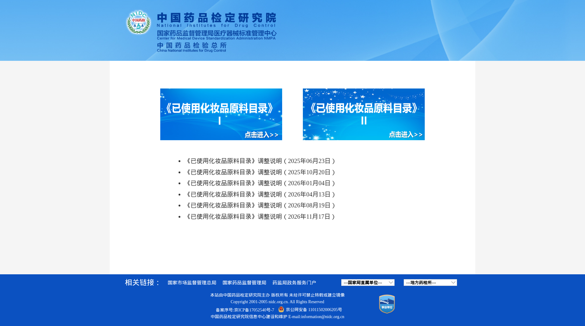
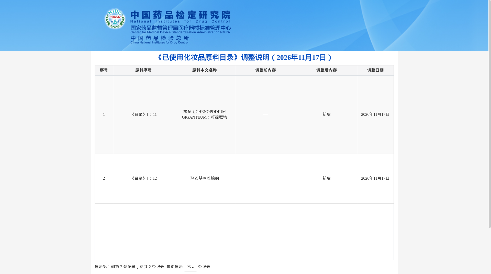
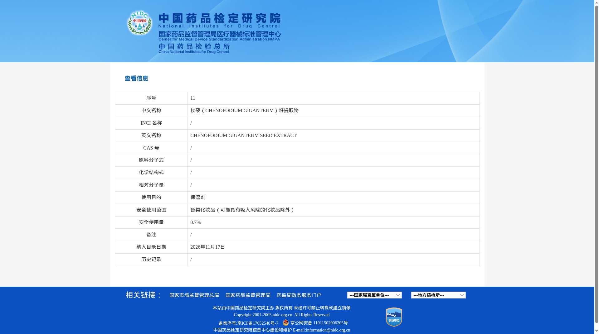
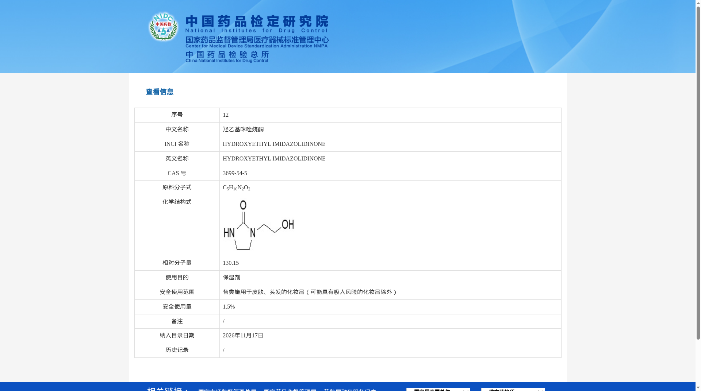

在中国做化妆品备案或注册的品牌注意：国家药监局对《已使用化妆品原料目录》做了**第六次动态调整**。官方没有另发带文号的公告，而是在中检院维护的 [目录查询页](https://hzpsys.nidc.org.cn/hzpGS/ysyhzpylml) 挂出 [《已使用化妆品原料目录》调整说明（2026年11月17日）](https://hzpsys.nidc.org.cn/hzpGS/ysyhzpylmlnewh?tm=2026%E5%B9%B411%E6%9C%8817%E6%97%A5)，并把两个监测期满的新原料写入《目录》Ⅱ。

**一句话：这两个保湿成分已经转正，其他企业可以按已使用原料来用；但不是随便加，用量、剂型都写死了。**

## 改了什么

两个原属化妆品新原料、安全监测期已满 3 年并经评估符合规定的成分，于 **2026年11月17日** 新增进入《目录》Ⅱ（调整前为「—」，调整后为「新增」）：

1. **羟乙基咪唑烷酮**（《目录》Ⅱ 序号 12）  
   - INCI / 英文名称：HYDROXYETHYL IMIDAZOLIDINONE  
   - CAS：3699-54-5  
   - 使用目的：保湿剂  
   - 使用范围：各类施用于皮肤、头发的化妆品（可能具有吸入风险的化妆品除外）  
   - 安全使用量：**1.5%**

2. **杖藜（CHENOPODIUM GIGANTEUM）籽提取物**（《目录》Ⅱ 序号 11）  
   - 英文名称：CHENOPODIUM GIGANTEUM SEED EXTRACT（官方未列 INCI 名称和 CAS 号）  
   - 使用目的：保湿剂  
   - 使用范围：各类化妆品（可能具有吸入风险的化妆品除外）  
   - 安全使用量：**0.7%**

纳入日期均以目录Ⅱ详情页为准：2026年11月17日。

## 影响谁

- 在中国做**普通化妆品备案**或**特殊化妆品注册**的品牌、配方师、代工厂、原料商  
- 以前不是该新原料注册人/备案人、想用却走不了或流程很重的企业：现在可以按已使用原料申报  
- 只在海外平台零售、不在中国备案/注册的卖家：这条不改你的境外上架义务

## 意味着什么 / 现在注意什么

- **转正不等于没有上限。** 配方、安全评估、备案/注册填报和标签，都要按《目录》Ⅱ写明的名称、使用目的、使用范围和安全使用量来做。超量，或者用在目录不允许的剂型上，申报会被卡住。
- **喷雾、气雾、散粉等可能有吸入风险的产品，这两个成分都不能用。** 羟乙基咪唑烷酮还限定在用于皮肤、头发的化妆品。
- 杖藜籽提取物官方没有给 INCI 名，配方表和全成分标注要以目录里的**中文名称和英文名称**为准，不要自行另起一个名字。
- 监测期满不会自动转正，要等评估通过并写入目录才算；写入之前仍按新原料管理。这次是目录更新，不是放宽禁限用清单。
- 目录调整现在以官方查询页和调整说明为准，不会再单独给你发一份带文号的公告。法规和配方团队要把这个查询页加入定期核对清单。

正在做或即将备案/注册、计划使用这两样原料的产品：先按上面的限量和对剂型要求改配方和安评，再提交。已经按新原料在用的，也要核名称、用量和剂型是否还在范围内，并更新原料安全信息。

## 证据（核对日期 2026-11-18）

中检院目录查询页列出「调整说明（2026年11月17日）」：

<small>来源：国家药监局已使用化妆品原料目录查询（中检院），核对日期 2026-11-18。</small>

调整说明表：两种原料新增至《目录》Ⅱ，调整日期 2026年11月17日：

<small>来源：中检院《已使用化妆品原料目录》调整说明（2026年11月17日），核对日期 2026-11-18。</small>

《目录》Ⅱ 杖藜籽提取物详情（保湿剂，安全使用量 0.7%，纳入日期 2026年11月17日）：

<small>来源：中检院《已使用化妆品原料目录》Ⅱ 详情页，核对日期 2026-11-18。</small>

《目录》Ⅱ 羟乙基咪唑烷酮详情（保湿剂，安全使用量 1.5%，CAS 3699-54-5，纳入日期 2026年11月17日）：

<small>来源：中检院《已使用化妆品原料目录》Ⅱ 详情页，核对日期 2026-11-18。</small>

## 来源

- 国家药监局已使用化妆品原料目录查询（中检院）· [目录查询页](https://hzpsys.nidc.org.cn/hzpGS/ysyhzpylml)（2026-11-18 核对，页上已挂 2026年11月17日调整说明）
- 同站 · [《已使用化妆品原料目录》调整说明（2026年11月17日）](https://hzpsys.nidc.org.cn/hzpGS/ysyhzpylmlnewh?tm=2026%E5%B9%B411%E6%9C%8817%E6%97%A5)
- 同站 · [《目录》Ⅱ 杖藜（CHENOPODIUM GIGANTEUM）籽提取物详情](https://hzpsys.nidc.org.cn/hzpGS/ysyhzpylmlbById?ylId=60772D5460C76E7CE063226510ACAFF6)
- 同站 · [《目录》Ⅱ 羟乙基咪唑烷酮详情](https://hzpsys.nidc.org.cn/hzpGS/ysyhzpylmlbById?ylId=60772D5460C96E7CE063226510ACAFF6)
- 站内对照：[中国合规](/compliance/cn/)
