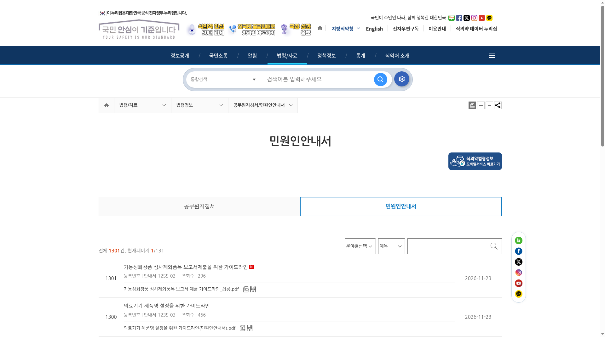
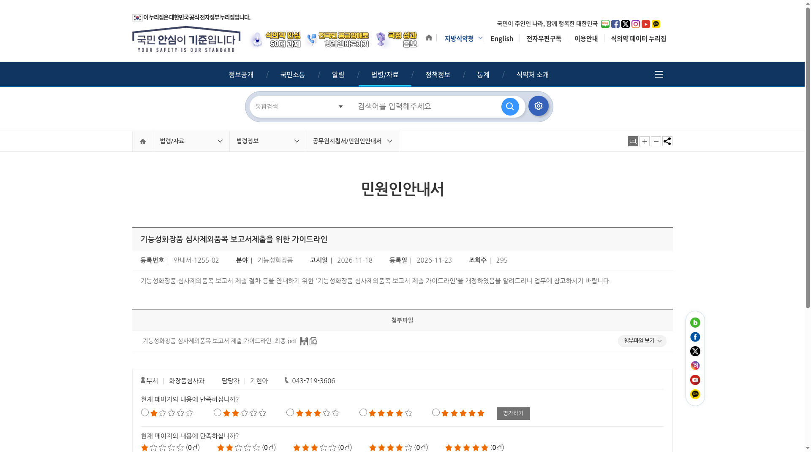
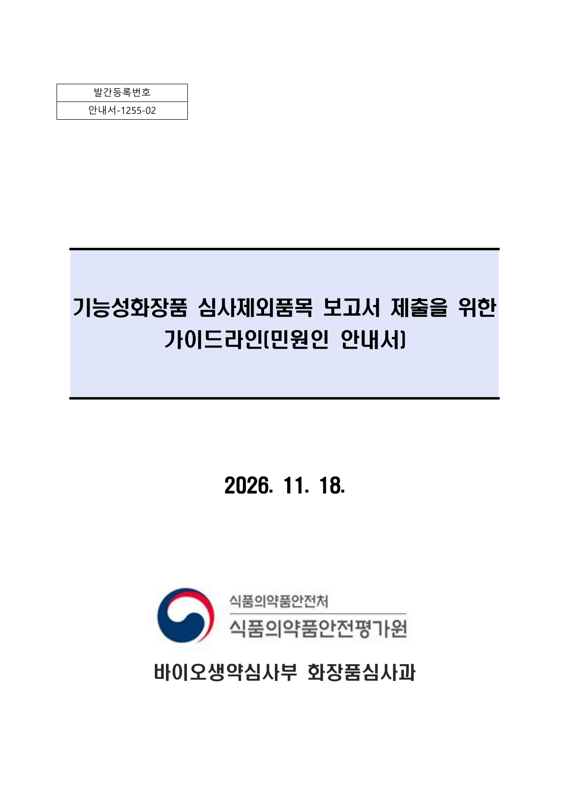
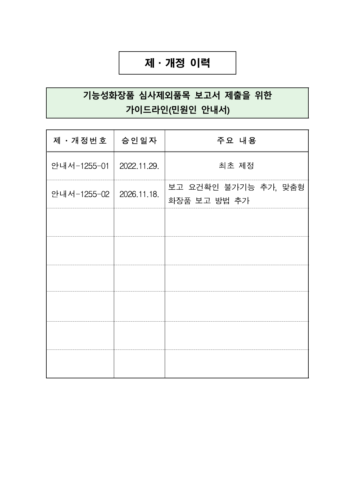
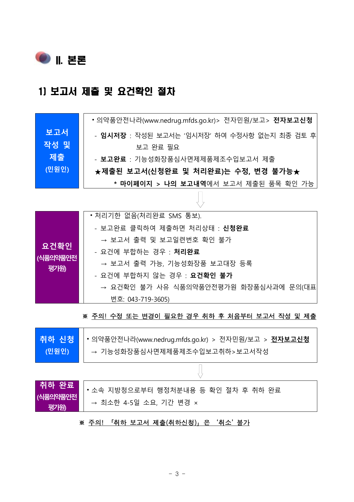
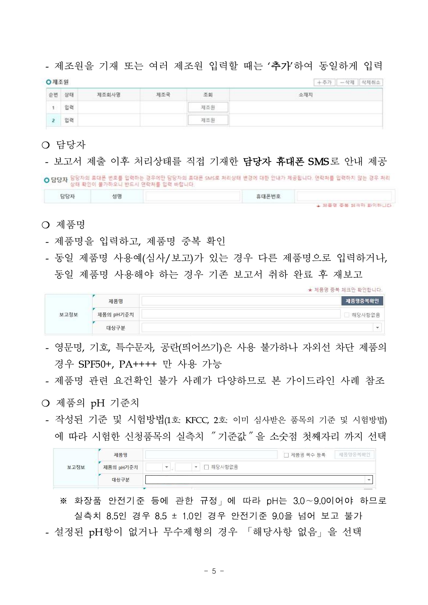
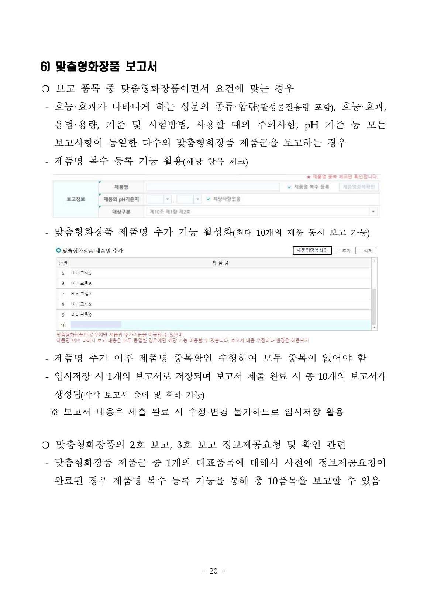
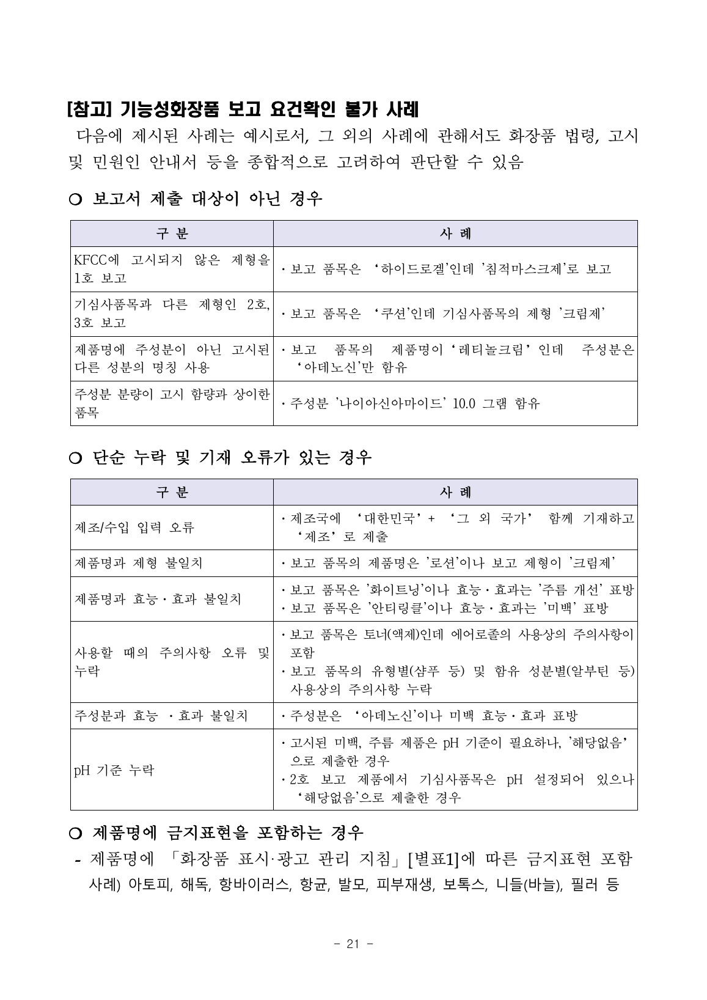

在韩国卖美白、抗皱、防晒这类「功能性化妆品」，不少单子不用走完整审查，只要向食品医药品安全评价院交一份**审查免除品目报告**。韩国食品医药品安全处把这份办理指南改了一版：编号 **안내서-1255-02**，**2026年11月18日**批准，**11月23日**挂到官网「민원인안내서」栏目，我们于 **2026-11-24** 打开了[详情页](https://www.mfds.go.kr/brd/m_1060/view.do?seq=16000)，并下载核对了官方附件 PDF。

先说清楚两件事：这是**给办理人看的指南（민원인 안내서）**，正文写明**对外没有法律效力**，只能当参考，不是新高示、也不是新禁令；谁该交报告、哪些成分可以走免审，还是按《化妆品法》施行规则第10条来。另外，不要和站内已写过的[防晒 SPF/PA 可用人体外 ISO 试验（第2026-75、76号高示）](/news/2026-11-10-korea-mfds-spf-in-vitro-iso-2026-75-76/)、以及仍未见定稿的[表示·广告管理指针修订草案](/news/2026-11-08-korea-cosmetic-labeling-ad-guideline-draft-nov9/)混在一起。

修订履历写得很干脆，这次就多了两块：一是系统里新增「要件确认不可」处理，并附上常见被打回的例子；二是补上定制化妆品（맞춤형화장품）怎么一次报多个名字。

## 改了什么

### 1. 报告交上去就不能改，不合格会变成「要件确认不可」

报告在「药品安全国家」（의약품안전나라，[nedrug.mfds.go.kr](https://www.nedrug.mfds.go.kr)）的电子报告里提交。指南用星号标出：**已经提交（申请完成或处理完成）的报告，不能修改、也不能变更。** 所以要先「临时保存」，核对完再点提交。

评价院做要件确认**没有处理时限**，处理完成会发短信：

- 符合要件：状态变成「处理完成」，可以打印报告，并登记到功能性化妆品报告台账
- 不符合：状态变成「要件确认不可」，要向化妆品审查科询问原因（指南写的代表电话：043-719-3605）

一旦要改，只能**先撤回，再从头写一份交上去**。撤回还要等所属地方厅核对有没有行政处罚等情况，指南写明**至少要 4–5 天，这个时间改不了**；撤回申请本身也**不能取消**。交错一份，少则耽误将近一周。

### 2. 公开了一批容易被打回的例子，产品名是重灾区

新附录把「要件确认不可」分成三类（都是示例，其他情形仍要结合法令、高示判断）：

**根本就不该走这份报告的：**

- 第1号报告用了 KFCC 里没有的剂型，比如货是水凝胶，却按浸渍面膜报
- 第2、3号报告的剂型和已经审查过的品目不一致，比如货是气垫，已审查品目却是乳霜
- 产品名里用了不是主成分的其他高示成分名，比如叫「视黄醇面霜」，实际主成分只有腺苷
- 主成分用量和高示含量对不上（指南举例：烟酰胺报成 10.0 克）

**漏填、填错的：**

- 制造国同时写了韩国和其他国家，却按「制造」提交（指南约定：制造商在韩国算制造，在海外算进口）
- 产品名写「乳液」，剂型却报成乳霜
- 名字写 Whitening / 抗皱，功效却报成另一项
- 注意事项漏了剂型或成分该有的那几条，或张冠李戴
- 主成分是腺苷，却宣称美白
- 该填 pH 基准的美白、抗皱产品，却勾成「不适用」

**产品名带了禁止表述：** 指南点名要对照《化妆品表示·广告管理指针》[附表1]，例子包括：아토피（特应性）、解毒、抗病毒、抗菌、生发、皮肤再生、肉毒、针（니들）、填充剂等。

共同事项里还写了产品名和 pH 的填法：产品名一般不能用英文、符号、空格，防晒可以保留 SPF50+、PA++++；pH 要按实测值选到小数点后一位，并落在化妆品安全基准 **3.0–9.0** 内——指南举例，实测 8.5 若再加 ±1.0，上限会超过 9.0，这样报不出去。没有 pH 项或无水剂型，才勾「不适用」。

### 3. 同一配方的定制妆，最多一次报 10 个产品名

新的第6章专门写定制化妆品。如果功效成分的种类和含量（含活性物剂量）、功效、用法用量、基准和试验方法、使用注意事项、pH 基准等**全部报告事项都相同**，可以勾选「产品名复数登记」，一次最多报 **10 个**产品名。每个名字都要通过重复校验。

临时保存时还是 1 份报告；提交完成后会生成 **10 份**报告，可以分别打印或撤回。第2、3号报告如果已经为产品群里的**一个代表品目**做完信息提供请求，也可以用这个功能一次报 10 个。提交后同样不能改，务必先用临时保存核对。

## 影响谁

- 在韩国走功能性化妆品「审查免除报告」（施行规则第10条第1、2、3号）的责任销售业者、制造业者，以及帮他们递交材料的进口商、法规代理
- 在 Coupang、韩国独立站、TikTok 等面向韩国消费者卖美白、抗皱、防晒，且走免审报告路径的品牌
- 在韩国做定制化妆品、同一套配方要挂多个产品名的店铺
- 只在中国或其他市场卖、不进入韩国功能性化妆品审查或报告的店：本条不直接管你

## 意味着什么、现在注意什么

1. **这不是新禁令，但交报告的坑更清楚了。** 指南本身没有对外法律效力，不会单独改你的义务；可系统已经按「交了不能改、不合格就要件确认不可」在运转。现在更宜先对照附录案例自查，再点提交。
2. **先盯产品名和一致性。** 名称里的成分、剂型、功效，必须和实际配方、报告内容一致；不要为了好卖，把「视黄醇」「美白」写进名字却对不上主成分。禁止表述那几类词也别出现在产品名里。
3. **pH 不要估、也不要随便勾「不适用」。** 按试验方法测到小数点后一位，连同允许偏差也要落在 3.0–9.0 里。
4. **给改错留出时间。** 撤回至少 4–5 天且不能取消，有上架或活动档期的，不要卡在截止当天才交。
5. **定制妆的「一次报 10 个」不是放开配方。** 只有全部报告事项相同的产品群才能用；提交后会变成 10 份独立报告，一份写错可能要一份份撤。
6. **跨境通常是韩国责任销售业者在系统里交。** 境外品牌要把产品名、配方、剂型、注意事项一次性给对，避免代理交上去后还要等一周撤回重报。

## 证据（核对日期 2026-11-24）

食药处官网「민원인안내서」列表将本指南登记在 **2026-11-23**（게시물 1301，안내서-1255-02）：

<small>来源：韩国食药处官网「공무원지침서/민원인안내서」列表页，核对日期 2026-11-24。</small>

详情页可见고시일 **2026-11-18**、등록일 **2026-11-23**，并写明已修订该指南，附件为官方 PDF：

<small>来源：韩国食药处官网指南详情页 seq=16000，核对日期 2026-11-24。</small>

官方 PDF 封面（발간등록번호 안내서-1255-02，日期 2026. 11. 18.）与修订履历（新增要件确认不可功能、定制化妆品报告方法）：

<small>来源：食药处官方附件《기능성화장품 심사제외품목 보고서 제출 가이드라인(민원인 안내서)》封面，核对日期 2026-11-24。</small>

<small>来源：同上官方 PDF「제·개정 이력」页，核对日期 2026-11-24。</small>

正文第3页：已提交报告不能修改；不符合要件则为「요건확인 불가」；撤回至少 4–5 天，撤回申请不能取消：

<small>来源：同上官方 PDF 正文第3页，核对日期 2026-11-24。</small>

正文第5页：产品名与 pH 填写要求（pH 选到小数点后一位，须落在 3.0–9.0）：

<small>来源：同上官方 PDF 正文第5页，核对日期 2026-11-24。</small>

正文第20页：定制化妆品在全部报告事项相同的前提下，最多一次登记 10 个产品名：

<small>来源：同上官方 PDF 正文第20页，核对日期 2026-11-24。</small>

正文第21页：「要件确认不可」示例，含剂型不符、产品名乱用成分名、以及禁止表述等：

<small>来源：同上官方 PDF 正文第21页，核对日期 2026-11-24。</small>
