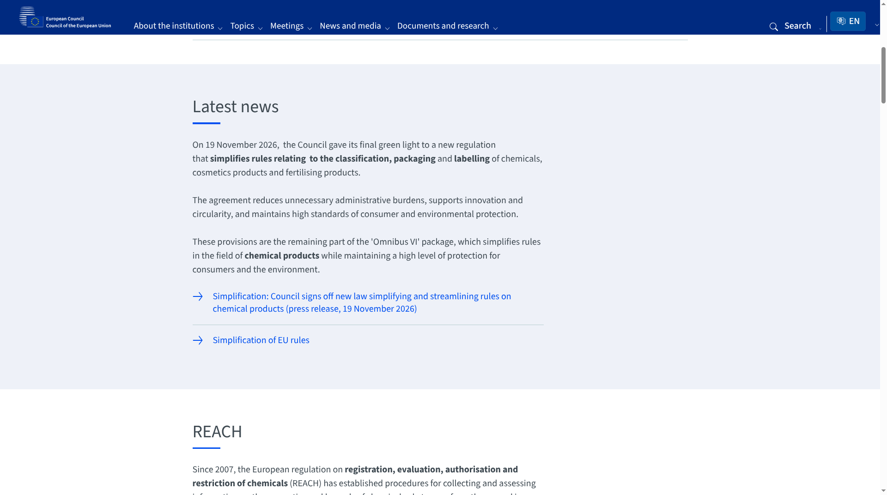
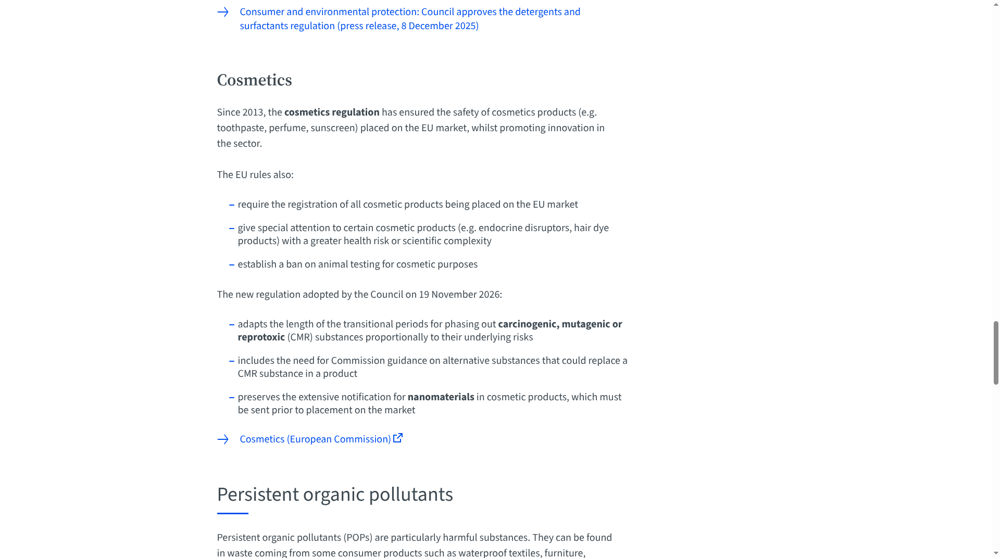
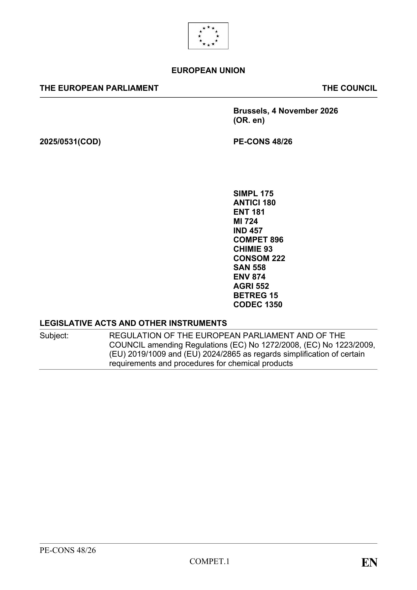
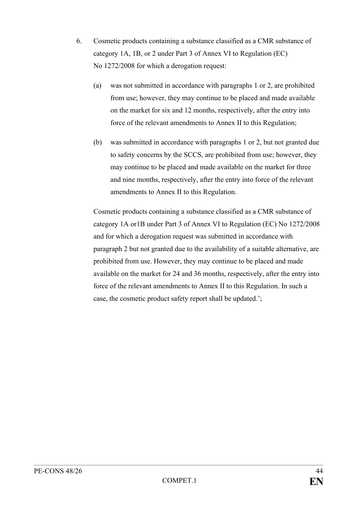
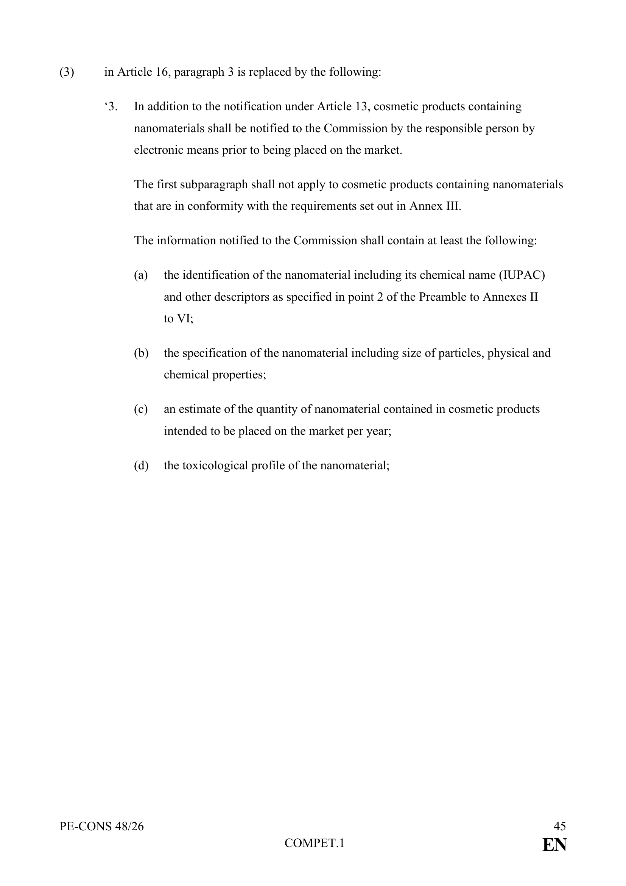
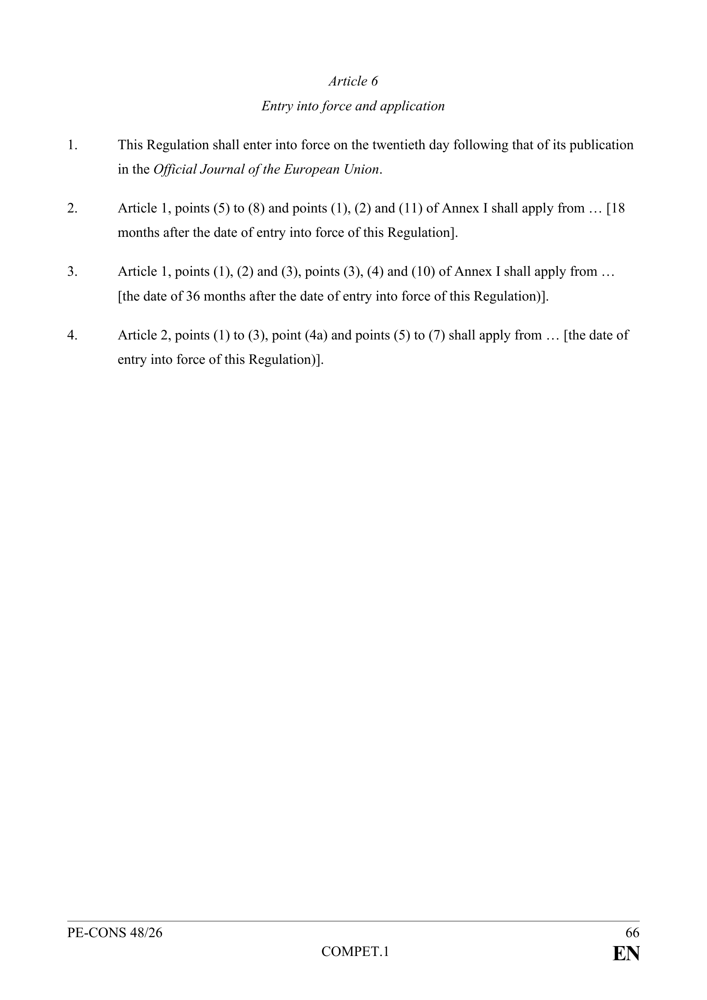

在欧洲站卖化妆品的品牌注意：欧盟理事会在 [化学品政策页](https://www.consilium.europa.eu/en/policies/chemicals/) 上写明，**2026年11月19日**终审通过了业内常说的 **Omnibus VI**（程序号 2025/0531(COD)），修订化妆品法规（EC）1223/2009 等。这是议会10月22日通过临时协议之后的最后一关。

**先说清楚：今天还没有生效，现在不用立刻改标签、也不用按新窗口清货。** 已通过的文本（PE-CONS 48/26）写明：本条例在《欧盟官方公报》公布后第20日生效。本轮核到的文本里，条例号和理事会决定日期都还是空的，说明还没有登报。

## 改了什么

依据理事会官网政策页（页脚标注最近审阅 2026年11月19日）和已打开的 PE-CONS 48/26 正式文本：

**1. 新禁 CMR 成分后的清货时间，按风险分成三档**

某物质被列为 CMR，并写入化妆品法规附录 II 禁用表之后（从「该次附录 II 修订生效日」起算，不是从今天、也不是从本条例一公布起算）：

- **没提交豁免申请**：还可以 **投放市场 6 个月**、**继续销售 12 个月**
- **提交了申请，但因 SCCS 安全顾虑未获批准**：投放 **3 个月** / 可售 **9 个月**
- **1A/1B 类因「已有合适替代物」未获批准**：投放 **24 个月** / 可售 **36 个月**，并须更新产品安全报告（CPSR）

豁免申请要在该物质被写入 CLP 附录 VI 第3部分、完成 CMR 分类的修订生效后 **3 个月内**提交。委员会还须在本条例生效后 **12 个月内**给出「替代物分析」指南。

**2. 含纳米成分：仍要事前通报，但不再要求「提前 6 个月」**

修订后的第16条第3款写明：含纳米材料的化妆品，责任人仍须在**投放市场前**以电子方式向委员会通报；符合附录 III 要求的产品另有例外。通报本身不能省，只是取消了比上市早 6 个月这一要求。

这两点和站内 [10月22日议会通过稿](/news/2026-10-22-eu-omnibus-vi-parliament/) 里的临时协议一致，现在是理事会终审锁定的文本。注意：9月21日那篇「Omnibus **IX**」讲的是另一批具体成分禁限草案（二苯酮-1/-2 等），和本条不是同一份文件。

## 影响谁、意味着什么

影响在欧盟投放或销售化妆品的品牌、责任人（RP）和跨境卖家，尤其是配方里可能碰到新 CMR 分类、或产品含纳米成分的人。

本条例生效后，欧洲站再出现新的 CMR 禁用，库存和在途货的缓冲会按上面三档走，未申请豁免时窗口更紧。现在该做的是：盯《官方公报》何时公布；和 RP、工厂约定「禁用表一生效就立刻停产停发」的节奏；不要按「还有一年慢慢清」来备货。在登报并满 20 日之前，仍按现行 1223/2009 执行。

正式文本见理事会文件 [PE-CONS 48/26](https://data.consilium.europa.eu/doc/document/PE-48-2026-INIT/en/pdf)。

## 证据（核对日期 2026-11-21）

<small>来源：欧盟理事会化学品政策页（https://www.consilium.europa.eu/en/policies/chemicals/），核对日期 2026-11-21。</small>

<small>来源：同上政策页「Cosmetics」一节，核对日期 2026-11-21。</small>

<small>来源：理事会文件 PE-CONS 48/26（https://data.consilium.europa.eu/doc/document/PE-48-2026-INIT/en/pdf），核对日期 2026-11-21。</small>

<small>来源：同上 PE-CONS 48/26 第44页（化妆品法规第15条新增第6款），核对日期 2026-11-21。</small>

<small>来源：同上 PE-CONS 48/26 第45页（第16条第3款修订），核对日期 2026-11-21。</small>

<small>来源：同上 PE-CONS 48/26 第66页第6条，核对日期 2026-11-21。条例号和决定日期在文本中仍为空白，以日后《官方公报》为准。</small>
