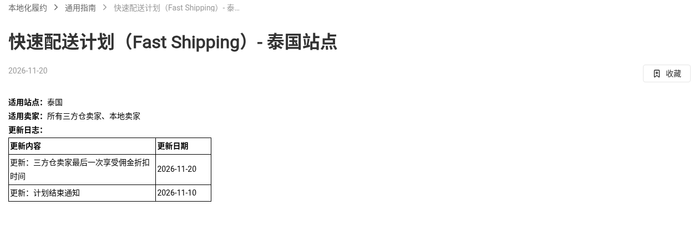
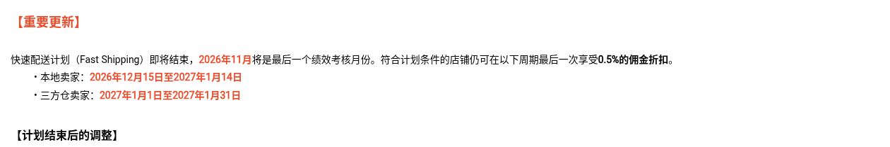
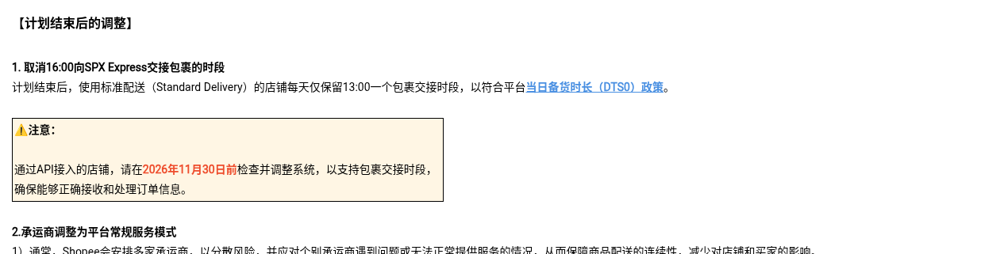
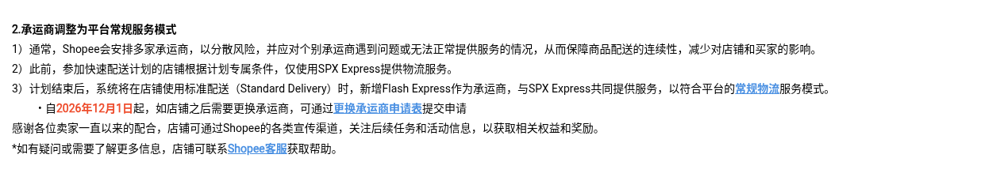

在泰国站走当地三方仓或本地发货的美妆个护卖家，先看发货节奏和佣金：Shopee 卖家学习中心《[快速配送计划（Fast Shipping）- 泰国站点](https://shopee.cn/edu/article/23457)》页面日期为 **2026-11-20**。我们于 **2026-11-26** 打开了这篇官方说明。页面写明：适用站点是**泰国**，适用卖家是**所有三方仓卖家、本地卖家**。更新日志里，**2026-11-10** 记的是「计划结束通知」，**2026-11-20** 又补了一条「三方仓卖家最后一次享受佣金折扣时间」。

简单说：**这个加快出货、换 0.5% 佣金折扣的计划要停了。11 月是最后一个考核月。** 折扣不会在 11 月底立刻消失，达标店还有一轮；但计划结束后，标准配送的交接时段和承运商会变。

## 改了什么

### 1. 11 月是最后一次绩效考核，折扣再发一轮就停

公告「重要更新」写：快速配送计划即将结束，**2026 年 11 月将是最后一个绩效考核月份**。符合计划条件的店铺，仍可在下面这个周期**最后一次**享受 **0.5%** 的佣金折扣：

- **本地卖家：** 2026 年 12 月 15 日至 2027 年 1 月 14 日
- **三方仓卖家：** 2027 年 1 月 1 日至 2027 年 1 月 31 日

也就是：11 月考完，折扣按公告给的窗口再发一次，不是「11 月 30 日当天折扣立刻取消」。过了上面的窗口，就不要再按这个计划去算那 0.5%。

### 2. 计划结束后，标准配送只留 13:00 一个交接时段

「计划结束后的调整」写：取消 **16:00** 向 SPX Express 交接包裹的时段。计划结束后，使用标准配送（Standard Delivery）的店铺，每天**只保留 13:00** 一个包裹交接时段，以符合平台当日备货时长（DTS0）政策。

公告还点名：**通过 API 接入的店铺，请在 2026 年 11 月 30 日前检查并调整系统**，以支持包裹交接时段，确保能正确接收和处理订单信息。这个日期写在「注意」框里，比「计划结束后」更具体，接了系统的三方仓要先对这一条。

公告没有把「16:00 时段取消」写成某一个日历日；这一段的标题是「计划结束后的调整」。不要自行把取消 16:00 说成已经在某一天生效，按公告原文理解为计划结束后执行。

### 3. 承运商改回常规模式，会加上 Flash Express

此前参加快速配送计划的店铺，按计划专属条件，只使用 **SPX Express**。计划结束后，店铺使用标准配送时，系统将**新增 Flash Express** 作为承运商，与 SPX Express 一起提供服务，回到平台常规物流模式。

同一节还写：自 **2026 年 12 月 1 日** 起，如店铺之后需要更换承运商，可通过「更换承运商申请表」提交申请。

## 影响谁

- **泰国站当地三方仓（3PF）卖家和本地卖家**（含美妆、个护）：公告写明的适用对象就是这两类。发货截点、承运商，以及那档 0.5% 佣金折扣，都要对着看。
- **接了 API 的店铺更急：** 公告要求 11 月 30 日前检查并调整系统，别等到包裹交接时段对不上，订单信息错乱。
- **公告没有把跨境直邮（SLS）写进「适用卖家」。** 不要自行引申成全站所有卖家；自己是不是三方仓或本地店，以店铺后台和官方说明为准。

## 意味着什么、现在该做什么

1. **先分清两件事：考核已经到头，折扣还会再走一轮。** 11 月是最后考核月。三方仓卖家若这轮达标，最后一次 0.5% 折扣窗口是 **2027 年 1 月整月**；本地卖家是 **2026 年 12 月 15 日到 2027 年 1 月 14 日**。定价和费用测算不要再把这档折扣当成长期政策。
2. **出货截点会更紧。** 计划结束后，标准配送只剩 13:00 交接。以前靠 16:00 那一班才出得去的单，后面要提前备货、打包。美妆活动期单量上去时，更容易卡在截点上。
3. **API 店把 11 月 30 日当成硬期限。** 先检查系统能不能正确接收只剩 13:00 的交接时段，避免漏单或状态不同步。
4. **承运商可能不再是只走 SPX。** 计划结束后会加上 Flash Express。如果店铺对承运商有要求，从 12 月 1 日起走「更换承运商申请表」，不要默认系统会一直只派 SPX。
5. **这是平台物流和佣金折扣安排，不是泰国化妆品注册或标签规则本身的变化。** 化妆品准入要求仍见 [泰国合规](/compliance/th/)。

## 证据（核对日期 2026-11-26）

卖家学习中心文章抬头：标题为「快速配送计划（Fast Shipping）- 泰国站点」，页面日期 **2026-11-20**，适用站点为泰国，适用卖家为所有三方仓卖家、本地卖家；更新日志为 11-20「三方仓卖家最后一次享受佣金折扣时间」和 11-10「计划结束通知」：

「重要更新」写明计划即将结束，2026年11月为最后一个绩效考核月份，并列出本地卖家与三方仓卖家最后一次 0.5% 佣金折扣窗口：

「计划结束后的调整」写明取消 16:00 向 SPX Express 的交接时段，标准配送只保留 13:00；注意框要求 API 接入店铺在 2026 年 11 月 30 日前检查并调整系统：

同一节说明计划结束后标准配送将新增 Flash Express，并与 SPX Express 共同服务；自 2026 年 12 月 1 日起更换承运商须通过申请表提交：

## 来源

- Shopee 卖家学习中心 · [快速配送计划（Fast Shipping）- 泰国站点](https://shopee.cn/edu/article/23457)（页面显示日期为 2026-11-20；2026-11-26 打开核对）
