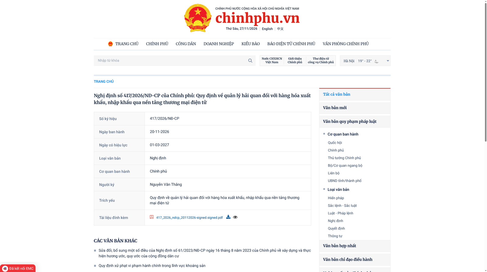
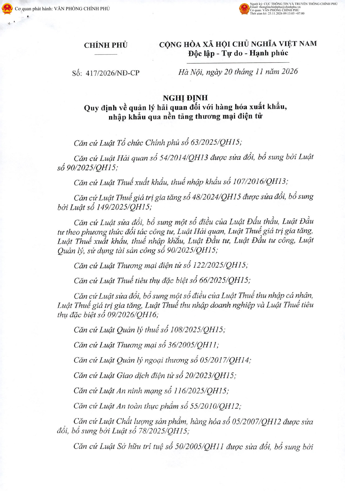
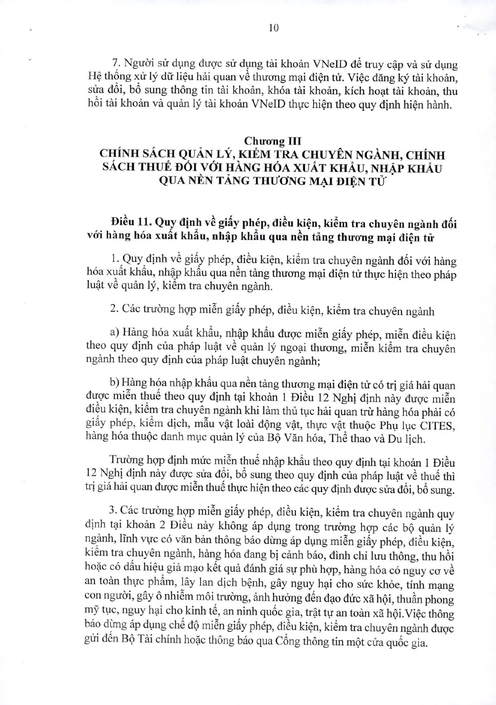
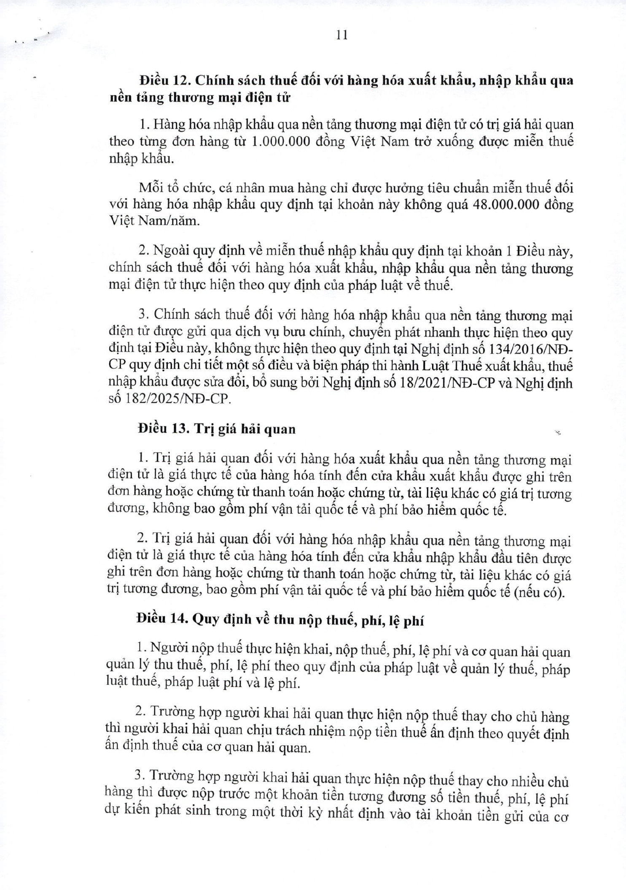
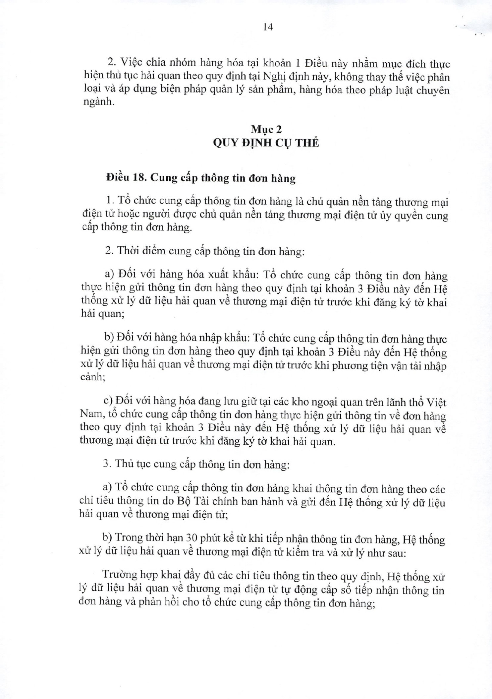
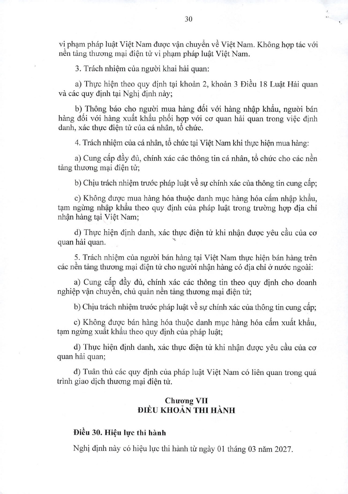
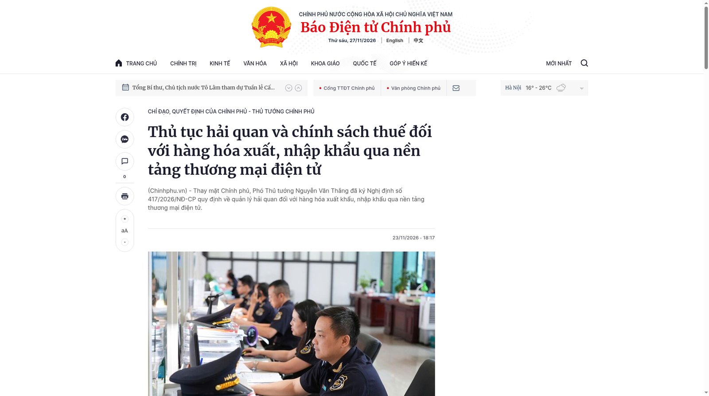
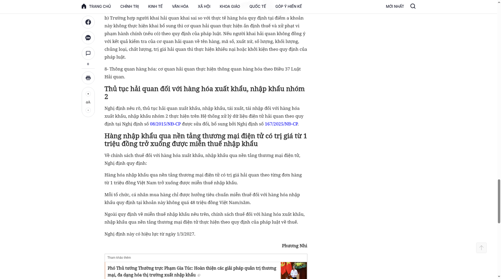

在 Shopee、Lazada、TikTok Shop 等平台，把美妆个护发到越南的，先看这条。越南政府于 **2026年11月20日** 颁布[第 417/2026/NĐ-CP 号政令](https://vanban.chinhphu.vn/?classid=1&docid=220347&pageid=27160&typegroupid=4)，管的是**通过电商平台进出口货物的海关管理**。我们于 **2026-11-27** 打开了越南政府电子门户公文页（文号 417/2026/NĐ-CP，颁布日 20-11-2026，生效日 **01-03-2027**），下载了对页的[官方签章 PDF](https://datafiles.chinhphu.vn/cpp/files/vbpq/2026/11/417_2026_ndcp_20112026-signed.signed.pdf)，并对照了[政府电子报 11月23日的说明](https://baochinhphu.vn/thu-tuc-hai-quan-va-chinh-sach-thue-doi-voi-hang-hoa-xuat-nhap-khau-qua-nen-tang-thuong-mai-dien-tu-102261123175641173.htm)。

**一句话：2027年3月1日起，走电商平台进口的低价订单可以免进口关税，但每个买家每年有额度；增值税等其他税还是要交。化妆品该做的公告和标签，不会因为免了这笔关税就自动取消。**

## 改了什么

政令第 12 条写明：通过电商平台进口、**按每一笔订单的海关完税价格不超过 100 万越盾**的货物，**免征进口关税**。每个买货的组织或个人，一年里能享受这笔免税的货物完税价格合计**不超过 4800 万越盾**。按大约 2.5 万盾兑 1 美元粗算，单笔大约合 40 美元、年度额度大约合 1900 美元，只作量级参考，计税以越盾为准。

同条第 2 款接着写：除了上面这条进口关税减免，其他税收仍按税法执行。也就是说，**增值税等并没有一起免掉**。

第 13 条把完税价格写死了：进口按到**第一个进口口岸**的实际货价，以订单或付款凭证为准，**包含国际运费和保险费（如有）**。货看起来卖不到 100 万盾，加上运保费就可能超线，超了就进不了这笔免税。

走邮政或国际快递的电商平台进口货，税收也按本政令执行，**不再按**第 134/2016/NĐ-CP 号政令（及其后修正）里原来的邮快件规则来。

海关手续上，政令把货分成两组。第 11 条第 2 款 b 项：已经按第 12 条免进口关税的低值进口货，在**办理海关手续时**可免部分「条件」和专项检查；但**需要许可证、检疫、CITES 附录动植物标本，以及文化体育旅游部管理清单上的货，不在此列**。主管部门发文暂停适用、正在被预警/停售/召回、有伪造合格评定迹象，或有食品安全、健康、环境等风险的，也不能用这个免除。

第 17 条把「第一组」定为：不属于外贸管理上要许可或条件、不属于专项检查目录，或已按上面第 11 条免除，并且不适用反倾销、反补贴、保障措施税的货物；其余是第二组，走现行一般海关程序。同一条写得很清楚：这样分组**只是为了按本政令办海关手续，不能替代按行业法规对产品做的分类和管理**。

平台这边也有硬动作。第 18 条：平台运营方或其授权方要向「电商海关数据处理系统」传订单信息——进口须在**运载工具入境前**传完，出口须在登记报关单之前传完，系统原则上 30 分钟内处理。第 4 条还写：平台如果是不在越南设机构的外国商户，须通过报关代理，或授权在越南的邮政、国际快递企业办理海关手续。第 20 条：第一组报关时，系统会核买卖双方身份；越南籍个人对不上国家人口数据库、企业信息对不上企业数据库，或货其实不属于第一组，申报会被拒绝。

第 30 条：本政令自 **2027年3月1日** 起施行。官方 PDF 未就化妆品单列例外。

## 影响谁

- 在 Shopee、Lazada、TikTok Shop 等平台，从中国或其他境外把美妆、个护直邮到越南的卖家，以及从越南保税仓出货的店
- 帮这些订单清关、承运、做平台对接的货代、报关行和平台运营方
- 在上述平台买境外货的越南买家（免税按人按年累计）
- 只在越南本地发货、不走跨境进口的店：这条海关新政不是给你改化妆品公告义务的

## 意味着什么 / 现在该注意什么

- **先看完税价格，别只看标价。** 国际运费和保险费要算进去。一笔刚过 100 万盾，进口关税就不能按这条免；同一个买家一年累计到 4800 万盾，后面的低价单也免不了。拆单规避年度额度，会被系统按买方累计盯上。
- **免的是进口关税，不是所有税，更不是化妆品监管。** 增值税等仍按税法。第 17 条已写明：分组通关不能替代行业管理。向越南销售化妆品，仍要按现行规则做产品公告（Phiếu công bố）、越南语标签等，不能把「低值货海关环节可免部分条件和专项检查」理解成「可以不公告、不贴标签就上架」。
- **许可证、检疫、CITES、文化部清单上的货，即使用低值订单也免不了相应手续。** 本政令没有点名化妆品算不算「必须有许可证」的商品。拿不准的，按现行化妆品管理来准备，不要赌海关会放行无公告货。
- **平台和物流会先动。** 2027 年 3 月前，要跟平台确认订单数据能否在运载工具入境前传到越南海关系统，收件人、卖家信息是否完整准确。对不上身份库，报关单会直接被拒，货就会卡在关口。
- 这是已经颁布、尚未施行的政令。财政部还可能就申报数据项、系统对接再出细则。正式通关以 2027 年 3 月 1 日当时的系统规则为准。

现在就可以做的：把越南站在售美妆的售价、运保费和客单价过一遍，标出会超过 100 万盾的 SKU；核对这些链接是否已有有效公告号和越南语标签；向平台或货代问清明年 3 月前的对接安排。不必现在改配方，但不要等生效当周才补材料。

## 证据（核对日期 2026-11-27）

越南政府电子门户公文页：文号 417/2026/NĐ-CP，颁布日 2026-11-20，生效日 2027-03-01，并提供官方签章 PDF 下载：

<small>来源：越南政府电子门户公文页，核对日期 2026-11-27。</small>

官方签章 PDF 第 1 页：文头「CHÍNH PHỦ」「Số: 417/2026/NĐ-CP」，河内，2026 年 11 月 20 日，政令名称是通过电商平台进出口货物的海关管理：

<small>来源：越南政府电子门户官方签章 PDF《Nghị định số 417/2026/NĐ-CP》，核对日期 2026-11-27。</small>

官方 PDF 第 11 条：低值免税进口货在办理海关手续时可免部分条件和专项检查，但许可证、检疫、CITES 和文化部管理清单上的货除外：

<small>来源：同上官方 PDF 第 11 条，核对日期 2026-11-27。</small>

官方 PDF 第 12、13 条：单笔完税价格不超过 100 万越盾免进口关税，每买家每年不超过 4800 万越盾；其他税按税法；进口完税价格含国际运保费：

<small>来源：同上官方 PDF 第 12、13 条，核对日期 2026-11-27。</small>

官方 PDF 第 17 条第 2 款：分组只为按本政令办海关手续，不能替代按行业法规对产品的分类和管理；并接第 18 条，进口订单须在运载工具入境前传送：

<small>来源：同上官方 PDF 第 17、18 条，核对日期 2026-11-27。</small>

官方 PDF 第 30 条：本政令自 2027 年 3 月 1 日起施行：

<small>来源：同上官方 PDF 第 30 条，核对日期 2026-11-27。</small>

政府电子报 2026年11月23日 18:17 报道副总理阮文胜签署该政令，并写明单笔不超过 100 万盾免进口关税、每买家每年不超过 4800 万盾、2027 年 3 月 1 日生效：

<small>来源：越南政府电子报《Thủ tục hải quan và chính sách thuế đối với hàng hóa xuất, nhập khẩu qua nền tảng thương mại điện tử》，2026-11-23 18:17，核对日期 2026-11-27。</small>

