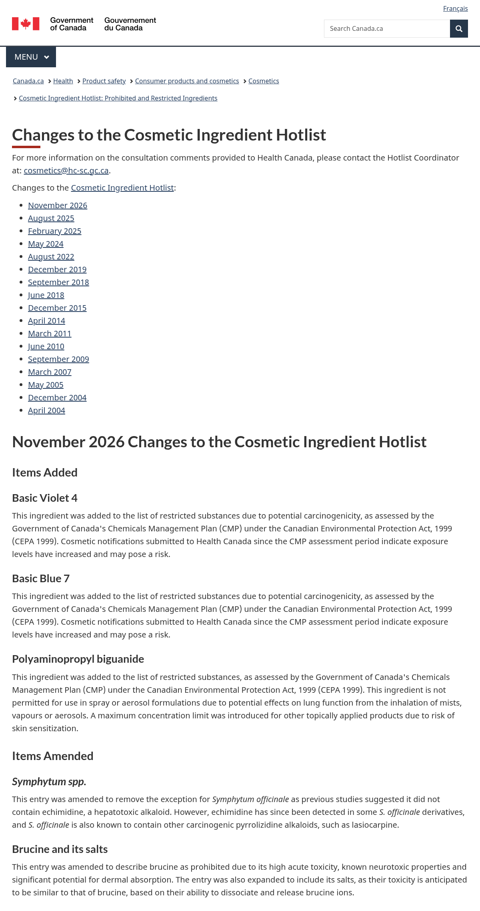
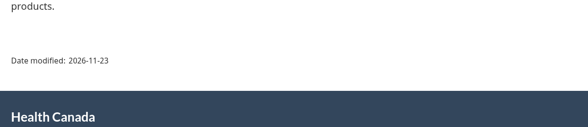
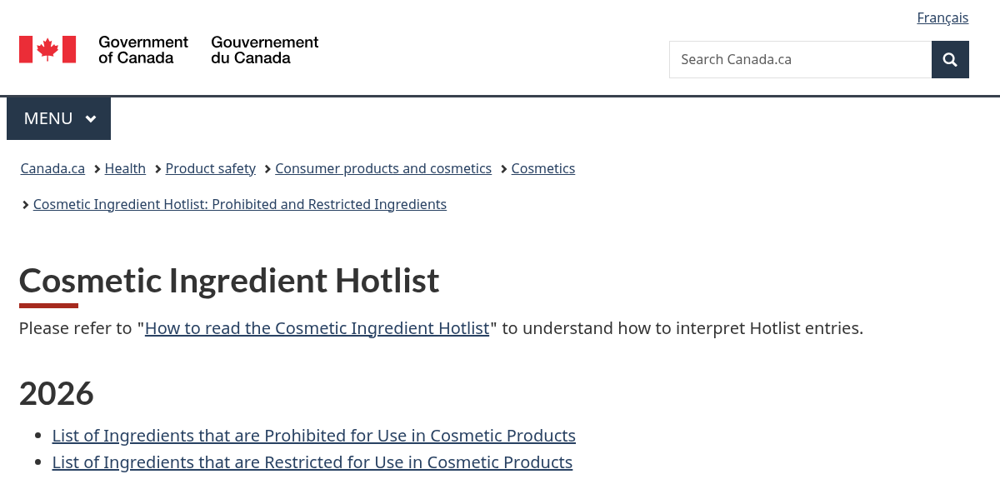
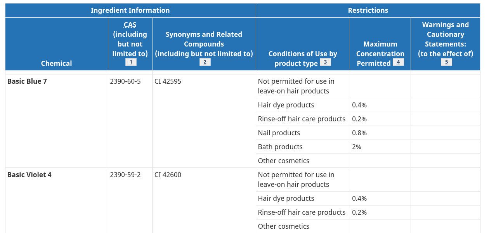
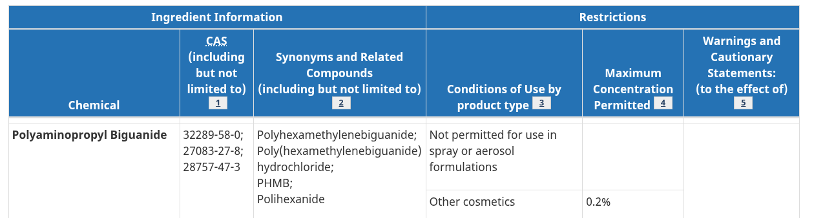
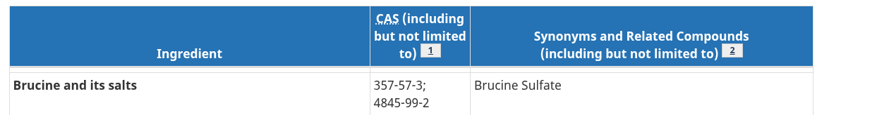
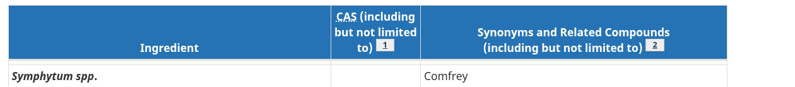
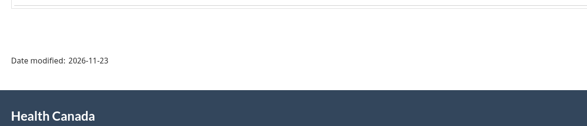
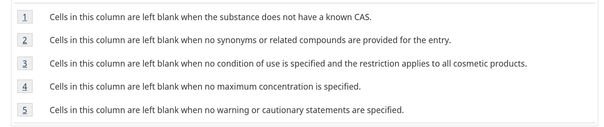

向加拿大卖美妆、个护的注意这条：我们于 **2026-11-25** 打开了加拿大卫生部[化妆品成分热列表变更页](https://www.canada.ca/en/health-canada/services/consumer-product-safety/cosmetics/cosmetic-ingredient-hotlist-prohibited-restricted-ingredients/changes.html)。页上列出 **「November 2026 Changes to the Cosmetic Ingredient Hotlist」**，页脚 **Date modified: 2026-11-23**。同一站点的现行[热列表](https://www.canada.ca/en/health-canada/services/consumer-product-safety/cosmetics/cosmetic-ingredient-hotlist-prohibited-restricted-ingredients/hotlist.html)（页眉为 2026 版，页脚同样是 2026-11-23）已经写入下面这些禁限用条件。

先说清楚边界：**热列表是卫生部的行政工具**，用来提示某些成分出现在化妆品里，可能违反《食品药品法》第 16 条一般禁令或化妆品法规，它不是一部新通过的法律文本。但向加拿大销售时，配方、标签和通报表（CNF）都要按**现行清单**来对。这两页都**没有写过渡期或宽限日**。

站内相关：[加拿大香精过敏原标示](/news/2026-08-01-canada-fragrance-allergen-labelling/)。

## 改了什么

### 1. 新列入限用：两种染发染料，驻留护发不能用

变更页写明，**碱性紫 4**（Basic Violet 4，CI 42600，CAS 2390-59-2）和 **碱性蓝 7**（Basic Blue 7，CI 42595，CAS 2390-60-5）因化学品管理计划（CMP）评估的潜在致癌性被列入限用；卫生部在评估之后收到的化妆品通报显示，暴露水平已上升，可能构成风险。

现行限用表（我们打开后核对）写的是：

| 成分 | 驻留护发 | 染发产品 | 淋洗护发 | 其他条件 |
| --- | --- | --- | --- | --- |
| 碱性紫 4（CI 42600） | 禁用 | 最高 **0.4%** | 最高 **0.2%** | 「其他化妆品」未规定浓度上限 |
| 碱性蓝 7（CI 42595） | 禁用 | 最高 **0.4%** | 最高 **0.2%** | 美甲最高 **0.8%**，浴用产品最高 **2%**；「其他化妆品」未规定浓度上限 |

「未规定浓度上限」不是官网写了「可以任意添加」，而是限用表「最大浓度」这一栏是空的。按热列表阅读说明第 4 条：这一栏空白，表示未规定最大浓度。驻留类护发产品（发膜、免洗精华、留在头发上的造型乳等）对这两种染料仍是明确禁用。

### 2. 新列入限用：PHMB 不能做喷雾，其他剂型最高 0.2%

**聚氨丙基双胍**（Polyaminopropyl Biguanide，又名聚六亚甲基双胍、PHMB、Polihexanide；CAS 32289-58-0、27083-27-8、28757-47-3）被列入限用。变更页的理由是：喷雾或气雾吸入可能影响肺功能，其他外用产品存在皮肤致敏风险。

现行限用表写的是：

- **喷雾或气雾剂型：禁用**
- **其他化妆品：最高 0.2%**

喷雾防晒、喷雾护发、气雾型消毒或定型产品，如果防腐体系靠 PHMB，这条会直接卡住。

### 3. 两项禁用修订：聚合草不再例外，马钱子碱及其盐改为禁用

- **聚合草（Symphytum spp.，英文 Comfrey）**：原先有一条例外，认为药用聚合草（*Symphytum officinale*）不含肝毒性生物碱 echimidine，可以排除在外。变更页写明，后来在部分 *S. officinale* 衍生物中检出了 echimidine，且该种还含有其他致癌吡咯里西啶生物碱（如 lasiocarpine），因此**取消例外，整属禁用**。现行禁用表只列 *Symphytum spp.* / Comfrey，不再附加例外。不要和中药里的「紫草」混为一谈，这里指的是聚合草属。
- **马钱子碱及其盐（Brucine and its salts）**：因急性毒性高、有神经毒性、容易经皮吸收，条目改为**禁用**，并扩大到盐类（例如硫酸马钱子碱，CAS 357-57-3、4845-99-2）。

## 影响谁

- 向加拿大出口，或在亚马逊加拿大等渠道卖美妆个护的品牌、进口商和代工厂
- 染发膏、彩色护发、淋洗/驻留护发里用了碱性紫 4 或碱性蓝 7 的配方团队
- 用 PHMB 做防腐的护理、湿巾或喷雾产品
- 配方里写了 Comfrey / Symphytum / 聚合草提取物的「植物护肤」
- 成分表或原料库里出现 Brucine 及其盐的产品（相对少见，但现在是禁用）

## 意味着什么 / 现在注意什么

- **先对照现行热列表核一遍配方和原料代码**，不要沿用旧版清单，也不要用其他国家的禁限用表代替加拿大的表。
- 驻留护发只要还含这两种碱性染料，就过不了现行条件；淋洗护发和染发要核对浓度。碱性蓝 7 还要看美甲和浴用产品。
- 含 PHMB 的喷雾、气雾要改防腐体系或改剂型；非喷雾产品把含量卡在 0.2% 以内。
- 以前靠「只用了 officinale、不在禁用之列」的聚合草配方，现在这条路没有了，要改配方或停售相关 SKU。
- **通报（CNF）不等于批准**。清单更新后，不合规产品仍可能被执法。官网变更页和现行清单都没有写宽限期，按现列条件执行。
- 具体物质、同义词和 CAS 以[现行热列表](https://www.canada.ca/en/health-canada/services/consumer-product-safety/cosmetics/cosmetic-ingredient-hotlist-prohibited-restricted-ingredients/hotlist.html)为准，配方一变就要再对一次。

## 证据（核对日期 2026-11-25）

加拿大卫生部变更页列出「2026年11月变更」，含三项新增限用和两项修订，页脚修改日为 2026-11-23：

<small>来源：加拿大卫生部 Health Canada《Changes to the Cosmetic Ingredient Hotlist》，核对日期 2026-11-25。</small>

<small>来源：同上变更页页脚，核对日期 2026-11-25。</small>

现行热列表页眉为 2026 版，禁用清单与限用清单均在同一页：

<small>来源：加拿大卫生部 Health Canada《Cosmetic Ingredient Hotlist》，核对日期 2026-11-25。</small>

限用表中碱性蓝 7、碱性紫 4 的剂型与浓度条件：

<small>来源：同上现行热列表限用表，核对日期 2026-11-25。</small>

限用表中 PHMB 的喷雾禁用与 0.2% 上限：

<small>来源：同上现行热列表限用表，核对日期 2026-11-25。</small>

禁用表中的马钱子碱及其盐、聚合草属：

<small>来源：同上现行热列表禁用表，核对日期 2026-11-25。</small>

<small>来源：同上现行热列表禁用表，核对日期 2026-11-25。</small>

现行热列表页脚修改日同样为 2026-11-23；表注第 4 条说明最大浓度栏空白表示未规定上限：

<small>来源：同上现行热列表页脚，核对日期 2026-11-25。</small>

<small>来源：同上现行热列表表注，核对日期 2026-11-25。</small>
