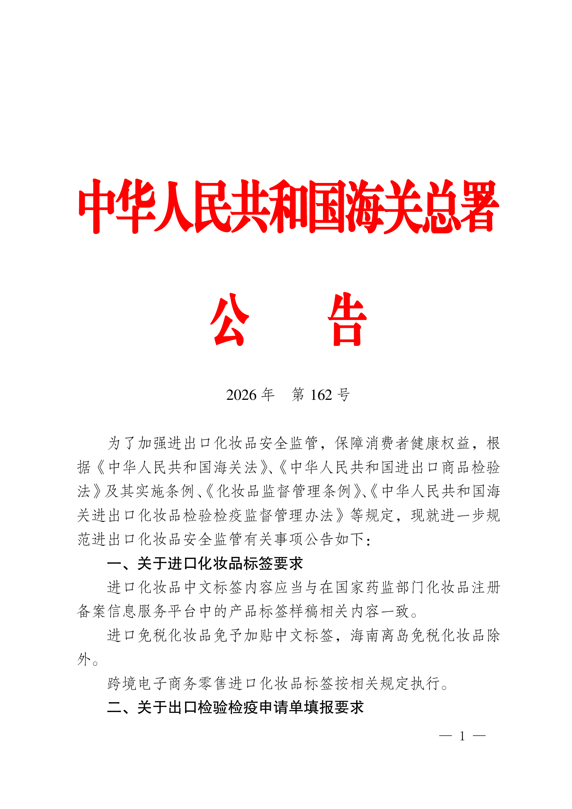
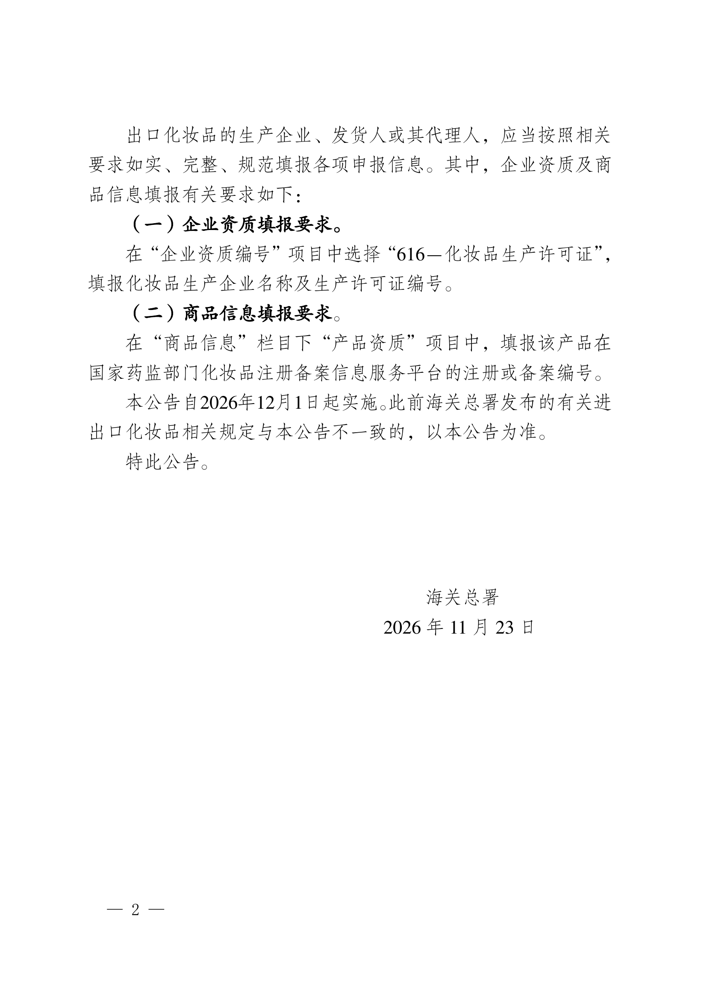
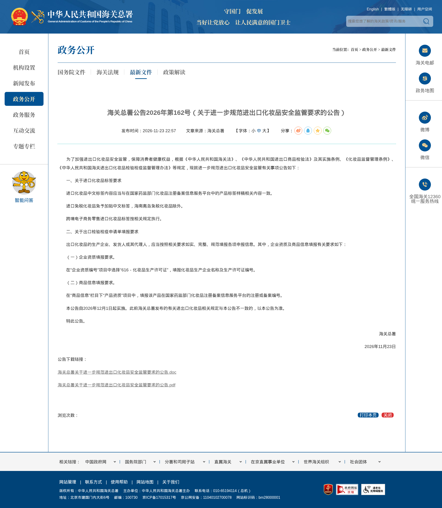
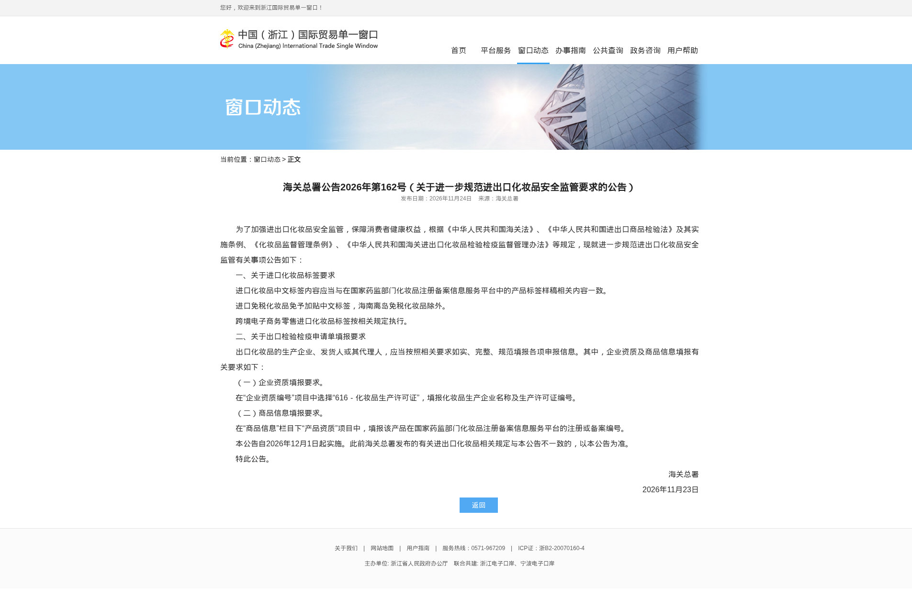

做中国进出口美妆的，先看这一条：**不是又出了一部新办法**，而是海关总署为即将施行的[第284号《进出口化妆品检验检疫监督管理办法》](/news/2026-05-06-china-customs-284-cosmetics-iq/)补上了标签和出口申报填报细则。

我们于 **2026-11-25** 打开了海关总署官网[公告页](http://www.customs.gov.cn/customs/2026-11/24/article_2026112410594082896.html)（标题《海关总署公告2026年第162号（关于进一步规范进出口化妆品安全监管要求的公告）》，发布时间为 **2026-11-23 22:57**，文章来源：海关总署），并下载了对页的[官方 PDF](http://www.customs.gov.cn/customs/attachDir/2026/11/海关总署关于进一步规范进出口化妆品安全监管要求的公告.pdf)。公文文头是「中华人民共和国海关总署 公告 **2026 年 第 162 号**」，落款 **海关总署 2026 年 11 月 23 日**，写明 **2026 年 12 月 1 日起实施**，与第284号办法同一天。此前海关总署发布的有关进出口化妆品规定，若与本公告不一致，**以本公告为准**。

浙江国际贸易单一窗口同日转载了全文，来源也写「海关总署」。

## 改了什么

公告只有两条，但都是硬要求。

### 1. 进口中文标签：要对上药监平台里的标签样稿

进口化妆品的中文标签内容，应当与国家药监部门化妆品注册备案信息服务平台里的**产品标签样稿相关内容一致**。

以前第284号办法只写「标签由海关验核，细则另定」。现在细则来了：口岸核对的基准，就是你在药监平台备案/注册时提交的那份标签样稿。实物标签和样稿对不上，就可能卡在海关验核。公告写的是「相关内容一致」，没有再列逐项字段；实操上仍应按样稿来对成分、宣称、责任人信息等关键内容，不要自行改版后再拿旧样稿过关。

两个例外，不要读错：

- **进口免税化妆品**免予加贴中文标签，但 **海南离岛免税化妆品除外**——走海南离岛免税渠道的，仍要按一般要求具备中文标签，不能套用其他免税口岸的免贴做法。
- **跨境电子商务零售进口**化妆品的标签，**按相关规定执行**。这次公告没有改写跨境零售的标签规则，也不等于一般贸易可以继续按跨境零售那套来。

### 2. 出口申报：申请单要填生产许可证和注册/备案编号

出口化妆品的生产企业、发货人或其代理人，必须如实、完整、规范填报出口检验检疫申请单。公告点名了两项：

- 在「企业资质编号」项目中选择 **「616－化妆品生产许可证」**，填报化妆品**生产企业名称**及**生产许可证编号**
- 在「商品信息」栏目下「产品资质」项目中，填报该产品在药监平台的**注册或备案编号**

注意：公告规范的是**申请单怎么填**，并没有写「没有注册或备案就不能出口」这样的禁令，不要自行加码。但编号填不出、填错或跟平台对不上，申报这一步就会卡住。代工出口的委托方和工厂，要提前确认能填上真实、有效的许可证号和产品编号。

## 影响谁

- 走**一般贸易等检验检疫通道**把化妆品进口到中国的品牌、进口商和境内责任人
- 在药监平台做注册/备案、负责中文标签和标签样稿的合规、设计团队
- 做**海南离岛免税**渠道的品牌和经销商（不能按普通免税「免贴中文标签」来理解）
- **出口**化妆品的生产企业、发货人或其代理人，以及委托国内工厂代工出口的境外品牌
- 同时做一般贸易和跨境电商零售进口的卖家：两条通道的标签规则不要混用

## 意味着什么 / 现在注意什么

离 **12 月 1 日**只剩几天，建议按通道盘一遍在途和计划报关的货。

- **进口（一般贸易等）**：把将入关产品的实物中文标签，和药监平台上的标签样稿逐项对一遍。不一致的，先做注册/备案信息变更，再改实物标签，顺序不要反。
- **免税和海南**：普通进口免税可以免贴中文标签；海南离岛免税不行，货上架前先核对中文标签。
- **跨境零售进口**：标签仍看原来的跨境专规，不要把这次162号理解成跨境零售也必须「对上备案样稿」。若同一批货、同一个主体也走一般贸易，仍要按162号和284号准备。
- **出口**：先更新申报模板，固定选择「616－化妆品生产许可证」，填工厂名称、许可证号和产品注册/备案编号，并确认许可证在有效期内。
- 第284号办法里关于电子比对注册/备案、进口记录保存、半成品和牙膏参照管理、跨境零售不适用该办法替代等规则仍然有效；162号补的是标签验核和出口申请单填报。两份文件一起看，不要把162号当成另一套新办法。

官网原文：[海关总署公告2026年第162号](http://www.customs.gov.cn/customs/2026-11/24/article_2026112410594082896.html)；官方 PDF：[公告全文](http://www.customs.gov.cn/customs/attachDir/2026/11/海关总署关于进一步规范进出口化妆品安全监管要求的公告.pdf)。站内相关：[第284号检验检疫办法](/news/2026-05-06-china-customs-284-cosmetics-iq/)。

## 证据（核对日期 2026-11-25）

海关总署官方 PDF 第 1 页：文头「中华人民共和国海关总署 公告 2026 年 第 162 号」，以及进口中文标签须与药监平台标签样稿相关内容一致、免税和海南离岛免税例外、跨境电商零售进口按相关规定执行：

<small>来源：海关总署官方 PDF《关于进一步规范进出口化妆品安全监管要求的公告》，核对日期 2026-11-25。</small>

官方 PDF 第 2 页：出口检验检疫申请单须填「616－化妆品生产许可证」及注册或备案编号，施行日期 2026 年 12 月 1 日，落款海关总署 2026 年 11 月 23 日：

<small>来源：同上官方 PDF 第 2 页，核对日期 2026-11-25。</small>

海关总署官网公告页（发布时间 2026-11-23 22:57，文章来源：海关总署）全文与官方 PDF 一致，并提供 .doc / .pdf 下载：

<small>来源：海关总署官网「最新文件」公告页，核对日期 2026-11-25。</small>

浙江国际贸易单一窗口转载页，发布日期 2026 年 11 月 24 日，来源写「海关总署」，正文条款与官网一致：

<small>来源：中国（浙江）国际贸易单一窗口「窗口动态」，核对日期 2026-11-25。</small>
